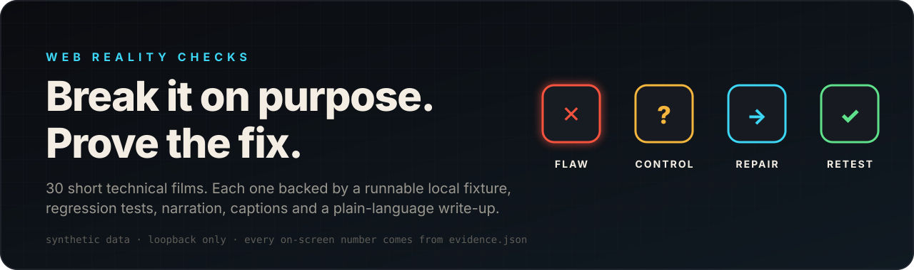
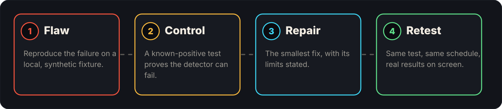

<div align="center">



# Web Reality Checks

**28 short narrated films about the web bugs that survive demos. Each one is backed by a fixture you can run on a laptop and tests that fail when the flaw comes back.**

[Watch on the site](https://mizcausevic-dev.github.io/web-reality-checks/) · [Episodes](#episodes) · [Launch packages](#launch-packages) · [Run a fixture](#run-a-fixture-in-one-minute) · [Reproduce a film](#reproduce-one-episode)



</div>

## What this is

A double charge. A page that will not update. Someone else's name on your dashboard. A date one day early. A deleted contact that still shows in search. These are not exotic failures, and a demo cannot show them, because a demo is one person, one browser, one happy path.

Web Reality Checks reproduces each failure on a local, synthetic fixture, proves the test can fail, applies the smallest repair, and runs the same test again. The film narrates what the test printed, so every number on screen is a number a file contains.



**Why the control step exists.** A passing test is only evidence if the same test fails when the flaw is present. The control step asserts the flaw is observable. It is also the fastest way to review AI-generated tests: ask whether the test has ever been seen failing.

## Episodes


Total runtime 48m 19s across 28 episodes.

| # | Episode | Arc | Runtime | Fixture tests | Watch |
|---|---------|-----|---------|---------------|-------|
| 01 | [Is it safe to launch?](episodes/ep01/README.md) | Trust & access | 1m 38s | [7/7](fixtures/ep01-authz) | [page](https://mizcausevic-dev.github.io/web-reality-checks/episodes/ep01/) |
| 02 | [Three purchase events](episodes/ep02/README.md) | Duplicates & ordering | 1m 52s | [8/8](fixtures/ep02-duplicate-purchase-events) | [page](https://mizcausevic-dev.github.io/web-reality-checks/episodes/ep02/) |
| 03 | [What Sign In does](episodes/ep03/README.md) | Trust & access | 1m 59s | [12/12](fixtures/ep03-sign-in-session) | [page](https://mizcausevic-dev.github.io/web-reality-checks/episodes/ep03/) |
| 04 | [A database in the page](episodes/ep04/README.md) | Data lifecycle | 1m 41s | [6/6](fixtures/ep04-pglite-notes) | [page](https://mizcausevic-dev.github.io/web-reality-checks/episodes/ep04/) |
| 05 | [How many are wrong?](episodes/ep05/README.md) | Data lifecycle | 1m 43s | [17/17](fixtures/ep05-directory-quality) | [page](https://mizcausevic-dev.github.io/web-reality-checks/episodes/ep05/) |
| 06 | [Prompt to answer](episodes/ep06/README.md) | Experience & speed | 1m 50s | [13/13](fixtures/ep06-prompt-to-answer) | [page](https://mizcausevic-dev.github.io/web-reality-checks/episodes/ep06/) |
| 07 | [Why is production broken?](episodes/ep07/README.md) | Delivery & freshness | 1m 36s | [9/9](fixtures/ep07-vite-env-localhost) | [page](https://mizcausevic-dev.github.io/web-reality-checks/episodes/ep07/) |
| 08 | [Why it feels slow](episodes/ep08/README.md) | Experience & speed | 1m 43s | [7/7](fixtures/ep08-feels-slow) | [page](https://mizcausevic-dev.github.io/web-reality-checks/episodes/ep08/) |
| 09 | [Try it without a mouse](episodes/ep09/README.md) | Experience & speed | 1m 32s | [15/15](fixtures/ep09-keyboard-form) | [page](https://mizcausevic-dev.github.io/web-reality-checks/episodes/ep09/) |
| 10 | [One DNS record](episodes/ep10/README.md) | Delivery & freshness | 1m 44s | [13/13](fixtures/ep10-dns-caches) | [page](https://mizcausevic-dev.github.io/web-reality-checks/episodes/ep10/) |
| 11 | [Reject All, then what?](episodes/ep11/README.md) | Experience & speed | 1m 46s | [10/10](fixtures/ep11-consent-gate) | [page](https://mizcausevic-dev.github.io/web-reality-checks/episodes/ep11/) |
| 12 | [Still the old version?](episodes/ep12/README.md) | Delivery & freshness | 1m 40s | [14/14](fixtures/ep12-sw-update) | [page](https://mizcausevic-dev.github.io/web-reality-checks/episodes/ep12/) |
| 13 | [Is that key a leak?](episodes/ep13/README.md) | Trust & access | 1m 49s | [16/16](fixtures/ep13-api-key-capability) | [page](https://mizcausevic-dev.github.io/web-reality-checks/episodes/ep13/) |
| 14 | [Uploaded, not ready](episodes/ep14/README.md) | Experience & speed | 1m 46s | [8/8](fixtures/ep14-upload-stages) | [page](https://mizcausevic-dev.github.io/web-reality-checks/episodes/ep14/) |
| 15 | [Paid once, two orders](episodes/ep15/README.md) | Duplicates & ordering | 1m 43s | [13/13](fixtures/ep15-idempotency) | [page](https://mizcausevic-dev.github.io/web-reality-checks/episodes/ep15/) |
| 16 | [It's being rate-limited](episodes/ep16/README.md) | Experience & speed | 1m 50s | [17/17](fixtures/ep16-rate-limit) | [page](https://mizcausevic-dev.github.io/web-reality-checks/episodes/ep16/) |
| 17 | [Live, ten minutes old](episodes/ep17/README.md) | Delivery & freshness | 1m 50s | [12/12](fixtures/ep17-stale-dashboard) | [page](https://mizcausevic-dev.github.io/web-reality-checks/episodes/ep17/) |
| 18 | [Webhook arrived twice](episodes/ep18/README.md) | Duplicates & ordering | 1m 51s | [14/14](fixtures/ep18-webhooks) | [page](https://mizcausevic-dev.github.io/web-reality-checks/episodes/ep18/) |
| 19 | [What did the server send?](episodes/ep19/README.md) | Delivery & freshness | 1m 47s | [11/11](fixtures/ep19-initial-html) | [page](https://mizcausevic-dev.github.io/web-reality-checks/episodes/ep19/) |
| 20 | [What HTTPS still shows](episodes/ep20/README.md) | Delivery & freshness | 1m 50s | [18/18](fixtures/ep20-https-visibility) | [page](https://mizcausevic-dev.github.io/web-reality-checks/episodes/ep20/) |
| 21 | [Deleted, still showing](episodes/ep21/README.md) | Data lifecycle | 1m 45s | [n/a](fixtures/ep21-deletion-copies) | [page](https://mizcausevic-dev.github.io/web-reality-checks/episodes/ep21/) |
| 22 | [Dates moved back a day](episodes/ep22/README.md) | Data lifecycle | 1m 29s | [n/a](fixtures/ep22-date-only-timezones) | [page](https://mizcausevic-dev.github.io/web-reality-checks/episodes/ep22/) |
| 23 | [Two tabs, one document](episodes/ep23/README.md) | Duplicates & ordering | 1m 37s | [n/a](fixtures/ep23-optimistic-concurrency) | [page](https://mizcausevic-dev.github.io/web-reality-checks/episodes/ep23/) |
| 24 | [Someone else's name](episodes/ep24/README.md) | Trust & access | 1m 39s | [n/a](fixtures/ep24-shared-cache-leak) | [page](https://mizcausevic-dev.github.io/web-reality-checks/episodes/ep24/) |
| 25 | [Can you restore it?](episodes/ep25/README.md) | Data lifecycle | 1m 40s | [n/a](fixtures/ep25-restore-tests) | [page](https://mizcausevic-dev.github.io/web-reality-checks/episodes/ep25/) |
| 26 | [One page, 101 queries](episodes/ep26/README.md) | Data lifecycle | 1m 31s | [n/a](fixtures/ep26-n-plus-one) | [page](https://mizcausevic-dev.github.io/web-reality-checks/episodes/ep26/) |
| 27 | [Results jump backward](episodes/ep27/README.md) | Duplicates & ordering | 1m 43s | [n/a](fixtures/ep27-stale-search-responses) | [page](https://mizcausevic-dev.github.io/web-reality-checks/episodes/ep27/) |
| 28 | [Hidden is not denied](episodes/ep28/README.md) | Trust & access | 1m 31s | [n/a](fixtures/ep28-hidden-admin-button) | [page](https://mizcausevic-dev.github.io/web-reality-checks/episodes/ep28/) |

## Launch packages

Three packages, one per audience. Each has a long article, a launch film and a five-question quiz. Nothing has been published to Medium, YouTube or social channels; the copy is ready in each folder.

| Audience | Article | Launch film | Quiz |
|----------|---------|-------------|------|
| Engineers and AI-assisted builders | [Break It on Purpose: Known-Positive Controls for Web Bugs](launch/a-break-it-on-purpose/article.md) | [cm01](episodes/cm01/README.md) (1m 06s) | [qz01](episodes/qz01/README.md) |
| Founders, product managers, buyers | [The Launch Review Checklist Your Demo Never Shows: 10 Questions for Founders, Product Managers and Buyers](launch/b-launch-review/article.md) | [cm02](episodes/cm02/README.md) (1m 09s) | [qz02](episodes/qz02/README.md) |
| General audience | [Why Do Websites Do Weird Things? Five Glitches, Explained With Everyday Objects](launch/c-weird-websites/article.md) | [cm03](episodes/cm03/README.md) (1m 03s) | [qz03](episodes/qz03/README.md) |

Each package folder also holds `seo.md`, `social.md`, `commercial.md`, `quiz.md` and `images/` with alt text.

## Run a fixture in one minute

Node 22 or newer. No install step and no network for fixtures without a `package.json`.

macOS and Linux:
```
git clone https://github.com/mizcausevic-dev/web-reality-checks.git
cd web-reality-checks/fixtures/ep15-idempotency
node --test
node demo.mjs
```

Windows PowerShell 5.1 (one command per line, no `&&`):
```
git clone https://github.com/mizcausevic-dev/web-reality-checks.git
cd web-reality-checks\fixtures\ep15-idempotency
node --test
node demo.mjs
```

`node --test` runs the regression tests, including the known-positive control. `node demo.mjs` rewrites `evidence.json`, the file the film reads its numbers from.

## Reproduce one episode

Requires Node 22+, ffmpeg and ffprobe on PATH, and Python 3 with Pillow (used only by `tools/verify-all.mjs`). Run everything from the repository root after cloning.

macOS and Linux (bash):
```
git clone https://github.com/mizcausevic-dev/web-reality-checks.git && cd web-reality-checks
cd video && npm install && npx remotion browser ensure && cd ..
node tools/build-timeline.mjs ep01
node tools/gen-root.mjs
node tools/render.mjs ep01 --concurrency 2
node tools/verify-all.mjs
```

Windows PowerShell 5.1:
```
git clone https://github.com/mizcausevic-dev/web-reality-checks.git; cd web-reality-checks
cd video; npm install; npx remotion browser ensure; cd ..
node tools/build-timeline.mjs ep01
node tools/gen-root.mjs
node tools/render.mjs ep01 --concurrency 2
node tools/verify-all.mjs
```

Narration is ElevenLabs, voice "Benedict - Premium British (RP) Male", model `eleven_v4`, saved to `video/public/<id>/narration.mp3`. Rebuild the site with `node tools/gen-assets.mjs --png`, `node tools/gen-site.mjs` and `node tools/gen-readme.mjs` (the site generator needs pandoc).

## Layout

| Path | Contents |
|------|----------|
| `fixtures/epNN-slug/` | Runnable fixture, `test.mjs` (node:test), `demo.mjs` which writes `evidence.json` |
| `episodes/epNN/` | `script.json`, `captions.srt` and `.vtt`, `README.md` (evidence and limits), MP4, thumbnail, hero, `content/` (three articles and a distribution kit) |
| `episodes/cmNN/`, `episodes/qzNN/` | Launch films and quizzes, same structure |
| `launch/<package>/` | Article, SEO notes, social copy, commercial and quiz scripts, images |
| `video/` | Remotion project: `src/kit` design system, `src/episodes/<id>` scenes and `timeline.json` |
| `tools/` | Timeline, render, verification, site, README and asset generators; `check-limits.mjs` measures social-copy limits |
| `index.html`, `assets/` | Generated GitHub Pages site and graphics |

## Evidence vocabulary

**Observed**: inspected directly. **Executed**: a command ran and its output is available. **Verified**: acceptance evidence passed. **Predicted**: expected, not yet run. **Blocked**: insufficient access or evidence.

Scenes that could not be executed on the fixture (a browser behavior, a TLS leg, a screen reader) are labeled conceptual on screen. This series is not an audit and not a certification, and the fixtures use synthetic data only.

## License

Code: MIT, see [LICENSE](LICENSE). Narration audio and rendered video: all rights reserved. © 2026 Kinetic Gain LLC.
