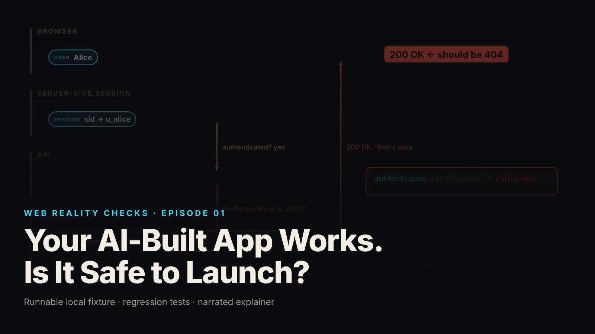

SEO title (≤60 chars): Authenticated Is Not Authorized: One Missing Ownership Check
Meta description (≤155 chars): A working AI-built app leaked another user's project with one missing ownership condition. The fixture, the failing control test, the scoped-query repair.
Slug: ai-app-authorization
Primary keyword: server-side authorization   Secondary keywords (3–5): broken object level authorization, ownership check, authenticated vs authorized, IDOR, launch review checklist
Medium tags (5): Web Security, Authorization, Node.js, Software Engineering, AI Coding

# Your AI-Built App Works. Is It Safe to Launch?



The app works. Every screen renders, every button does something, and the demo ends on "Demo complete." Then a signed-in user asks the API for a project ID that is not hers and the server hands it over, because the only question the endpoint ever asked was whether a user existed.

This is episode one of Web Reality Checks. The whole episode is a single missing condition in a single query, demonstrated on a local fixture with synthetic data, then repaired and retested. The point is not that this bug is exotic. The point is that nothing in a working interface can tell you whether it is there.

## What actually happens

Peel the interface back and there are four layers: the browser, a server-side session that knows who you are, the API that answers requests, and the database that holds every project. Authentication lives in the session layer. Authorization has to live in the query that touches the database. They are two different questions, and a gate that answers only the first one will pass the second by default.

The vulnerable endpoint in this fixture does exactly that. It resolves the session cookie, confirms a user is attached, and then looks the project up by ID alone. Alice is authenticated, so the server assumes she is authorized for whatever ID she typed. The project row for Bob exists, the lookup finds it, and the response is 200 OK with Bob's data in the body. No exception, no log line, no visible error anywhere in the UI. From the browser's point of view, the request succeeded, which is precisely the problem.

The mechanism is worth stating plainly because it explains why demos cannot catch it. A demo exercises the happy path: a user requests her own objects, and her own objects come back. The failure only appears when a user requests somebody else's object, and no interface offers a button for that. You have to construct the request deliberately. That is what the fixture does.

## The fixture

`fixtures/ep01-authz/` is a loopback-only Node 22 HTTP API. It has two synthetic users, Alice and Bob, with one private project each, an in-memory session table keyed by an opaque cookie, a deliberately vulnerable read endpoint (`GET /vuln/projects/:id`) and a corrected one (`GET /projects/:id`). The vulnerability was constructed by hand for this fixture. No claim is made that an AI tool generated it.

The data is tiny on purpose, so there is no ambiguity about what should and should not be visible:

```js
export const db = {
  users: {alice: {id: 'u_alice', name: 'Alice'}, bob: {id: 'u_bob', name: 'Bob'}},
  projects: {
    p_1001: {id: 'p_1001', ownerId: 'u_alice', name: 'Alice private roadmap', notes: 'alice-only'},
    p_2002: {id: 'p_2002', ownerId: 'u_bob', name: 'Bob private budget', notes: 'bob-only'},
  },
};
```

Identity comes only from the server-side session. Any user ID the client supplies in a header, query string or body is ignored by design. The two lookup functions sit side by side so the difference is one line:

```js
// Vulnerable lookup: by id only.
export const findProjectById = (id) => db.projects[id] ?? null;
// Corrected lookup: by id AND owner. One query, one condition set.
export const findProjectForOwner = (id, ownerId) => { const p = db.projects[id]; return p && p.ownerId === ownerId ? p : null; };
```

And the two route handlers differ only in which lookup they call:

```js
if (req.method === 'GET' && (m = url.pathname.match(/^\/vuln\/projects\/(\w+)$/))) {
  if (!user) return json(res, 401, {error: 'unauthenticated'});
  const p = findProjectById(m[1]);                 // <-- missing: AND p.ownerId === user.id
  if (!p) return json(res, 404, {error: 'not found'});
  return json(res, 200, {endpoint: 'vulnerable', authenticatedAs: user.id, project: p});
}
if (req.method === 'GET' && (m = url.pathname.match(/^\/projects\/(\w+)$/))) {
  if (!user) return json(res, 401, {error: 'unauthenticated'});
  const p = findProjectForOwner(m[1], user.id);     // ownership-scoped query
  if (!p) return json(res, 404, {error: 'not found'}); // absent OR inaccessible -> 404 (deliberate policy)
  return json(res, 200, {endpoint: 'corrected', authenticatedAs: user.id, project: p});
}
```

The `401` check is identical in both handlers. Authentication was never the bug.

## The test that proves it

`node --test fixtures/ep01-authz/test.mjs` runs seven tests and reports `# tests 7  # pass 7  # fail 0` (local synthetic fixture). The test names describe the contract:

- `unauthenticated request is rejected (both endpoints)`
- `Alice can read Alice's project (corrected endpoint)`
- `KNOWN-POSITIVE CONTROL: vulnerable endpoint returns Bob's project to Alice`
- `Alice cannot read Bob's project after the repair (404 by policy)`
- `absent project also returns 404 (indistinguishable from inaccessible, by policy)`
- `client-side identity claims do not bypass server enforcement`
- `logout invalidates the session`

The third test is the important one and it is the one most teams skip. It asserts that the vulnerable endpoint returns 200 and that the returned project's `ownerId` is `u_bob` while Alice is the caller. The assertion message in the source says why: "the flaw must be observable or the fix test proves nothing." If you cannot make the bug fail a test, a passing test on the fixed code tells you nothing about whether you fixed anything. A known-positive control turns "we think it is secure" into "the test can see the difference."

`demo.mjs` runs the same scenario as a scripted walkthrough and writes `evidence.json`. From that file (local synthetic fixture): an unauthenticated `GET /projects/p_1001` returns 401; Alice reading her own `p_1001` through the vulnerable endpoint returns 200; Alice reading Bob's `p_2002` through the vulnerable endpoint returns 200, with `"ownerId": "u_bob"` and `"notes": "bob-only"` in the body while `authenticatedAs` is `u_alice`.

## The repair

Resolve the user on the server, then look the project up by its ID and the owner's ID together, in the same query. The corrected handler calls `findProjectForOwner(m[1], user.id)`, where `user.id` comes from the session table and nothing else. If nothing matches, return 404.

Two details of this repair matter more than they look.

First, the ownership condition is inside the lookup, not applied afterward. A pattern of "fetch by ID, then check owner in the handler" works until someone adds a second code path that forgets the second step. Scoping the query means there is no object in hand to leak in the first place.

Second, the fixture deliberately returns 404 for both absent and inaccessible projects. If inaccessible returned 403 and absent returned 404, the response code alone would confirm to Alice that project 2002 exists and belongs to someone. The 404-for-both policy is a choice, documented in the fixture README, and a test (`absent project also returns 404`) locks it in so a future refactor cannot quietly split the two cases.

## Retest

From `evidence.json` (local synthetic fixture), after the repair:

- Alice reads her own `p_1001` on `GET /projects/p_1001`: 200, body shows `"endpoint": "corrected"`.
- Alice reads Bob's `p_2002` on `GET /projects/p_2002`: 404, `{"error": "not found"}`.
- Alice reads Bob's `p_2002` with a spoofed `?user=u_bob` query parameter plus an `X-User-Id: u_bob` header: 404.

The spoof test in `test.mjs` also sends `x-ui-role: admin`. None of it matters, because the server never reads those values. Flipping client-side user IDs or any interface state changes nothing when identity is resolved from the session and authorization is resolved from the query.

## What this does not prove

The brief and the README are explicit about scope, and so is this article.

- The repair covers the demonstrated read path only. Lists, writes, deletes, exports and admin paths each need the same ownership test. The application is not claimed to be fully secure.
- The session mechanism is a test harness (`GET /login/:user`), not production authentication. Episode 3 covers a real sign-in flow.
- The vulnerable fixture must never be deployed. It binds to 127.0.0.1 on an ephemeral port.
- The vulnerability was written by hand to demonstrate the mechanism. This is not a finding about any AI coding tool or any real product.

## Launch checklist

From the fixture README's launch-review checklist for authorization:

1. Every resource read, list, write, delete and export resolves the user from a server-side session, never from the request.
2. Every object lookup is scoped by owner or tenant in the query itself, not filtered afterward.
3. A test exists per endpoint where user A requests user B's object and expects 404 or 403 per policy.
4. A known-positive control exists: a deliberately vulnerable variant that the test catches.
5. Client-side state (roles in the UI, hidden buttons, IDs in URLs) is treated as untrusted input.
6. Error responses do not confirm the existence of objects the caller cannot access.
7. The response policy for inaccessible objects (404 or 403) is written down and tested, so a refactor cannot change it silently.

## FAQ

**What is the difference between authentication and authorization?**
Authentication answers "who is this?" and is usually settled by a session or token. Authorization answers "may this user do this to this object?" and must be settled per request, per resource. In this fixture both endpoints authenticate correctly; only the corrected one authorizes.

**Why return 404 instead of 403 for another user's resource?**
A 403 confirms the object exists and belongs to someone else. Returning 404 for both absent and inaccessible objects means a caller cannot probe ID ranges to learn what exists. It is a policy choice; the fixture documents it and tests it.

**How do I test for broken object-level authorization?**
Sign in as user A, request user B's object by ID, and assert the response matches your policy (404 or 403). Add a known-positive control: a deliberately vulnerable variant that the same test fails on. Repeat per endpoint, including lists, writes and exports.

## Watch the episode

[YouTube link]

- 00:00 Demo complete
- 00:09 Four layers: browser, session, API, database
- 00:22 Alice reads her own project: 200
- 00:31 Controlled test: Alice requests Bob's project
- 00:39 The leak: 200 OK with Bob's data
- 00:50 Freeze on the missing ownership condition
- 01:01 The repair: query by ID and owner
- 01:14 Retest: 200 and 404
- 01:27 What this does not fix

Related episodes: [Watch What Happens When You Click 'Sign In'](../../ep03/content/article-technical.md) and [That API Key Is in Your JavaScript. Is That Always a Leak?](../../ep13/content/article-technical.md)

> This episode uses a deliberately constructed local fixture with synthetic data. Nothing here is a finding about a real product or company. Fixture, tests and video source: github.com/mizcausevic-dev/web-reality-checks

A working interface is not an authorization test. Build the test that asks the second question, and build the control that proves the test can see the answer.

Miz Causevic, Kinetic Gain LLC
