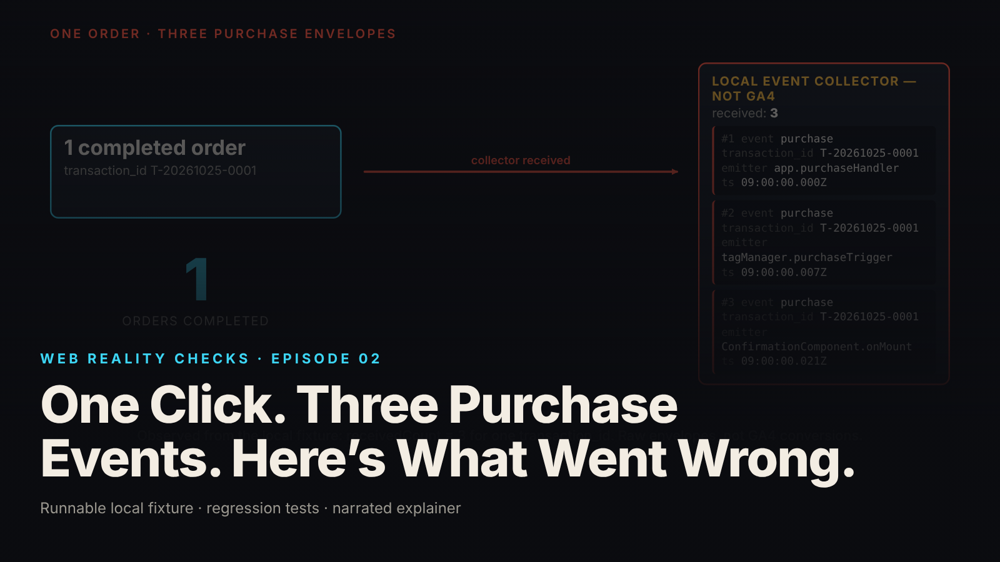

SEO title (≤60 chars): One Order, Three Purchase Events: Fixing Duplicate Emitters
Meta description (≤155 chars): One order produced three purchase envelopes from three emitters. The fixture, the control test, the one-owner repair, and what GA4 dedup leaves out.
Slug: duplicate-purchase-events
Primary keyword: duplicate purchase events   Secondary keywords (3–5): GA4 transaction_id deduplication, event ownership, tag manager duplicate purchase, analytics event duplication, idempotency vs deduplication
Medium tags (5): Web Analytics, Google Analytics, JavaScript, Software Engineering, Tag Management

# One Click. Three Purchase Events. Here's What Went Wrong.



The customer clicked once, the order completed once, and the thank-you screen appeared once. The local event collector received three `purchase` envelopes for that one order, same event name, same `transaction_id`, three different senders.

This is episode two of Web Reality Checks. The whole episode is three pieces of code that each believe they own the same business event, demonstrated on a local fixture with synthetic data, then repaired and retested. Nothing in the checkout flow, and possibly nothing in your analytics report, will tell you that all three are firing.

## What actually happens

A purchase is one business event: the order moves from pending to complete. An analytics event is a message about that business event, sent by some piece of code to some collector. Those are different things, and the gap between them is where the duplication lives.

In a typical web checkout, several components are in a position to notice that an order completed. The application handler that processes the completion knows. A tag manager listening on the same event bus knows. The confirmation component knows, because it was mounted with the order. Each was probably added by a different person with a reasonable local justification: "fire purchase when the order completes," "marketing configured a purchase trigger in the container," "fire purchase when the thank-you screen appears." Each is correct in isolation. Together they send three messages about one event.

The mechanism that hides this matters. The collector in this fixture records raw envelopes with no deduplication, so the duplication is visible. A real analytics platform may not show it. GA4 documents deduplicating `purchase` events by matching `transaction_id` on web data streams. That is a documented behavior for one event type on one stream type. It is not a general property of transaction IDs, it does not cover every event, and it does not stop the duplicate requests from being sent. A report can look right while the emitters are wrong, which is why you count at the raw layer before trusting the reporting layer. Three raw envelopes are not three GA4 conversions. They are three claims on one order.

## The fixture

`fixtures/ep02-duplicate-purchase-events/` is a purchase-confirmation "page" simulated in Node 22 with no browser: an in-process event bus plus three code paths that can each send `purchase`. Beside it sits a loopback-only local event collector on `127.0.0.1`, ephemeral port. The collector labels every response `LOCAL EVENT COLLECTOR — NOT GA4`, stores envelopes verbatim with a sequence number, and applies no deduplication. It is a plain recorder.

There is one synthetic order with one stable `transaction_id`, generated per order and never per emission:

```js
// One synthetic completed order. One stable transaction id per ORDER (never per emission).
export const ORDER = {transaction_id: 'T-20261025-0001', value: 149.0, currency: 'USD', items: [{item_id: 'SKU-4471', quantity: 1}]};
```

Every envelope carries four fields, and the collector rejects any POST missing one of them with a 400, so a malformed emission cannot pass silently:

```js
const send = async (emitter, order) => {
  const envelope = {event: 'purchase', transaction_id: order.transaction_id, emitter, ts: clock()};
  const r = await fetch(collectorBase + '/collect', {method: 'POST', headers: {'content-type': 'application/json'}, body: JSON.stringify(envelope)});
  sent.push({...envelope, status: r.status});
  return r.status;
};
```

The three emission paths are wired by a `mode` switch. In `flawed` mode all three fire. In `corrected` mode only the application handler remains on the bus and the component only renders:

```js
// --- Path 1: application purchase-completion handler (the ONE authoritative emitter) ---
bus.on('order:completed', (order) => send(EMITTERS.app, order));

// --- Path 2: simulated tag-manager listener on the same bus ---
// Flawed: a "purchase" trigger is configured in the tag container as well as in app code.
if (mode === 'flawed') bus.on('order:completed', (order) => send(EMITTERS.tag, order));
```

The confirmation component's mount handler is the third path. In flawed mode it calls `send(EMITTERS.mount, order)` every time it mounts; in corrected mode it only records what it rendered. The clock is deterministic, a fixed epoch advancing 7 ms per tick, so the timestamps in the evidence are reproducible.

## The test that proves it

`node --test fixtures/ep02-duplicate-purchase-events/test.mjs` runs eight tests and reports `# tests 8  # pass 8  # fail 0` on Node v22.23.4 (local synthetic fixture). The test names describe the contract:

- `collector is labelled as a local collector, not GA4, and stores envelopes verbatim`
- `collector rejects an envelope missing required fields`
- `KNOWN-POSITIVE CONTROL: flawed page emits three purchase envelopes for one order`
- `flawed page: remounting the confirmation component emits a fourth envelope`
- `corrected page: one order emits exactly one purchase envelope, from the app handler`
- `corrected page: remounting the confirmation component emits nothing`
- `transaction id is per order, not per emission: two orders give two distinct ids, one envelope each (corrected)`
- `LIMIT (documented, not fixed): replaying the completion action for the same order emits again`

Two of these carry the weight. The known-positive control asserts that the flawed page has two listeners on `order:completed`, that one `completeOrder` produces a count of 3, that the emitters are `app.purchaseHandler`, `tagManager.purchaseTrigger` and `ConfirmationComponent.onMount` in that order, that every envelope is `purchase` with the same `transaction_id`, and that the three timestamps are distinct. The assertion message in the source says why: "the flaw must be observable or the fix test proves nothing."

The LIMIT test is the other one. It runs the corrected page, calls `completeOrder(ORDER)` twice, and asserts a count of 2. It passes by documenting what the fix does not do: replaying the completion action for the same order still emits again. The repair is emitter ownership, not order-level idempotency, and the suite says so in code rather than in a footnote.

`demo.mjs` runs the exact video scenario and writes `evidence.json`. From that file (local synthetic fixture), the flawed run has `purchaseListenersOnBus: 2` and `receivedCount: 3`: seq 1 from `app.purchaseHandler` at `09:00:00.000Z`, seq 2 from `tagManager.purchaseTrigger` at `09:00:00.007Z`, seq 3 from `ConfirmationComponent.onMount` at `09:00:00.021Z`. All three carry `event: "purchase"` and `transaction_id: "T-20261025-0001"`. Not three orders. Three claims on one order, milliseconds apart.

## The repair

Choose one authoritative path. The application's purchase-completion handler runs when the order actually completes, so it owns the event. Then remove the other two: delete the `purchase` trigger from the tag container, and delete the emission from the confirmation component's mount handler. The component still renders. It simply no longer reports.

The principle underneath the repair is that the emitter is tied to the state change, not the screen. A confirmation component mounts whenever the UI decides to render it: first display, re-render, layout change, back-forward navigation. None of those are purchases. The `order:completed` transition happens once per order, so the handler attached to it is the only code path with a legitimate claim to report it. The tag-manager trigger is harder to see because it lives in a container rather than in the repository, but the rule is the same: either the app code or the trigger is the owner, never both.

Note what the repair does not touch. The `transaction_id` was already one per order. The collector was already a plain recorder. The bug was purely about how many pieces of code were allowed to speak for one event.

## Retest

From `evidence.json` (local synthetic fixture), the corrected run repeats the same action and then remounts the confirmation component twice:

- `completeOrder(T-20261025-0001)`: received so far, 1.
- `remountConfirmation()`: received so far, 1.
- `remountConfirmation()`: received so far, 1.

Final `receivedCount: 1`, from `app.purchaseHandler`, `transaction_id: T-20261025-0001`, with `purchaseListenersOnBus: 1`. The by-emitter breakdown shows `tagManager.purchaseTrigger: 0` and `ConfirmationComponent.onMount: 0`. The corrected-page test also asserts `ConfirmationComponent.isMounted()` is true after the remounts, so the component is still doing its visible job. One envelope, in this tested scenario only.

## What this does not prove

The brief and the README are explicit about scope, and so is this article.

- Three received envelopes are raw emissions, not three GA4 conversions. The collector is not GA4, applies no deduplication, and does not reproduce GA4's internal logic.
- GA4 documents purchase deduplication by matching `transaction_id` for web data streams. That covers the `purchase` event on web streams. Nothing here implies that transaction IDs deduplicate other event types, and nothing here tests what any platform would actually report.
- One emitter in the tested scenario is not exactly-once delivery. Network loss, retries, offline queues, page reload, back/forward cache, multiple tabs and multiple devices were not simulated.
- Order-level idempotency is a separate design concern and is deliberately not implemented. The LIMIT test shows that replaying `completeOrder` emits a second envelope even in corrected mode.
- The page, the tag-manager listener, the component lifecycle and the collector are all in-process Node code. No real browser, tag manager, GA4 or Measurement Protocol was used.

## Launch checklist

From the fixture README's event-ownership checklist:

1. One owner per business event. For each event (`purchase`, `sign_up`, `refund`) name exactly one code path allowed to emit it, and write it down.
2. Tie the owner to the state change, not the screen. Mount, render and visibility handlers must not emit business events.
3. Audit the tag container. If a tag-manager trigger also fires the event, either the app code or the trigger is the owner, never both.
4. One `transaction_id` per order, generated once and carried unchanged; never per emission, per page view or per emitter.
5. Inspect the raw log, not the report. Count envelopes at a local collector or network inspector by `event + transaction_id + emitter`, because platform reports may already deduplicate and will hide the raw duplication.
6. Retest with remount and re-navigation. The raw count for that `transaction_id` must stay at one in the tested scenario.
7. Treat idempotency separately. Retries, reloads, multi-tab and multi-device replays need an order-level design of their own.
8. Keep a known-positive control, and only then verify what the analytics platform reports for the same transaction IDs.

## FAQ

**Why does GA4 show one purchase when my code sends three?**
GA4 documents deduplicating `purchase` events with a matching `transaction_id` on web data streams. That can hide duplicate emissions in the report without stopping them. Count raw requests at a collector or network inspector; the fixture here recorded 3 envelopes for one order before the fix (local synthetic fixture).

**Does a unique transaction_id deduplicate all my events?**
No. The documented GA4 behavior covers the `purchase` event on web streams. It is not a general deduplication mechanism for every event type, and relying on it does not fix the emitters. Give each order one `transaction_id`, then make sure only one code path sends `purchase`.

**Is fixing the emitters the same as idempotency?**
No. Emitter ownership means one code path per business event. Idempotency means replaying the same completion action, through a retry or reload, does not emit again. The fixture's LIMIT test shows the corrected page still emits twice when `completeOrder` runs twice; that is a separate design concern.

## Watch the episode

[YouTube link]

- 00:00 One order, three purchase envelopes
- 00:12 Rewind: one click, one completed order
- 00:21 Three emitters into the collector
- 00:37 Inspect: event, transaction ID, emitter, timestamp
- 00:49 The problem: several components claim one event
- 01:09 Choose one authoritative emitter
- 01:16 Remove the trigger and the mount emission
- 01:26 Retest: complete, then remount twice
- 01:32 Received count: 1, and the limits
- 01:47 Fix the emitters. Then verify the reporting.

Related episodes: [You Clicked Pay Once. Why Did the App Create Two Orders?](../../ep15/content/article-technical.md) and [Your Webhook Arrived Twice. Then an Older Update Arrived.](../../ep18/content/article-technical.md)

> This episode uses a deliberately constructed local fixture with synthetic data. Nothing here is a finding about a real product or company. Fixture, tests and video source: github.com/mizcausevic-dev/web-reality-checks

One business event, one emitter. Count the raw envelopes before you trust the report, and keep the test that proves the duplication was ever there. Fix the emitters. Then verify the reporting.

Miz Causevic, Kinetic Gain LLC
