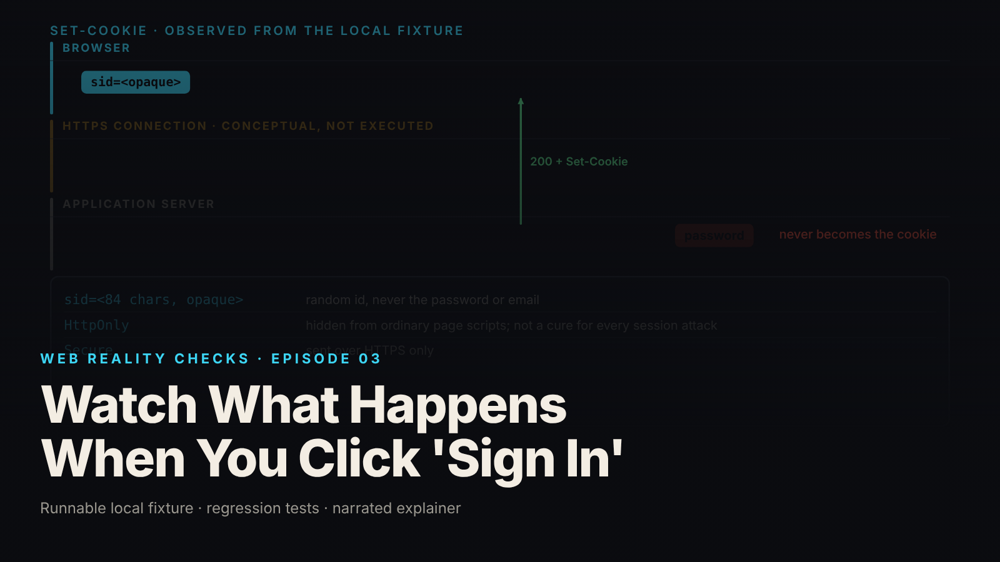

SEO title (≤60 chars): What Happens When You Click Sign In, Explained Simply
Meta description (≤155 chars): Your password goes in, a dashboard comes out. In between, a well-built site never stores your password and never puts it in a cookie. Here is what it does.
Slug: sign-in-session
Primary keyword: what happens when you log in   Secondary keywords (3–5): how passwords are stored, what is a session cookie, login explained, is my password safe, why log out matters
Medium tags (5): Technology, Privacy, Security, Explainer, Internet

# Watch What Happens When You Click 'Sign In'

Picture a gym with a front desk. You say your name and a secret phrase, and if it matches, the desk snaps a wristband on you. For the rest of your visit, nobody asks for the phrase again. They look at the band. When you leave, the band is cut off.

That is a sign-in, and what makes one trustworthy is in the details of the band: what is on it, how it was issued, and what happens to it when you leave. This episode follows one way of doing it, on a small practice system built on a laptop with two made-up members (local synthetic fixture). Many real sign-ins are built differently.

## The desk does not keep your phrase

The desk does not write your secret phrase down. It runs it through a one-way blender that turns it into a smudge, and keeps the smudge. The blender only works forward: given your phrase, the desk can make the same smudge again and compare, but nobody can un-blend a smudge back into the phrase. In software this is hashing, and the practice system uses a maintained library for it.

The blender also adds random grit each time, so two smudges from the same phrase look different, and both still match (local synthetic fixture: two hashes of one password differ, both verify). Someone who steals the smudges does not have the phrases.

In the practice system, the wrong phrase gets a 401 refusal, and the right one gets a 200, which means OK, plus one wristband (local synthetic fixture).

## The band is not your phrase

The wristband carries a long random number and nothing else: no name, no phrase, no email. The desk writes that number in its ledger next to who you are and your membership type. The band means something only because the ledger says so.

Here is the part most people never think about. You were already wearing a visitor band when you reached the desk, handed out at the door. When your phrase checks out, the desk cuts that band off and issues a new one. If it simply upgraded the old band, anyone who had slipped a band onto your wrist outside could later walk in wearing the twin as you. In the practice system, the old visitor band after sign-in is refused: 401 (local synthetic fixture).

The band also has rules printed on it. It works in this building only. It gets read only through the official scanner. Passersby cannot read the number off your wrist, though that does not stop every trick. In software these are cookie settings named `HttpOnly`, `Secure` and `SameSite`, and the episode checks each is present (local synthetic fixture).

## The band gets you in, not everywhere

A valid band gets you through the turnstile, not into the staff room. At every door, the desk asks two questions: is this band still in the ledger, and is this member allowed through this door? In the practice system, no band at the staff room is 401, a member's band is 403 (valid, not allowed), and a manager's band is 200 (local synthetic fixture). The band identifies you. The desk decides what you may do.

## Leaving

When you sign out, the desk crosses your number out of the ledger and cuts the band. Someone who finds the old band and tries it gets nowhere: 401 (local synthetic fixture). Signing out also has to be something you do on purpose, not something a stranger triggers with a link; the practice system requires proof the request came from you.

One note. The armored hallway between you and the desk, the encrypted HTTPS connection, was drawn in the video rather than built, because the practice setup could not run it for real. The episode labels it as an illustration.

## What this means for you

- If a site can email you your old password, it kept the phrase instead of the smudge. Use a password there that you use nowhere else.
- Signing out matters on any device you share or might lose. On a well-built site it cuts the band and the old session stops working. Closing the tab may not.
- Being signed in is not the same as being allowed. A good site checks at every door, not once at the desk.

## FAQ

**Does a website know my password after I sign in?**
A well-built one never stores it. It keeps a one-way hash, a scrambled version that cannot be turned back into your password, and on each login scrambles what you typed and compares. In the episode's practice system the stored value is a salted argon2id hash.

**What is a session cookie?**
It is the wristband: a random identifier your browser sends back with each request so the site knows which signed-in visit you belong to. It should not contain your password or name. The site looks it up in its own records to find out who you are.

**Why should I bother logging out?**
On a well-built site, logging out tells the server to destroy your session, so the old identifier stops working anywhere, including on a device you forgot about. In the episode's practice system, reusing the old cookie after logout is refused.

## Watch the episode

[YouTube link]

Related episodes: [Your AI-Built App Works. Is It Safe to Launch?](../../ep01/content/article-technical.md) and [I Clicked 'Reject All.' What Did the Website Actually Do?](../../ep11/content/article-technical.md)

> This episode uses a deliberately constructed local fixture with synthetic data. Nothing here is a finding about a real product or company. Fixture, tests and video source: github.com/mizcausevic-dev/web-reality-checks

The desk never keeps your phrase. The band is not your phrase. The band gets you in, and the desk decides where.

Miz Causevic, Kinetic Gain LLC
