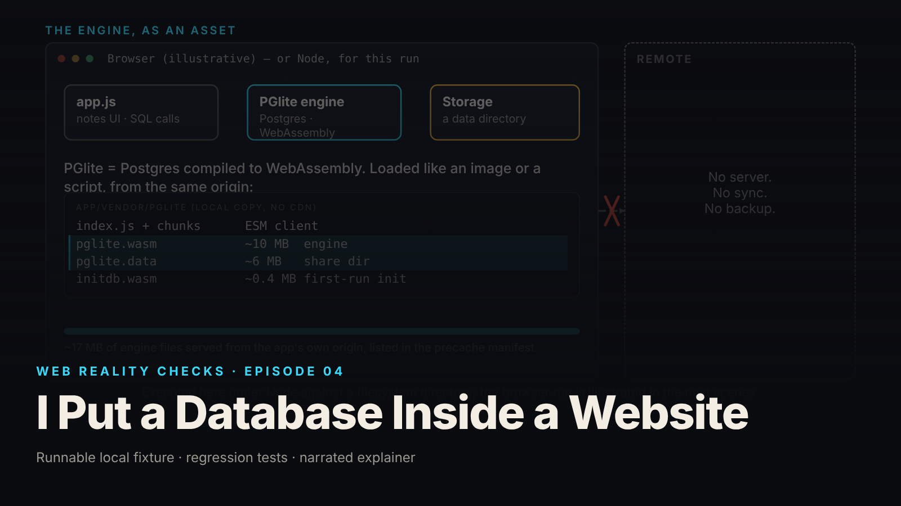

SEO title (≤60 chars): "Works Offline" Is Not "Backed Up": Browser Databases
Meta description (≤155 chars): A database can run inside a web page and survive a reload. That is not sync and not a backup. What the demo hides, five questions to ask, what it costs.
Slug: pglite-notes
Primary keyword: offline web app data loss   Secondary keywords (3–5): browser local storage risk, local-first app, offline-first product decisions, data persistence vs backup, vendor questions web app storage
Medium tags (5): Product Management, Startup, Software Development, Technology, Leadership

# I Put a Database Inside a Website

## The symptom as a business event

The product promise was clean: it works offline, your notes are saved, no account required. Then the support tickets arrive in three shapes. "I opened the app on my laptop and my phone and the notes are different." "I cleared my browser history and everything is gone." "I shared the link with a colleague and she sees an empty app." No crash, no error, no outage. The software did what it was built to do, and the marketing described something else.

This episode reproduces the mechanism on a local fixture: a notes app with a full Postgres engine running inside the page. Under Node, with real files standing in for browser storage, a note created, closed and reopened was still there, count 1. A second storage location saw 0. An in-memory variant lost the note on close, 0. Deleting the storage folder and reopening gave 0 (local synthetic fixture). The browser steps, reload, offline, clean profile, clear site data, were not executed in the build environment and are described as a manual checklist, not as results.

## Why a demo cannot show this

A demo of a local-first app is one person, one browser, one machine, for a few minutes. Every failure shape above needs something the demo never includes: a second device, a second profile, a different address, or time passing while the browser does housekeeping. The demo shows "I typed a note, I reloaded, the note is there." True, and the smallest possible claim about persistence.

The word "saved" does the damage. In the demo it means "written to storage this browser controls." In the customer's head it means "I can get it back." Nothing on screen distinguishes them. The fixture's interface tries: its empty state reads "No notes yet in this browser profile." Most products say "No notes yet."

## The mechanism in plain terms

Think of a notebook kept in a hotel room safe. The safe is real, it locks, and your notebook is there when you come back from dinner. That is browser persistence: the database engine runs inside the page and writes to storage that belongs to this browser, on this device, for this website address. Reload the page and the notebook is in the safe.

Now the limits. The safe is in one room. Check into a different room, meaning a different device or a different browser profile, and the safe there is empty. Nobody carried the notebook over, because no bellhop exists; the app has no sync service of any kind. And the safe belongs to the hotel. Housekeeping can empty it. A user clearing site data, a privacy setting, or the browser freeing up space can remove the storage, and the app has no copy anywhere else. The analogy holds because in both cases the storage is real, it works, and it is owned by someone other than you.

One more piece. "Works offline" is a separate job from "saves your data." For the app to open with no network, a background component called a service worker must have cached the whole application, including the database engine, about 16 megabytes of files (local synthetic fixture, uncompressed sizes). If caching was not finished before the connection dropped, the app does not open at all. Two mechanisms, two things that can each be true or false, and the demo shows both working at once.

## What to ask your team or vendor

1. Where exactly does the data live, and what is it keyed to? The honest answer names a storage type and says "this website address, this browser profile, this device." If the answer is "locally," ask what that means when the user opens a second device.
2. What happens when the user clears browser data, or the browser runs low on space? If the answer is "the data is gone," that should be in the product copy. If nobody knows, nobody has tested it.
3. Is there a test that proves the in-memory version loses data? The fixture calls this a known-positive control. Without it, a passing persistence test might be passing for reasons unrelated to storage.
4. Does the app wait for a write to finish before telling the user it is saved? A "saved" indicator that lights up before the storage write completes is a reload away from being wrong.
5. Was the offline behavior tested in a real browser, in a named version, with the steps written down and the results recorded? Ask to see the record. In this fixture the browser checklist exists and has not yet been executed, and the episode says so on screen rather than filming a success.

If the answers are vague, the state of the product is "unknown," not "works offline."

## What it costs if ignored

No invented figures here, only the shape of the cost.

The first cost is support load of a demoralizing kind: tickets that are not bugs. Engineering closes them as "working as designed" and the customer hears that their lost work is their fault.

The second cost is trust, and in local-first products trust is the pitch. "Your data stays on your device" is a privacy promise customers value. If the same customers discover that "on your device" also meant "only on this device, until the browser removes it," the privacy promise sours into a reliability complaint.

The third cost is the retrofit. Sync, export and backup are each real engineering projects, harder to bolt on after launch than to decide on at the start. The fixture ships none of the three and labels the gap. The expensive version is shipping none and letting the marketing imply all of them.

The quiet cost is a release decision made on illustrative footage. This episode refused to film browser steps it had not run. A team that accepts "it should work" for a storage claim makes the same choice with real customers as the audience.

## FAQ

**If an app works offline, is my data safe?**
Not by that fact alone. Working offline means the app's code is cached locally. Data safety depends on where writes go, whether the write completes before the app says "saved," and whether anything copies the data elsewhere. In this fixture nothing does, and the product copy says so (local synthetic fixture).

**Does a browser-based database sync between my devices?**
Only if the product built a sync service, which is separate work. The database engine itself knows nothing about other devices. In this fixture a second storage location saw zero notes, and the episode describes that as isolation, not as a bug (local synthetic fixture).

**Can users lose everything by clearing their browser data?**
Yes, when the only copy lives in browser storage. In this fixture, deleting the storage folder and reopening gave a count of zero (local synthetic fixture). The browser owns that storage and may remove it; a product that relies on it should say so and offer an export.

## Watch the episode

[YouTube link]

Related episodes: [Your Website Updated. Why Am I Still Seeing the Old Version?](../../ep12/content/article-technical.md) and [100% Uploaded. Why Isn't My File Ready?](../../ep14/content/article-technical.md)

> This episode uses a deliberately constructed local fixture with synthetic data. Nothing here is a finding about a real product or company. Fixture, tests and video source: github.com/mizcausevic-dev/web-reality-checks

A database in the page is a real capability and a narrow promise. Before you write "your notes are saved," decide which of local, synced and backed up you mean, and make the interface say it.

Miz Causevic, Kinetic Gain LLC
