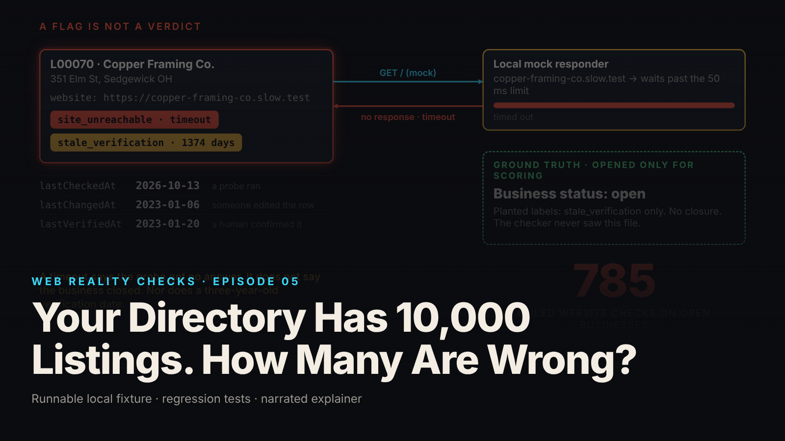

SEO title (≤60 chars): Why a Big Business Directory Can Still Be Full of Mistakes
Meta description (≤155 chars): A directory brags about 10,000 listings. How many are wrong? A plain-language look at why counting rows is not the same as checking them.
Slug: directory-quality
Primary keyword: business directory accuracy   Secondary keywords (3–5): wrong business listings, closed business still listed, duplicate listings, outdated phone numbers, how directories check listings
Medium tags (5): Technology, Explainer, Data, Small Business, Internet

# Your Directory Has 10,000 Listings. How Many Are Wrong?

Imagine a phone book. It is thick, and the cover proudly says 10,000 entries. Open it and you find the same bakery listed three times under slightly different names, a plumber whose number was disconnected years ago, and a shop that moved across town before the book was printed. The cover was telling the truth. There are 10,000 entries. It never promised they were right.

That is the whole episode. Counting listings is easy. Knowing how many are correct is a different job, and most directories only do the first.

## What the episode shows

We built a fake phone book on a laptop: exactly 10,000 made-up businesses with invented names and addresses, and phone numbers that all start with 555. Then we planted problems on purpose and wrote down, in a separate sealed file, exactly what we planted. Nothing here is real or about any real directory (local synthetic fixture).

Then we ran five automated checks: is anything missing, do two entries look like the same business, is the website address spelled correctly, does the website respond, and how long since a person last confirmed the entry. The checker was not allowed to peek at the sealed file.

The checker raised 3,875 flags. Those flags fell on only 3,303 different listings (local synthetic fixture). Why the gap? Because one entry can have several things wrong at once, the way one phone book entry can have an old number and a misspelled street. Count flags and you get one number. Count entries with flags and you get a smaller one. Add up the flag columns and call the total "wrong listings" and you have invented problems.

## The phone call nobody answered

Imagine you phone every business in the book to see who picks up. Some lines ring out. Have those businesses closed? Not necessarily. Someone might be at lunch, or the line might be down for the afternoon.

The website check in our fake directory is the same thing. It knocked on 1,136 websites that did not answer properly. In our sealed file, 1,038 of those belonged to open businesses (local synthetic fixture). The example in the video is a framing shop whose website took too long to respond. The sealed file says the shop is fine; nobody has double-checked its entry since January 2023, and that is all.

So the rule is simple: a failed check is a reason to look closer, not a verdict. Flagged entries go into a review pile, not the bin, each with every reason it was flagged. A person looks, decides, and writes down what they saw, when, and who they are. Marking a business closed takes two separate pieces of evidence, not one unanswered knock.

## Three dates, not one

Picture three small dates on each entry. One: when a machine last tried the website. Two: when someone last edited the entry. Three: when a human last confirmed the business is really there.

When the reviewer decided "keep the framing shop, check again in a week," the "last tried" date moved to today. The "last confirmed" date did not, because nobody had confirmed anything. A directory with one date for everything cannot tell an entry someone checked from one a machine merely poked.

## What the checker missed

Because we knew what we planted, we could see what the checker did not find. Of 400 businesses that had moved, 190 left no trace in their entry. Of 350 that had closed, 126 still had a website answering normally (local synthetic fixture). The episode reports those misses rather than hiding them.

## What this means for you

- When a directory boasts about how many listings it has, that tells you how big the book is, not how accurate. Ask how entries are checked and how often a real person confirms them.
- If you find a wrong listing, a duplicate, or a closed business, report it. A good directory treats that as evidence worth more than an automated check.
- If you run a small business, check how you appear in the directories people use to find you. A website that was down for a day should never get you quietly removed, but in a careless directory it can.

## FAQ

**Why would a directory list a business that closed years ago?**
Because nobody confirmed it. Automated checks only see surface signals like whether a website responds, and a closed business can keep a working website for years. In the fixture, 126 of 350 planted closures were invisible to the website check (local synthetic fixture). Only a human catches those.

**If a business's website is down, is it closed?**
Not necessarily. Websites go down for hosting problems, expired domains, slow servers and bad luck. In the fixture, 1,038 failed website checks landed on open businesses (local synthetic fixture). Look closer; do not delete the listing.

**Why does the same business show up more than once?**
Entries get added at different times by different people, with "Co." on one and "LLC" on another, or a phone number formatted differently. An automated check can spot likely pairs, but the fixture treats them as candidates for a person to confirm, because two businesses can share an office phone line.

## Watch the episode

[YouTube link]

Related episodes: [Your Dashboard Says 'Live.' Its Data Is Ten Minutes Old.](../../ep17/content/article-technical.md) and [Your Website Updated. Why Am I Still Seeing the Old Version?](../../ep12/content/article-technical.md)

> This episode uses a deliberately constructed local fixture with synthetic data. Nothing here is a finding about a real product or company. Fixture, tests and video source: github.com/mizcausevic-dev/web-reality-checks

The thick phone book never lied about how many entries it had. It never checked them. A failed website check is a lead, not proof.

Miz Causevic, Kinetic Gain LLC
