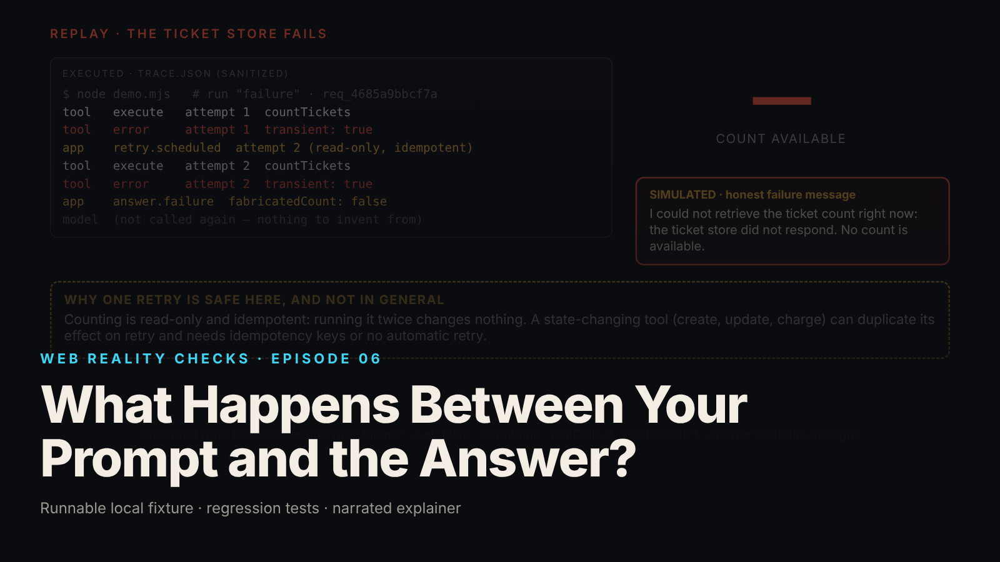

SEO title (≤60 chars): When an AI Answers "5," Where Did the Number Come From?
Meta description (≤155 chars): An AI assistant does not look things up itself. A plain-language walk through each step between your question and the answer, and what happens if it fails.
Slug: prompt-to-answer
Primary keyword: how AI assistants work   Secondary keywords (3–5): how does AI answer questions, AI tool use explained, why AI makes up numbers, AI assistant explained simply, can AI see my data
Medium tags (5): Artificial Intelligence, Technology, Explainer, Software, Privacy

# What Happens Between Your Prompt and the Answer?

You call a restaurant and ask the host for a table for four at seven. The host walks to the book, checks, and comes back: "Yes, we do." You heard one voice, but two jobs were done: someone understood your question, and someone looked at the book.

An AI assistant that answers from real information works the same way, and this episode shows the two jobs separately. The voice is the AI model. The looking-up is done by ordinary software built around the model, and that software decides what gets looked up, whose book gets opened, and what to say when the book cannot be found.

## What the episode shows

We built a small assistant on a laptop that answers one question: "How many open support tickets are high priority?" The data is made up: 120 pretend tickets across three pretend companies. The AI is also a stand-in: a fixed, predictable piece of code shaped like a real model's output, labeled "simulated model response" in every scene where it appears. Nothing here is a real product (local synthetic fixture).

You type the question. The software around the model, call it the host stand, packages it with one thing the model is allowed to ask for: "count tickets by status and priority." That is the only request form on offer. There is no "read anything you like" form.

The model does not answer. It fills in the form: status open, priority high. That form is the model's entire output at this step. The episode does not show the model "thinking," because the software cannot see that, and the episode shows only the observable.

The host stand checks the form. Is this a form we offered? Are the boxes filled with allowed values? Anything in the margin? If any answer is wrong, the request is refused and nothing is looked up.

Then the host stand decides whose book to open, based on who is signed in, not on anything the model wrote. In the episode the model is made to scribble a different company's name in the margin. The form is refused, and had the scribble slipped through, a second check throws it away.

Now the count happens: a small, read-only function that filters a list by two fields. It cannot run queries or see other companies' tickets, because the host stand handed it the company. It returns one number. The model turns that number into a sentence: there are 5 open high-priority tickets in your organization.

Five is right for this user. Across all three pretend companies there are 13. This user sees their own 5, never the 13 (local synthetic fixture).

## When the book is missing

The second half of the episode breaks the ticket data on purpose. The count fails. The host stand tries once more, safe only because counting changes nothing; if the form had been "cancel a reservation," trying twice could cancel two. It fails again.

Here is the part that matters. The host stand does not go back to the model and ask it to answer anyway. It writes the message itself: the ticket store did not respond, no count is available. No number. A test in the fixture checks that the message contains no digits at all (local synthetic fixture). The host who cannot reach the book says "I cannot check right now," not "yes, probably."

## What this means for you

- When an AI assistant gives you a number about your account, orders or tickets, it came from a lookup that other software ran on the model's behalf, not from the model's memory. Whether that lookup was checked, limited to your data, and allowed to fail without guessing depends on how the assistant was built, not how fluent it sounds.
- A confident sentence is not evidence. The design that gives the right "5" and the design that would have given a wrong "6" produce equally confident sentences. The difference lives in software you cannot see from the chat window.
- "I cannot check that right now" is a good sign. An assistant built to say that when its data source fails is not making numbers up when you are not looking.

## FAQ

**Does an AI assistant look through my data itself?**
Not in the design this episode shows. The model fills in a request form; the software around it checks the form, decides which data is yours, and runs a small lookup. The model receives the result and never touches the data directly. Other assistants may be built differently.

**Why do AI assistants sometimes make up numbers?**
One way is when the software asks the model to answer after the lookup has failed. The episode shows the alternative: after two failures the software writes "no count is available" itself and does not ask the model, so no number can be invented.

**Can an AI assistant show me someone else's information by mistake?**
It can if the software lets the model decide whose data to open. In the episode the model is made to ask for another company's data, and the request is refused before anything runs. Whether a real assistant does the same is a question for its builders.

## Watch the episode

[YouTube link]

Related episodes: [Watch What Happens When You Click 'Sign In'](../../ep03/content/article-technical.md) and [Your Dashboard Says 'Live.' Its Data Is Ten Minutes Old.](../../ep17/content/article-technical.md)

> This episode uses a deliberately constructed local fixture with synthetic data. Nothing here is a finding about a real product or company. Fixture, tests and video source: github.com/mizcausevic-dev/web-reality-checks

The host asks. Someone else checks the book. One way to build an assistant, not every one, but the one where "5" means five.

Miz Causevic, Kinetic Gain LLC
