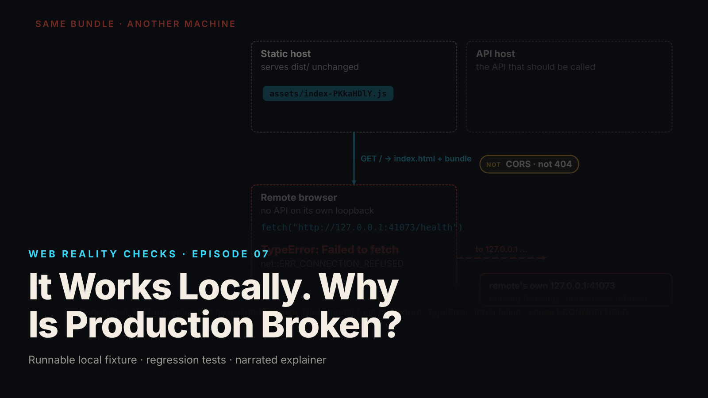

SEO title (≤60 chars): Why a Website Can Work for Its Maker and Nobody Else
Meta description (≤155 chars): A website worked on the developer's laptop and failed for everyone else. The one address frozen into its files, and why no server setting could fix it.
Slug: vite-env-localhost
Primary keyword: website works for developer but not users   Secondary keywords (3–5): why websites break after launch, localhost explained, how websites are built, web development explained simply, it works on my machine
Medium tags (5): Technology, Explainer, Web Development, Software, Internet

# It Works Locally. Why Is Production Broken?

Imagine you write a note to a friend that says "meet me at home." To you, "home" means your house. To your friend, reading it in their own kitchen, "home" means theirs. The note is identical in both places. It means a different building depending on who is holding it.

Computers have an address that works exactly like that. It is `127.0.0.1`, often called "localhost," and it always means "this computer, the one I am on right now." On your laptop it goes to your laptop. On mine it goes to mine. That is the whole of this episode.

## What the episode shows

We built a small website on a laptop, with a tiny made-up service behind it that answers one question, "are you healthy?", with "yes." Nothing here is a real product; all data is synthetic (local synthetic fixture).

Websites like this are made in two steps. A developer writes the instructions in a readable form, then a build tool turns them into the compact files a browser downloads. Part of that second step is filling in blanks. The instructions say, in effect, "the service lives at [ADDRESS]," and the build tool replaces the blank with whatever address it was given at that moment. Once filled in, the blank is gone. The finished file says the address, the way a printed form says a name.

On the developer's laptop the address given was the laptop's own "home" address, and that was fine, because the service really was running there. The page asked "are you healthy?" and got back 200, web-speak for "OK" (local synthetic fixture).

Then those finished files were put on a web server for the world. Anyone else's browser downloads the file, reads "the service lives at 127.0.0.1," and looks for the service on their own computer. There is nothing there. The connection is refused. We could not set up a separate, truly isolated computer to film that moment, so the episode shows it as a labeled simulation and says so on screen; what we did run is the same situation from the laptop with the service switched off, and the error was the refused connection the explanation predicts (local synthetic fixture).

## The fix that did not work

The natural instinct: go to the web server that hands out the files and change its "address" setting. The episode does this. The server confirms it has the new address. The file it hands out is unchanged, checked byte for byte with a fingerprint taken before and after (local synthetic fixture).

Back to the note. Suppose you tell the post office the correct address. It writes that on its own clipboard. The note inside the envelope still says "meet me at home." The post office delivers envelopes; it does not open them and rewrite what is inside. A web server that serves finished files is the same: it delivers, it does not rebuild.

## The fix that did

Write the note again with the full street address, and send the new one. In software terms: run the build step again with an address that works from everywhere, and put the new files on the server. The episode does this and the page asks "are you healthy?" and gets 200 OK, now from the right place (local synthetic fixture). The fixture also runs 9 automated checks, and all 9 pass, including one that deliberately reproduces the refused connection so we know the checks can see the problem when it exists.

One more thing the episode insists on. Anything filled into these blanks ends up inside the file every visitor downloads. It is public, like words on the outside of the envelope. Fine for an address. Never fine for a password.

## What this means for you

- When a website "works for the developer but not for you," it is often not your device or your internet. It can be a single address inside the files that only makes sense where they were built. You cannot fix that from your end, and neither can the company's server settings; the files have to be rebuilt.
- If you are paying someone to build a website, ask one question before launch: "Has anyone opened it from a computer that is not yours?" A phone on mobile data is enough. It is the one test a developer's own machine cannot perform.
- If you are learning to build things yourself: "localhost" means this computer, always. The moment your files leave your machine, it points somewhere else. Fill in a real address before you build, not after.

## FAQ

**What does "localhost" or 127.0.0.1 actually mean?**
A special address that always points at the computer you are using right now; it never reaches another machine. A program told to contact 127.0.0.1 looks on its own computer, which is why the same instruction works on one laptop and fails on every other.

**Why could the company not fix it by changing a setting on the server?**
The address was written into the finished files when they were built. The server that hands out those files cannot edit what is inside them, only deliver them. In the episode the server was given the right address and kept delivering the identical old file. Only rebuilding changes it.

**Is this kind of mistake a sign of a bad developer?**
Not by itself. The files are identical on the developer's machine and everyone else's; the only difference is where one address points. One habit catches it: opening the finished product from a machine other than the one it was built on, before telling anyone it is ready.

## Watch the episode

[YouTube link]

Related episodes: [Your Website Updated. Why Am I Still Seeing the Old Version?](../../ep12/content/article-technical.md) and [I Changed One DNS Record and Broke My Website](../../ep10/content/article-technical.md)

> This episode uses a deliberately constructed local fixture with synthetic data. Nothing here is a finding about a real product or company. Fixture, tests and video source: github.com/mizcausevic-dev/web-reality-checks

"Meet me at home" is a perfect note until someone else reads it. Write the full address before you print; the post office will not do it for you.

Miz Causevic, Kinetic Gain LLC
