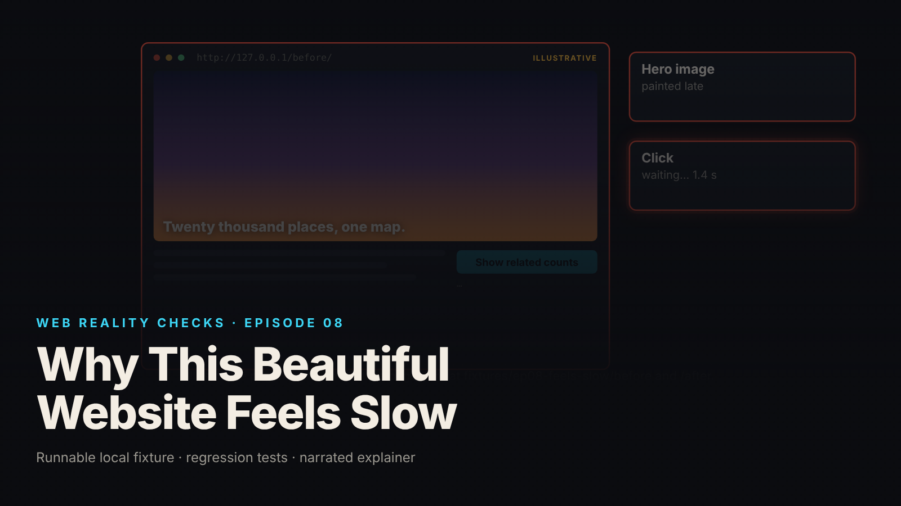

SEO title (≤60 chars): Slow Load vs Slow Click: Two Timelines, Two Different Fixes
Meta description (≤155 chars): A 12 MB hero PNG and an O(n²) click handler make one page feel slow for two unrelated reasons. The fixture, the tests, the repairs, what was not measured.
Slug: feels-slow
Primary keyword: website feels slow   Secondary keywords (3–5): largest contentful paint, interaction to next paint, main thread blocking, hero image optimization, synchronous click handler
Medium tags (5): Web Performance, JavaScript, Frontend Development, Core Web Vitals, Software Engineering

# Why This Beautiful Website Feels Slow



The page is finished, the design is good, and two users file the same complaint: slow. One waited for the hero image to appear. The other clicked a button and watched nothing happen. Same word, two unrelated causes, and fixing either one does nothing for the other.

This is episode eight of Web Reality Checks: two visually identical pages, one bottleneck on the loading timeline, one on the interaction timeline, both repaired and tested. The article is also candid about the measurement that could not be run here: nothing in a browser was timed.

## What actually happens

The loading timeline is about painting. Largest Contentful Paint asks how soon the largest visible element is rendered. If that element is an image, the browser must request it, receive every byte, decode it into pixels and composite it. A 12 MB file does not paint early no matter how fast the CSS is, because the pixels do not exist until the decoder finishes. Resolution is the hidden multiplier: a 4000 pixel wide image holds more than six times the pixels of a 1600 pixel wide one, and lossless encoding keeps all of them.

The interaction timeline is about the main thread. On a click, the browser queues the event, runs your handler, and only then can it produce the next frame. If the handler takes four seconds, the next paint is at least four seconds away. No spinner or button state change can appear in between, because the thread that would draw them is busy inside your loop.

The two timelines share nothing. Shrinking the image does not make a handler cheaper; rewriting the handler does not make the image arrive sooner.

## The fixture

`fixtures/ep08-feels-slow/` holds `before/index.html` and `after/index.html`, served from a loopback-only Node 22 server (`serve.mjs`, 127.0.0.1, `Cache-Control: no-store`). Both images are generated deterministically by `make-assets.mjs`; the 20,000-item catalogue is seeded (Mulberry32, seed 8). A test asserts the two pages have identical markup apart from asset path, handler path and label.

The before page requests a 4000×2250 lossless PNG for a slot that is at most 1600 CSS pixels wide:

```html
<section class="hero">
  
  <h1>Twenty thousand places, one map.</h1>
</section>
```

Note what is absent: `loading="lazy"`. The hero is above the fold and is the expected largest contentful element, so lazy-loading would delay the paint further. Both variants keep `fetchpriority="high"` and intrinsic dimensions; a test enforces it.

The before handler, `handler-before.mjs`, computes for each item how many others share its collection by rescanning the whole list every time:

```js
export const relatedCounts = (items) => {
  const n = items.length;
  const out = new Int32Array(n);
  for (let i = 0; i < n; i++) {
    let c = 0;
    const col = items[i].collection;
    for (let j = 0; j < n; j++) if (j !== i && items[j].collection === col) c++;
    out[i] = c;
  }
  return out;
};
```

With n = 20,000 that is 400 million comparisons, all synchronous, called directly inside the click listener. The browser cannot paint the next frame until this returns.

## The test that proves it

`node --test fixtures/ep08-feels-slow/test.mjs` reports `# tests 7  # pass 7  # fail 0` (local synthetic fixture):

- `both handlers produce identical output on the seeded catalogue (same digest, same values)`
- `handlers also agree on small edge-case inputs`
- `the after hero image is smaller in bytes than the before hero image`
- `KNOWN-POSITIVE CONTROL + repair: before handler median is slower than after (Node CPU time, not INP)`
- `hero  is present and NOT lazy-loaded in either page`
- `pages are visually equivalent: identical markup apart from asset, handler and label`
- `loopback server serves both pages and shared modules, binds 127.0.0.1 only`

The control test gives the rest meaning. It asserts the before handler's median in Node is above 100 ms, so the flaw is observable, and that the after handler is faster with the same digest. If the slow variant cannot be seen to be slow, a fast result on the fixed one proves nothing.

The suite names what it measures: Node CPU time, not INP. Node and Chromium share V8 but not the event loop, the rendering pipeline or input-delay accounting. A handler timed in Node tells you how much main-thread work the click would cause, not what a user waits.

## The repair

The image: same picture, resized to the slot at 1600×900 and encoded as WebP at quality 80. It stays above the fold, keeps `fetchpriority="high"` and `width="1600" height="900"`, and is still not lazy-loaded. The element the user is waiting for should be requested early; the fix is to make it small, not late.

The handler, `handler-after.mjs`, counts each collection once in a histogram and then reads the counts back:

```js
export const relatedCounts = (items) => {
  const n = items.length;
  const hist = new Map();
  for (let i = 0; i < n; i++) {
    const col = items[i].collection;
    hist.set(col, (hist.get(col) ?? 0) + 1);
  }
  const out = new Int32Array(n);
  for (let i = 0; i < n; i++) out[i] = hist.get(items[i].collection) - 1; // minus itself
  return out;
};
```

Two passes over 20,000 items instead of 400 million comparisons, identical output for every input (asserted by the first two tests), and still synchronous. The brief forbids hiding the delay behind a spinner, a `setTimeout` or an animation: the cost was removed by a cheaper algorithm, not moved out of sight.

## Retest

From `evidence.json`, written by `demo.mjs` (local synthetic fixture, Node v22.23.4, linux x64, 2 vCPU shared container):

- Hero image file bytes: before `hero-large.png` 12,173,721, after `hero-sized.webp` 17,004, both confirmed as served by the loopback server. File bytes, not transfer times and not LCP.
- Handler CPU time in Node, 7 timed runs after one excluded warm-up: before median 4253.02 ms (raw 4299.32, 4921.91, 4253.02, 3555.42, 3288.51, 3891.63, 4488.83), after median 1.40 ms (raw 9.24, 1.35, 1.31, 29.84, 1.35, 1.4, 21.4). Fixture-measured handler CPU time in Node, not browser INP.
- Both handlers produce digest `ec44c9fd`; `equalOutputs` is `true`.

The raw lists are kept on purpose: the container is shared and not CPU-pinned, so the before runs spread roughly 3.3 to 4.9 s. Re-running `demo.mjs` yields different absolute values.

## What this does not prove

- Nothing in a browser was measured. No LCP, Event Timing or INP figure exists for either page. Byte size is a file property and Node CPU time is a proxy for the click's main-thread work; neither is a user-perceived latency.
- On loopback without throttling, even 12 MB arrives in milliseconds. The loading comparison only means something under a throttled network preset.
- One image and one handler were corrected. Fonts, CSS, scripts and other interactions were not examined.
- The page in the video's first scene is an illustrative drawing, not a browser capture.

### Blocked: the browser lab run

No browser was available in the build environment. The procedure from `test-conditions.md`, to run locally before quoting any loading or interaction number:

1. `node fixtures/ep08-feels-slow/make-assets.mjs` once, then `node fixtures/ep08-feels-slow/serve.mjs 4508` so URLs stay stable.
2. One browser build; record `chrome://version`. Fresh profile or extensions off. Same machine, mains power.
3. Viewport pinned to 1600×900 CSS px, device pixel ratio 1.
4. One CPU throttle for every trial (for example DevTools 4×) and one network preset for every trial (for example Fast 3G). Never mixed.
5. Cold: "Disable cache" on, hard reload per trial. Warm: cache enabled, `no-store` removed from `serve.mjs` for that run as a documented deviation, one discarded priming load, then measure. Separate tables; never averaged.
6. Record an initial Performance trace per variant. Confirm the LCP element is the hero `` and the long task on click is inside `relatedCounts` before attributing anything.
7. At least five trials per variant per condition. Report the median, keep every raw value.
8. LCP via `PerformanceObserver` on `largest-contentful-paint` with `buffered: true`. Interaction via `PerformanceObserver` on `event` with `durationThreshold: 16` for the single scripted click on "Show related counts", reported as a lab measurement of one scripted interaction, not a field INP assessment. Total Blocking Time is not a substitute.
9. Add results under a `browserLab` key in `evidence.json` with the conditions. The Blocked lines then become Executed.

## Launch checklist

1. Identify the expected largest contentful element on each key page; confirm its file is sized to its slot and encoded with a modern lossy format where appropriate.
2. Do not lazy-load the above-the-fold hero; give it `fetchpriority="high"` and intrinsic `width` and `height`.
3. Find every synchronous main-thread handler that runs over a large collection and know its algorithmic cost at production data sizes.
4. Where a handler is expensive, make it cheaper and prove identical output with a digest, rather than masking the wait with animation.
5. Keep a known-positive control: a test that fails on the slow variant.
6. Measure loading (LCP) and interaction (Event Timing) separately, under one browser build, viewport, CPU throttle and network preset, with cold and warm as different tables.
7. Record a trace before attributing a cause.
8. Label every number with how it was obtained. A Node timing is not INP; a byte count is not a load time.

## FAQ

**Why does my website feel slow even though it looks finished?**
Visual polish, loading speed and interaction responsiveness are three separate things. A page can render its layout quickly, wait for an oversized hero image, then freeze on a click because the handler runs heavy synchronous work on the main thread. Each has its own cause and measurement.

**Should I lazy-load the hero image to speed up the page?**
Not when the hero is above the fold and is the largest contentful element. Lazy-loading delays the request for the element the user is waiting for. Size and encode the image to its slot, keep `fetchpriority="high"`, and declare intrinsic dimensions.

**Is a Node benchmark of a click handler the same as INP?**
No. Node shares V8 with Chromium but has no input pipeline, rendering or Event Timing accounting. A Node timing bounds the main-thread work a click would cause; INP is a field metric from real users. Use a browser lab run with Event Timing for the interaction timeline.

## Watch the episode

[YouTube link]

- 00:00 The page looks finished, then feels slow
- 00:09 Loading and interaction are two timelines
- 00:22 The hero request: 12 MB PNG for a 1600 px slot
- 00:36 The handler: 20,000 items against every other
- 00:51 Correct the image: 1600×900 WebP
- 01:05 Correct the handler: count once, look up
- 01:17 Measured here, and what was not
- 01:32 Two different tests

Related episodes: [The Browser Shows Your Page. What Does the Server Send?](../../ep19/content/article-technical.md) and [Your Website Updated. Why Am I Still Seeing the Old Version?](../../ep12/content/article-technical.md)

> This episode uses a deliberately constructed local fixture with synthetic data. Nothing here is a finding about a real product or company. Fixture, tests and video source: github.com/mizcausevic-dev/web-reality-checks

Loading quickly and responding quickly are different tests. Run both, under the same conditions, before calling the page fast.

Miz Causevic, Kinetic Gain LLC
