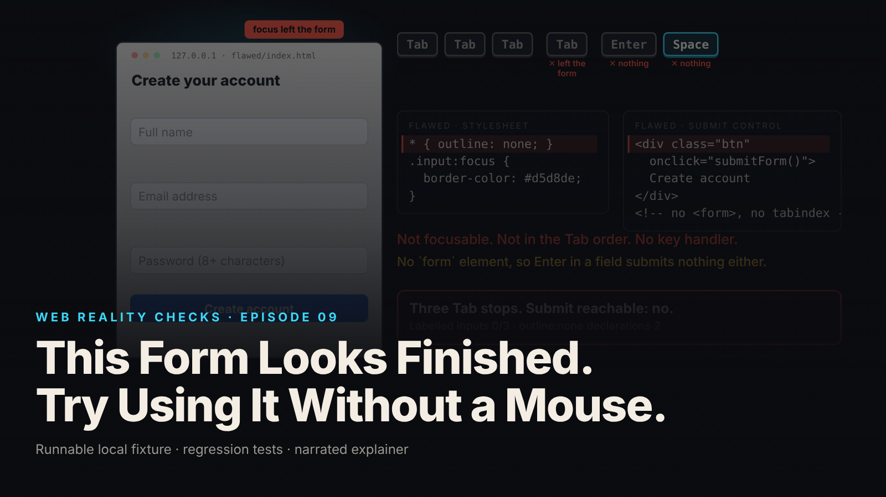

SEO title (≤60 chars): Your Signup Form Passed Review. Does It Work With No Mouse?
Meta description (≤155 chars): A polished form can be impossible to submit from the keyboard, and no screenshot shows it. What fails, why demos miss it, five questions to ask your team.
Slug: keyboard-form
Primary keyword: keyboard accessibility testing   Secondary keywords (3–5): form usability review, accessibility before launch, vendor accessibility questions, keyboard only users, web form conversion
Medium tags (5): Product Management, Accessibility, UX, Startup, Leadership

# This Form Looks Finished. Try Using It Without a Mouse.

## The symptom as a business event

The new signup form went live on Tuesday. Design approved the screenshots, QA clicked through it, the launch post went out. By Friday there are three support tickets with the same shape: "I filled in the form and there is no way to submit it." One mentions a broken trackpad. One mentions a screen magnifier. One says the Create account button "does nothing when I press Enter." Nobody on the team can reproduce it, because everybody on the team reaches for the mouse.

That is the event this episode reproduces on a local fixture: a small registration form with name, email, password and a blue Create account button. With a mouse it works. With a keyboard, the flawed version cannot be submitted by any sequence of keys; the fixture's journey model records "no keyboard path to submission" (local synthetic fixture). The corrected version completes the same journey, including a validation error and its correction, in seven keystrokes.

## Why a demo cannot show this

A demo is a pointer tour. The presenter clicks into a field, types, clicks the next one, clicks the button. Every click works, because the flawed form was built for clicks. The defects only appear under a different kind of input, the keyboard, and a demo never switches input.

A screenshot is worse. Three of the four defects are about what happens when something changes: focus moving without a visible marker, a placeholder vanishing the moment you type, an error appearing with no connection to its field. A still image has no "before" and "after." The fourth defect, a button that is not a real button, is invisible by design. It is styled to look exactly like one.

So the review that approved this form was not careless. It answered "does it look finished and work with a mouse?" The question "can it be operated at all without a pointer?" was never asked.

## The mechanism in plain terms

Think of a building with an elevator whose buttons are painted on. From across the lobby the panel looks complete: floor numbers, a lit arrow, the right colors. Walk up and press one and nothing happens, because a painted button is a picture of a button. The real buttons are wired to the elevator; the painted ones are wired to nothing.

The flawed form's Create account control is a painted button. In the browser, a real button is a specific element the browser already knows how to treat: it can receive focus when you press Tab, it activates on Enter or Space, and when it sits inside a real form, pressing Enter in any field submits. The flawed version used a generic box styled blue with a click handler attached. The browser does not put generic boxes in the Tab sequence and does not activate them with keys. So Tab skips it, and Enter and Space do nothing (local synthetic fixture).

Three more defects stack on top. A stylesheet rule removed the focus outline everywhere, so even the fields that can be reached give no visual sign of it: the user moves through the form blind. The only labels were placeholders, which disappear the moment you type. And the error messages were shown with a style change, attached to nothing, so the page's structure holds no connection between a field and its message.

The repair is to stop painting. Use the real form element and the real button, so the browser's built-in behavior does the work. Draw a visible ring around whatever has focus. Give every field a label that stays put. When validation fails, connect each message to its field in the page's structure, mark the field invalid, keep what the user typed, and move focus once to the first problem. Under the fixture's audit, the flawed version passes 3 of 11 checks and the corrected version passes 11 of 11 (local synthetic fixture).

## What to ask your team or vendor

1. Has anyone completed the signup, checkout and account forms with the mouse unplugged, and written down the result per step? Ask for the written record, not a yes.
2. Are the buttons real buttons? Specifically: is every control that submits or confirms a native button element inside a native form, rather than a styled box with a click handler?
3. When I press Tab, can I see where I am at every step? If any stylesheet removes the focus outline, what replaced it, and is the replacement visible on every background?
4. Does every field have a visible label that stays on screen after I type, or are placeholders the only labels?
5. After I submit bad data, is each error connected to its field in the page structure, does my typed data survive, and where does focus go? "It shows a red message" is a visual answer to a structural question.

If the answers are "the design review covered it" or "the automated scanner passed," the honest state is "untested," not "accessible."

## What it costs if ignored

No figures here, only the shape of the cost.

The direct cost is lost completions. A form that cannot be submitted from the keyboard turns away every user who is not using a pointer at that moment: people with motor impairments, people using switch devices or magnifiers, power users who tab through forms, and anyone whose mouse battery just died. They do not file a bug. They leave, and the funnel records a drop-off with no explanation.

The compliance cost depends on where you sell. Keyboard operability is one of the most basic expectations in accessibility standards, and a form that fails it is an easy finding for anyone looking. This episode makes no legal claim and is not an audit; it only notes that the defect is simple to demonstrate, and simple to demonstrate is simple to cite.

The quiet cost is rework. The team that painted this button has usually painted others: in the modal, the dropdown, the date picker. The fixture repairs one form and says so. Each other control needs its own keyboard test.

## FAQ

**Our forms work fine with a mouse. Why does keyboard access matter?**
Because a meaningful share of users are not using a pointer at any given moment, by necessity or by preference, and a form that cannot be submitted from the keyboard loses all of them silently. Keyboard operability is also one of the most basic expectations in accessibility standards.

**Our automated accessibility scanner passed. Is that enough?**
No. Scanners catch some missing labels and attributes, but they do not press Tab or Enter. The fixture's own audit is explicit that it is a static check, not a browser and not a conformance tool. A person completing the form by keyboard, with results written down, is the test.

**Does passing a keyboard test make the form accessible?**
No. Keyboard operability is one slice. Contrast, motion, timing, cognitive load, touch targets and what a screen reader actually announces were not tested in this episode. Each needs its own test with its own tools, and screen-reader results should only be reported from a named browser and screen reader pair.

## Watch the episode

[YouTube link]

Related episodes: [Why This Beautiful Website Feels Slow](../../ep08/content/article-technical.md) and [Watch What Happens When You Click 'Sign In'](../../ep03/content/article-technical.md)

> This episode uses a deliberately constructed local fixture with synthetic data. Nothing here is a finding about a real product or company. Fixture, tests and video source: github.com/mizcausevic-dev/web-reality-checks

A screenshot cannot show whether a form is operable. Before the next launch, have someone put the mouse in a drawer, press Tab, and report what they saw at every stop. It is a keyboard test, not an audit, and it is the cheapest one you will run.

Miz Causevic, Kinetic Gain LLC
