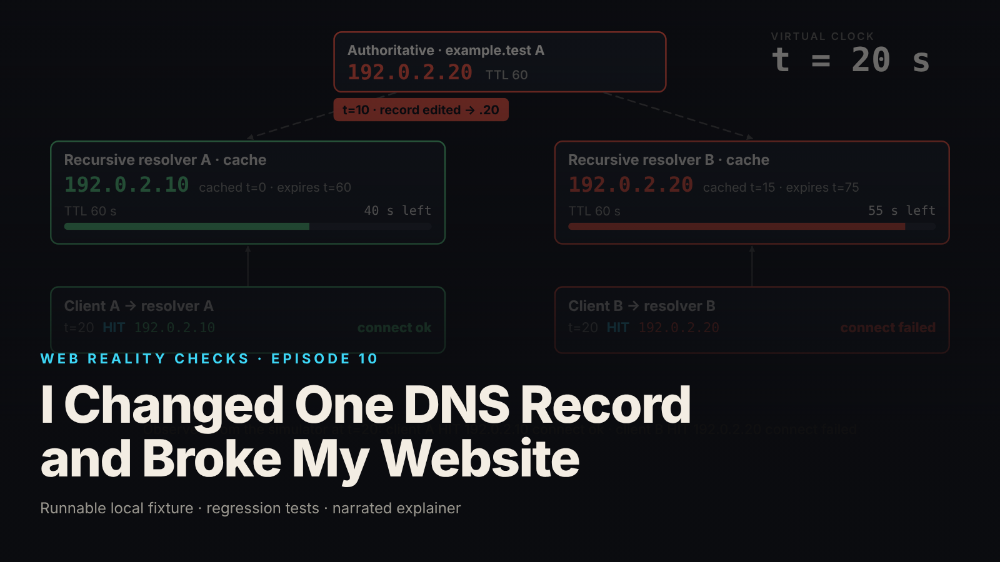

SEO title (≤60 chars): DNS Caches: Why Fixing the Record Did Not Fix the Site
Meta description (≤155 chars): One wrong A record, two resolvers, two different answers. A deterministic DNS cache simulator shows why the fix did not take: 13 tests plus a checklist.
Slug: dns-caches
Primary keyword: DNS cache TTL   Secondary keywords (3–5): DNS propagation, authoritative A record, recursive resolver cache, TTL not retroactive, DNS troubleshooting checklist
Medium tags (5): DNS, Web Development, Networking, Site Reliability, Node.js

# I Changed One DNS Record and Broke My Website



One edit to the A record for `example.test`, and moments later one client still loads the site while the other cannot connect. You correct the record, and the broken client stays broken for another forty-five seconds of simulated time, because the fix went to the source and the stale answer lives somewhere else.

This is episode ten of Web Reality Checks. The whole episode is a wrong authoritative A record, two recursive resolver caches that learned different things at different moments, and the gap between fixing a record and every cache noticing. It runs on a deterministic local simulator with a virtual clock and no real network; every number below comes from that local synthetic fixture.

## What actually happens

Loading a website is two steps that most people experience as one. Resolution: the client asks its recursive resolver for an address. Connection: the client tries to reach that address. The resolver does not consult the authoritative server every time. It answers from its own cache for as long as the record's TTL, the time-to-live it stored with the answer, has not run out. Only when the entry is stale does it ask the authority again.

That cache is the entire story. When you edit the authoritative record, you change what the next cache miss will fetch. You do not change anything already sitting in a resolver's cache, and you have no channel to reach it. Resolvers that cached the old answer keep serving it until their stored TTL runs out. Resolvers that miss while the record is wrong cache the wrong answer and serve that until their own TTL runs out. Two resolvers, two fetch times, two expiry times, two views of the same name.

Three accuracy points follow from the mechanism.

First, a wrong answer is not a resolution failure. Every query in this fixture returns `NOERROR` with an address. The lookup succeeded. It returned the wrong destination. What fails is the connection step afterwards, because the destination is wrong, not because DNS broke.

Second, lowering the TTL after the fact does nothing for entries already cached. A resolver computes `expiresAt = cachedAt + ttlAtFetch` when it stores the answer. A TTL set at the authority later governs only later lookups.

Third, expiry pushes nothing. When an entry passes its `expiresAt`, nothing is sent to the resolver or the client. The stale entry sits there until a client asks again, and only then does the resolver fetch whatever the authority says at that moment.

## The fixture

`fixtures/ep10-dns-caches/` is a zero-dependency Node 22 state machine: one authoritative A record for `example.test`, two recursive resolver caches (A and B), two clients each bound to one resolver, and a simplified connect stage that succeeds only when the resolved address equals the intended origin `192.0.2.10`. The wrong address is `192.0.2.20`. Both are RFC 5737 documentation addresses held as strings. Nothing opens a socket.

The clock is virtual. Every action carries a time `t` in seconds, and a cache entry expires because `t >= expiresAt`, never because of a scripted countdown:

```js
  cacheState(resolverId) {
    const r = this.resolvers[resolverId];
    if (!r) throw new Error(`unknown resolver ${resolverId}`);
    const c = r.cache;
    if (!c) return {status: 'empty', answer: null, ttlRemaining: null};
    const remaining = c.expiresAt - this.now;
    return remaining > 0
      ? {status: 'fresh', answer: c.answer, ttlRemaining: remaining, cachedAt: c.cachedAt, expiresAt: c.expiresAt}
      : {status: 'expired', answer: c.answer, ttlRemaining: 0, cachedAt: c.cachedAt, expiresAt: c.expiresAt};
  }
```

A resolver answers from cache if the entry is fresh. Otherwise it fetches the authoritative record as it is at that moment, and stores it with the TTL in force at fetch time:

```js
  resolve(resolverId) {
    const r = this.resolvers[resolverId];
    const st = this.cacheState(resolverId);
    if (st.status === 'fresh') {
      return {cacheHit: true, answer: st.answer, ttlRemaining: st.ttlRemaining, rcode: 'NOERROR'};
    }
    // Miss (empty or expired): fetch from the authoritative server *as it is now*.
    const {value, ttl} = this.authoritative;
    r.cache = {answer: value, ttl, cachedAt: this.now, expiresAt: this.now + ttl};
    this.cacheWrites.push({t: this.now, resolver: resolverId, answer: value, ttl, expiresAt: this.now + ttl});
    return {cacheHit: false, answer: value, ttlRemaining: ttl, rcode: 'NOERROR'};
  }
```

`runSequence()` executes the brief's sequence as actions on the clock. The comments in the source are the plot of the first half of the episode, up to the restore:

```js
  sim.at(0).query('clientA');            // 1. resolver A caches the correct address, TTL 60
  snap();
  sim.at(10).setRecord(WRONG_IP);        // 2. the authoritative record is changed to the wrong address
  snap();
  sim.at(15).query('clientB');           // 3. resolver B misses and caches the wrong address, TTL 60
  snap();
  sim.at(20).query('clientA');           // 4. client A still gets the correct answer…
  sim.query('clientB');                  //    …client B gets the wrong one and its connection fails
  snap();
  sim.at(30).setRecord(INTENDED_IP);     // 5. restore the correct authoritative address
```

After the restore, both clients query at t=30, both at t=60, and both again at t=75, with a snapshot taken at each of those times.

The connect stage is a comparison against the intended IP and stands in for TCP connect only. TLS and HTTP are handled by the diagnostic checklist instead.

## The test that proves it

`node --test fixtures/ep10-dns-caches/test.mjs` reports `# tests 13  # pass 13  # fail 0` (local synthetic fixture). The names carry the argument:

- `t=0: resolver A caches the correct address with TTL 60 (cache miss, connect ok)`
- `t=10: authoritative record changed to the wrong address; resolver A cache untouched`
- `t=15: resolver B misses and caches the WRONG address with TTL 60 (KNOWN-POSITIVE CONTROL)`
- `t=20: client A still correct (cache hit); client B wrong (cache hit) and connection fails`
- `resolution is NOT a failure: every answer in the run is a NOERROR answer; only connect fails`
- `t=30: authoritative restored; resolver B still serves the cached wrong answer (45 s left)`
- `t=60: resolver A entry expired (expiresAt=60); its next query refreshes from the authority`
- `t=75: resolver B bad entry expired; next query retrieves the corrected answer`
- `expiry permits a new lookup; it does not push an update (stale entry sits until queried)`
- `lowering the authoritative TTL is not retroactive for an answer already cached`
- `the two resolvers are independent: no fixed global recovery moment`
- `virtual clock cannot run backwards`
- `evidence shape: every event has the required fields`

The known-positive control at t=15 makes the rest meaningful. It asserts that resolver B actually serves and caches `192.0.2.20`, with the message "the flaw must be observable: the wrong record is served". If the simulator could not be made to serve the wrong answer, a passing recovery test would prove nothing.

Two tests isolate the accuracy claims. The TTL test caches an answer at t=0 with TTL 60, lowers the authoritative TTL to 5 at t=5, and asserts at t=20 that `expiresAt` is still 60; only the lookup at t=60 inherits the new TTL, giving `expiresAt` 65. The expiry test caches an answer, changes the record, jumps the clock to t=100 with nobody asking, and asserts the stale entry is still what is stored and `events.length` is still 1: no query happened on its own.

`demo.mjs` runs the sequence and writes `evidence.json`. From that file (local synthetic fixture): 10 queries, 0 resolution failures, 4 failed connections, all four to `192.0.2.20`. At t=20, client A hits its cache and gets `192.0.2.10` with 40 seconds remaining; client B hits its cache and gets `192.0.2.20` with 55 seconds remaining, and its connection fails.

## The repair

At t=30 the authoritative record is restored to `192.0.2.10`. That is the repair, and it is the correct one. The point of the episode is what it does and does not do.

It changes what every future cache miss fetches. It does not touch resolver B's entry, cached at t=15 with TTL 60 and therefore expiring at t=75 whatever happens at the authority. At t=30, client B queries again, hits the cache, receives `192.0.2.20` with 45 seconds remaining, and fails to connect. The source is correct. The client is still broken.

There is nothing else to do from the authority's side. You cannot shorten resolver B's entry by lowering the TTL now; that TTL is already stored. You cannot push the correction; expiry only permits the next question. What you can do is know when each cache you care about will ask again, which is why the checklist says to record the TTL in force when the bad answer was cached.

## Retest

From `evidence.json` (local synthetic fixture):

- t=60, client A: cache miss, fetches `192.0.2.10`, TTL 60, connect ok. Resolver A's original entry (cached t=0, TTL 60) had aged out.
- t=60, client B: cache hit, `192.0.2.20`, 15 seconds remaining, connect failed. Still fresh, still wrong.
- t=75, client B: cache miss, fetches `192.0.2.10`, TTL 60, connect ok. The bad entry expired at t=75 and a client asked.
- t=75, client A: cache hit, `192.0.2.10`, 45 seconds remaining, connect ok.

Resolver A recovered at t=60 and resolver B at t=75. The test `the two resolvers are independent: no fixed global recovery moment` asserts those two numbers differ. Each recovery time is that cache's fetch time plus its stored TTL plus whenever it next got asked. There is no single propagation time in this run, and none in real incidents either.

## What this does not prove

The README and the brief are explicit about scope.

- This is a simulated model, not a measurement of any resolver software. Not modeled: serve-stale, prefetch or pre-expiry refresh, browser DNS cache, operating-system stub cache, negative caching, resolver TTL clamping, multiple authoritative servers, primary-to-secondary propagation delay, CNAME chains, round-robin.
- A record only. A real investigation must also check AAAA. An IPv6-capable client may never consult the A record you fixed, and a wrong or stale AAAA record produces the same symptom.
- The recovery times t=60 and t=75 belong to this sequence. They are not a general propagation interval.
- Connectivity, TLS and HTTP are not simulated. The connect stage is a string comparison.
- Record TTL says nothing about website-content cache lifetimes (`Cache-Control`, CDN TTLs). A fresh DNS answer can still show old content, and the reverse. Separate clocks.

## Launch checklist

From `fixtures/ep10-dns-caches/diagnostic-checklist.md`, for the next time a record change breaks a site:

1. Query the authoritative server directly first. It is what new lookups will receive.
2. Query each recursive resolver your users actually rely on, and compare answers and remaining TTLs, not just answers.
3. Classify the DNS layer before touching anything else: `NXDOMAIN`, `SERVFAIL` or timeout is a resolution failure; `NOERROR` with the wrong address is a successful lookup to the wrong destination.
4. Check AAAA as well as A.
5. Record the TTL in force when the bad answer was cached, and compute each resolver's `expiresAt`. Lowering the TTL now does not shorten those entries.
6. Do not quote a single propagation time. Each cache recovers on its own schedule.
7. Test connectivity against the resolved address, then against the intended address explicitly with `--resolve`, so you know which host your results describe.
8. Separate HTTP cache state (`Cache-Control`, `Age`, CDN cache keys) from DNS cache state before concluding that the fix did not propagate.

## FAQ

**Why does my website still fail after I fixed the DNS record?**
Resolvers that cached the wrong answer keep serving it until the TTL they stored runs out. In the fixture, resolver B cached `192.0.2.20` at t=15 with TTL 60, so it kept failing until t=75 even though the record was corrected at t=30 (local synthetic fixture). The fix reaches the source, not existing caches.

**Does lowering the DNS TTL speed up propagation?**
Only for lookups made after you lower it. An entry already cached keeps the expiry computed when it was stored. The fixture test lowers the TTL to 5 seconds at t=5 and the entry cached at t=0 still expires at t=60 (local synthetic fixture). Lower the TTL well before a planned change, not during the incident.

**Is a wrong DNS answer a DNS failure?**
No. `NOERROR` with the wrong address is a successful resolution to an unintended destination. All 10 queries in the fixture resolved; 4 connections failed, each because the destination was wrong (local synthetic fixture). Diagnose resolution, connectivity, TLS and HTTP as separate layers.

## Watch the episode

[YouTube link]

- 00:00 One A-record edit, two different results
- 00:10 Resolution versus connection
- 00:21 Three copies of one answer
- 00:36 Restore the record; client B still fails
- 00:47 Why the stale answer stays until t=75
- 01:02 Expiry and the next query
- 01:17 Recovery: 10 queries, 0 resolution failures, 4 failed connections
- 01:32 Fixing the source does not erase every cached answer

Related episodes: [It Works Locally. Why Is Production Broken?](../../ep07/content/article-technical.md) and [Your Website Updated. Why Am I Still Seeing the Old Version?](../../ep12/content/article-technical.md)

> This episode uses a deliberately constructed local fixture with synthetic data. Nothing here is a finding about a real product or company. Fixture, tests and video source: github.com/mizcausevic-dev/web-reality-checks

Fixing the source does not erase every cached answer. Know which caches hold what, when each one stored it, and when each one will ask again. That is the whole of DNS incident timing, and no single number stands in for it.

Miz Causevic, Kinetic Gain LLC
