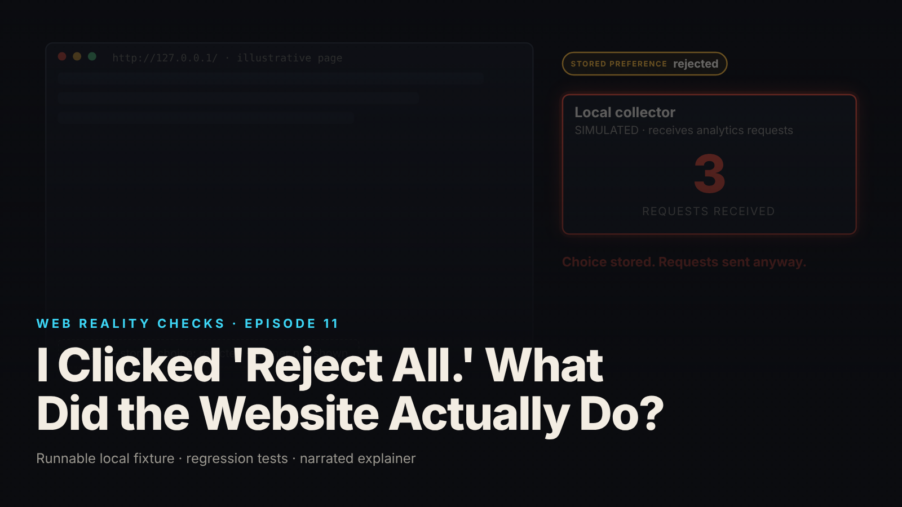

SEO title (≤60 chars): Reject All Did Nothing: Consent Gates Every Request Path
Meta description (≤155 chars): A consent banner stored the rejection and the analytics module kept sending. The fixture, the control test, and the state-machine gate that fixes it.
Slug: consent-gate
Primary keyword: consent gate analytics   Secondary keywords (3–5): consent state machine, reject all still tracking, cookieless tracking, consent management implementation, withdraw consent analytics
Medium tags (5): Web Development, Privacy, JavaScript, Software Engineering, Analytics

# I Clicked 'Reject All.' What Did the Website Actually Do?



The visitor clicks "Reject optional." The banner disappears, the choice is written to storage, and the analytics module keeps posting to the collector exactly as before the click. Three requests after the rejection, four in total (local synthetic fixture). Nothing on screen is wrong, which is the problem.

This is episode eleven of Web Reality Checks. The subject is the gap between a consent interface and the code that emits requests. A banner is a UI component; a request is behavior. They are connected only if someone wrote the connection, and in the flawed build nobody did. The episode builds the flaw by hand, measures it with a local collector, repairs it with an explicit state machine, and retests every state. It is a technical demonstration, not legal advice or a compliance claim, and no real website is depicted or accused.

## What actually happens

Four parts are involved: the consent UI (banner and settings panel), a preference store, an optional analytics module, and a collector that records every request it receives. In the fixture they are in-process Node objects plus a loopback HTTP server labelled `SIMULATED ANALYTICS · LOCAL COLLECTOR`.

The flaw is a missing read. The buttons write the preference, the stored JSON says `"state": "rejected"`, and on reload the banner reads that value to decide whether to show itself. But the analytics module is initialized unconditionally on load, attaches listeners for page views and interactions, queues an envelope for each, and its batch flush posts whatever is queued. Nothing on that path consults the preference. The consent state is data at rest; the emission path is code in motion; the two never meet.

Two details matter for real systems. The module identifies the visitor with an in-memory client id. No cookie exists in the fixture, yet the collector receives a stable identifier on every request; blocking cookies does not block this. And the collector is same-origin, a first-party endpoint, which changes nothing about whether the requests are optional. First-party describes where a request goes, not whether the visitor agreed to it.

## The fixture

`fixtures/ep11-consent-gate/` is a Node 22 simulation with no browser. The page is an object whose UI actions are function calls: `load()`, `acceptOptional()`, `rejectOptional()`, `openSettings()`, `withdrawOptional()`, `interact(name)` and `flush()`. The preference store persists to a JSON file, so a second `createPage` on the same file behaves like a reload in the same browser context. A fixed-epoch clock and a seeded client id make every run produce the same numbers.

`page-flawed.mjs` stores the choice and ignores it. The bug is one line in `load()`:

```js
load() {
  const stored = store.read();
  if (stored && STATES.includes(stored.state)) { consent.state = stored.state; consent.updatedAt = stored.updatedAt; }
  ui.bannerVisible = consent.state === 'no_choice'; // the banner honours the stored choice…
  analytics.init();                                   // …the analytics module does not. (THE BUG)
  return page;
},
```

`init`, `track` and `flush` in the flawed module never check consent, and `withdrawOptional()` changes the state without telling the module anything.

`page-corrected.mjs` has the same surface. It adds one policy function and a gate that calls it at the moment each emission path runs:

```js
/** The policy, in one place: optional analytics may run only while consent is `accepted`. */
export const optionalAllowed = (state) => state === 'accepted';

init() {
  if (!gate.check('init')) return false;                 // GATE 1: do not even start
track(event, detail) {
  if (!gate.check('track')) return false;                // GATE 2: a stray listener cannot queue
async flush() {
  if (!gate.check('flush')) { this.queue.length = 0; return 0; } // GATE 3: a stale queue cannot send
```

`collector.mjs` is a raw recorder: `POST /collect` stores the envelope verbatim and answers 202, `GET /events` returns the count, and it applies no consent filtering. If a request reaches it, the page sent it, and nothing can un-receive it.

## The test that proves it

`node --test fixtures/ep11-consent-gate/test.mjs` reports `# tests 10  # pass 10  # fail 0` (local synthetic fixture, Node v22.23.4). The names state the contract:

- `corrected: no choice → zero optional requests`
- `corrected: reject → zero optional requests`
- `corrected: accept → optional requests flow (page_view + interactions)`
- `corrected: withdraw → listeners removed, unsent queue cleared, no new requests`
- `corrected: reload with stored rejection → still zero`
- `corrected: reload with stored acceptance → requests resume (the stored choice is honoured both ways)`
- `corrected: state machine rejects invalid transitions`
- `KNOWN-POSITIVE CONTROL: flawed page emits optional requests after "Reject optional"`
- `KNOWN-POSITIVE CONTROL: flawed page emits before any choice and after reload with stored rejection`
- `collector rejects malformed envelopes (a broken emission cannot pass silently)`

The two controls give the rest meaning. The first loads the flawed page, calls `rejectOptional()`, asserts the state is stored as `rejected` and the banner is hidden, then browses and flushes. It expects exactly 3 optional requests, some carrying `consentState: "rejected"` on the wire. The assertion message in the source says why: "the flaw must be observable or the fix tests prove nothing." The second flushes before any choice (1 request), rejects, reloads from the stored file, flushes again, and gets a second page view despite the stored rejection. If either control stopped failing on the flawed build, every green test on the corrected build would be unverified.

`demo.mjs` runs the video scenario and writes `evidence.json`. In the flawed run, `load()` alone leaves `analyticsInitialized: true` with 2 listeners and 1 queued event in state `no_choice`. After rejection and a flush the collector holds 3; after a reload with the stored rejection and another flush, 4: 1 `no_choice`, 3 `rejected` (local synthetic fixture).

## The repair

Model consent as explicit states with named transitions, then make the state machine drive execution, not just the banner. The corrected fixture defines `no_choice → rejected | accepted` and `accepted → withdrawn`; `rejected` and `withdrawn` are terminal, and an invalid transition throws. One function, `optionalAllowed`, decides whether optional work may run, and the gate records every decision in a `gateLog`. The transitions carry the wiring:

```js
const setState = (next) => {
  if (!TRANSITIONS[consent.state].includes(next)) throw new Error(`invalid consent transition ${consent.state} -> ${next}`);
  const prev = consent.state;
  consent.state = next; consent.updatedAt = clock();
  store.write({state: next, updatedAt: consent.updatedAt}); // the preference itself may remain stored
  // The state machine drives execution, not just the banner:
  if (optionalAllowed(next) && !optionalAllowed(prev)) analytics.init();
  if (!optionalAllowed(next) && optionalAllowed(prev)) analytics.teardown();
};
```

Three choices are deliberate. The gate is checked when each path runs, not cached at boot, so a state change between queueing and sending is honored. `load()` still calls `analytics.init()`, but init is gated, so a stored `rejected` keeps the module off from the first tick and a stored `accepted` lets it resume. And `teardown()` on withdrawal removes the optional listeners, drops the unsent queue and forgets the client id. It does not pretend to recall requests that already reached the collector, because nothing can.

## Retest

From `evidence.json` (local synthetic fixture), corrected build:

- No choice, browse and flush: 0 optional requests. `analyticsInitialized: false`, 0 listeners.
- Rejected: 0.
- Reload with the stored rejection: 0. Banner not shown again.
- Accepted: 3 requests (one page view, two interactions), all stamped `consentState: "accepted"`.
- One more interaction queued, then withdraw: `unsentQueue` 1 → 0, listeners 2 → 0.
- Browse and flush after withdrawal: count stays at 3.

The collector logs the video displays are the real outputs: `collector-log-flawed.json` holds 4 events, `collector-log-corrected.json` holds 3, all `accepted`, still there after withdrawal. Stopping future requests does not delete what was collected.

## What this does not prove

The README and the brief draw the limits, and so does this article.

- Simulated, not captured. The page, banner, store, module and "reload" are in-process simulations; the counts come from the real loopback collector. Nothing came from a browser or a real site.
- One optional category only (`analytics_optional`). A per-category gate is the same mechanism repeated, but the fixture does not show it. Necessary requests are not modelled.
- Server-side deletion, data-subject requests and retention are out of scope. Stopping emissions does not achieve them.
- Not tested: re-consent after rejection, consent expiry, cross-device state, third-party scripts or tag managers, network loss or retries, late-flush/withdraw races.
- Not a legal compliance certification. The fixture demonstrates a mechanism, not conformity with any regulation. No real analytics or advertising service was contacted.

## Launch checklist

From the episode README:

1. Model consent as explicit states with named transitions, not a boolean read once at boot.
2. One policy function decides whether optional work is allowed; every emission path (init, queue, send) calls it at the time it runs.
3. Do not initialize optional modules before the state allows it; loading a script is already a request.
4. On withdrawal, remove listeners and drop unsent events; do not promise to recall what was sent.
5. Persist the choice and honor a stored rejection on reload before anything optional runs.
6. Prove it with a collector: count requests per state, and keep a known-positive control that fails on the flawed build.

## FAQ

**Why does a website still track after I click Reject All?**
Because the button and the tracking code are separate. The button writes a preference; the tracking module stops only if its code reads that preference before initializing, queueing and sending. In this fixture the flawed build never reads it, so the choice is stored and ignored.

**Can a website track me without cookies?**
Yes. The fixture's module identifies the visitor with an in-memory client id and sets no cookie, and the collector still receives a stable identifier on every request. Cookie blocking does not stop an identifier held in script memory for the life of the page.

**How do I test that consent is enforced?**
Point the analytics transport at a local collector, count requests per consent state (none, rejected, accepted, withdrawn, reload with stored rejection), and keep a known-positive control: a deliberately broken build the same test fails on. Here: 10 tests, 10 pass.

## Watch the episode

[YouTube link]

- 00:00 Reject optional, four requests anyway
- 00:12 Four parts: consent UI, store, analytics module, collector
- 00:26 The gap: written, never read; no cookie needed
- 00:44 The repair: a consent state machine drives one gate
- 01:00 Retest every state
- 01:15 The collector's actual logs
- 01:32 The button is a promise. The requests show the implementation.

Related episodes: [One Click. Three Purchase Events. Here's What Went Wrong.](../../ep02/content/article-technical.md) and [The Browser Shows Your Page. What Does the Server Send?](../../ep19/content/article-technical.md)

> This episode uses a deliberately constructed local fixture with synthetic data. Nothing here is a finding about a real product or company. Fixture, tests and video source: github.com/mizcausevic-dev/web-reality-checks

A banner is not a compliance certificate, and neither is this fixture. The button is a promise. The requests show the implementation.

Miz Causevic, Kinetic Gain LLC
