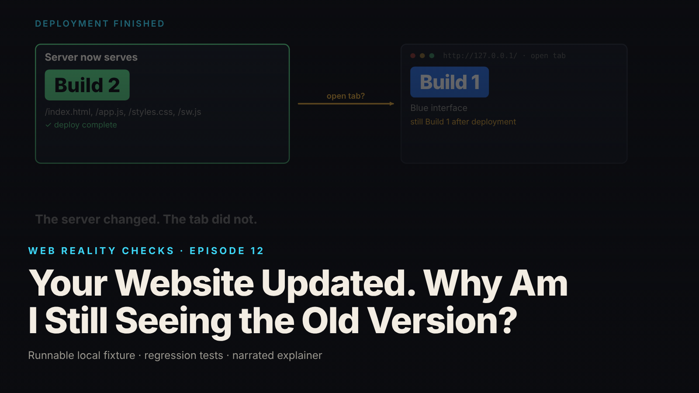

SEO title (≤60 chars): Why a Website Still Shows the Old Version After an Update
Meta description (≤155 chars): The site says it updated, your tab says otherwise, and refreshing does nothing. A plain-language look at one reason that happens and what the fix is.
Slug: sw-update
Primary keyword: website still showing old version   Secondary keywords (3–5): refresh not working, update available notice, why websites cache, browser tab old version, offline web app
Medium tags (5): Technology, Explainer, Web, Browsers, Software

# Your Website Updated. Why Am I Still Seeing the Old Version?

Picture a library that hands out a printed guidebook at the front desk. A new edition arrives this morning. Everyone who walks in from now on gets it. But you came in yesterday, you still have yesterday's copy, and nobody taps you on the shoulder to swap it. Flip back to page one as often as you like; it is still the old book.

That is this episode. A website really did update. A browser tab that was already open really is still showing the old version. Both are true at once, and pressing refresh does not fix it.

## What the episode shows

We built a tiny website in two versions on a laptop: Build 1, blue, and Build 2, green. Nothing here is a real product (local synthetic fixture). We opened Build 1 in a tab, then switched the server to Build 2, which is what "deploying an update" means: from now on the server hands out the green version to anyone who asks. The open tab stayed blue. Refreshing kept it blue.

To be clear: this is one reason a site can look out of date, not the only one. Several others involve different kinds of caching, and this episode is only about this one. Also, the real browser steps were not run where the episode was built. The sequence in the video comes from a model that runs the site's actual code, and the step-by-step browser check is a written checklist in the project. The video says so on screen.

## Why refreshing does not help

Many websites install a small helper in your browser called a service worker. It keeps its own copy of the site's files so pages load quickly and can work offline, and answers your tab's requests from that copy. In the library picture, it is a librarian assigned to you, holding your edition.

When the new edition arrives, the browser hires a second librarian and hands them the new book. But it does not fire the first one while they are still serving a reader. The new librarian stands beside the old one and waits. Your refresh goes to the same old librarian, who hands you the same old book. That is the whole mechanism: the browser will not swap out a page's code while the page is in use, so the update waits.

How long it waits is up to the website, not the browser. Some sites tell the new librarian to take over immediately. The site in this episode shows a small notice, "Update available," with an Approve button, and waits for you to say yes. That is this site's choice, not a browser rule.

## What happens when you approve

In the episode's model run, clicking Approve lets the new librarian step in. The old copy of the site's files is cleared away, only that one site's old copy and nothing else, and the page reloads exactly once. After that single reload the tab is green: Build 2 (local synthetic fixture, model run, not a browser recording). A safeguard makes sure it reloads only once, so the tab never gets stuck reloading itself.

One catch. The librarians work for the whole site in your browser, not for a single tab. Have the same site open in three tabs and approve in one, and all three switch over; in this site's design all three reload. Anything unsaved in the other two is gone. The project documents this as a real risk; it was not run in a browser for the episode.

## What this means for you

- If a site says it has updated and your tab still looks old, you are probably not imagining it. Closing the tab and opening the site again is the ordinary way to get the new version, because a plain refresh can go right back to the old helper.
- If a site shows an "Update available" or "New version, reload" notice, that is the site asking permission to swap. Save your work first, then say yes.
- If you keep the same site open in several tabs, an update accepted in one may reload the others. Save before you approve.

## FAQ

**Why does a website still show the old version after I refresh?**
Some sites keep a helper in your browser that serves the page from its own saved copy. A refresh goes back through that same helper, which still has the old version. Closing the tab and reopening the site, or accepting an "Update available" notice, usually brings the new version. One cause, not the only one.

**Is the website broken?**
Not necessarily. The server may be sending the new version to everyone who opens it fresh, while a tab opened earlier stays on the old one. The browser is deliberately avoiding a code swap in a page you are using. The site's own code decides when the swap happens.

**Will accepting the update lose what I was typing?**
It can, especially in other tabs of the same site that reload at the same moment. Save or copy anything important before you click Approve or Reload. A well-built site warns you about this; the one in the episode does.

## Watch the episode

[YouTube link]

Related episodes: [Why This Beautiful Website Feels Slow](../../ep08/content/article-technical.md) and [Your Dashboard Says 'Live.' Its Data Is Ten Minutes Old.](../../ep17/content/article-technical.md)

> This episode uses a deliberately constructed local fixture with synthetic data. Nothing here is a finding about a real product or company. Fixture, tests and video source: github.com/mizcausevic-dev/web-reality-checks

The new edition is on the shelf. Whether it is in your hands is a separate event, and the site decides when to make the swap.

Miz Causevic, Kinetic Gain LLC
