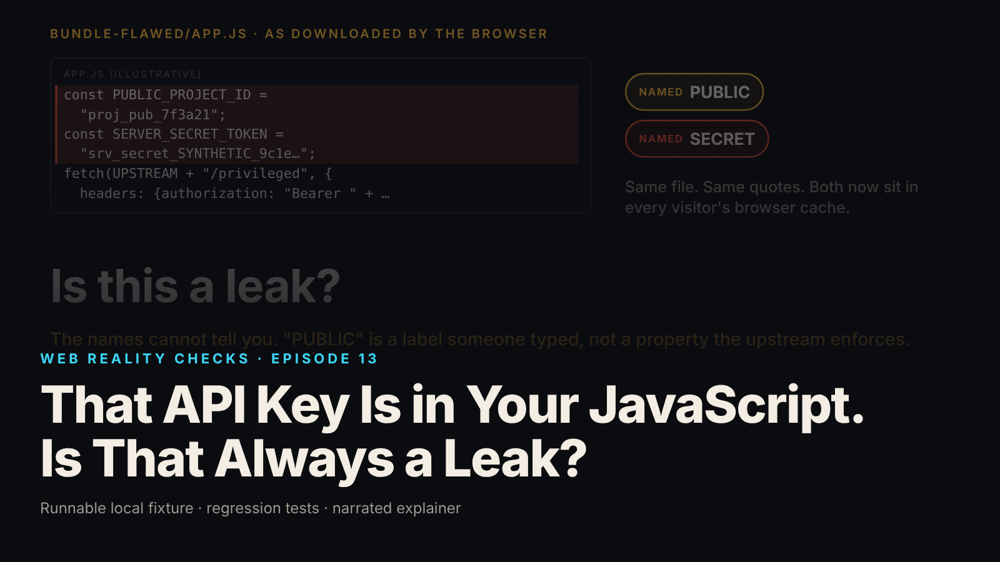

SEO title (≤60 chars): Is a Password in a Website's Code Always a Leak? Explained
Meta description (≤155 chars): Websites send code to your browser, and sometimes that code contains keys. A plain-language look at how to tell a harmless label from a real leaked secret.
Slug: api-key-capability
Primary keyword: website leaked secret   Secondary keywords (3–5): API key explained simply, is my data safe, how websites work, public vs secret key, what is a leak
Medium tags (5): Technology, Privacy, Security, Explainer, Software

# That API Key Is in Your JavaScript. Is That Always a Leak?

Imagine a shop that hands every customer a flyer. Printed on the flyer are two things: the shop's street address, and a copy of the key to the stockroom. Nobody minds the address being on there. It is on the sign outside anyway. The key is a different matter. Every customer who took a flyer can now open the stockroom, and asking for the flyers back does nothing, because people have already photographed them.

That flyer is what a website sends to your browser. Every site you visit delivers a bundle of code to your device so the page can work, and whatever is written in that code is in the hands of every visitor. Sometimes those bundles contain strings that look like keys. The question episode 13 of Web Reality Checks asks is simple: how do you tell the address from the stockroom key?

## What the episode shows

We built a small pretend system on a laptop: a made-up online service, a website that talks to it, and the code that website sends to browsers. Nothing is real, no real company is involved, and both of the "keys" were invented for the demonstration (local synthetic fixture).

Open the website's code and two key-shaped strings fall out. One is labelled public. One is labelled secret. The lazy answer is to trust the labels. The episode does not. Instead it asks the pretend service directly: if someone shows up holding this string, what will you do for them?

Holding the one labelled public and asking for a privileged action, the service says no, status 403, which means "you are not allowed." The string identifies a project, the way an address identifies a building, and that is all it does. Holding the one labelled secret and asking for the same action, the service says yes, status 200, and performs it (local synthetic fixture). That string is the stockroom key. Everyone who downloaded the site had a copy.

Here is the part that matters. The public one turned out to be harmless, but the episode did not know that from its name. It knew because it tried the key in the lock and the lock refused. A label is a promise from whoever wrote it. The lock does not read labels.

## The fix, and the trap inside the fix

The repair sounds obvious: take the key off the flyer. In software terms, the website stops carrying the secret, and a separate part of the system, the backend, which runs on the company's own servers rather than on your device, holds the key instead. When the website needs the privileged action, it asks the backend.

The trap is a backend that does whatever it is asked. Picture a stockroom key kept behind the counter, handed over to anyone who says "stockroom, please." The key is technically off the flyer and nothing has improved. The backend in the episode does three things before it touches the key: it checks that you are signed in, it checks that the action you asked for is one of the few it offers at all, and it checks that your account is allowed to do that one. In the episode a visitor with no account gets 401, a signed-in visitor without the right role gets 403, and the one person who is allowed gets 200. When that allowed person asks for a bigger, destructive action the pretend service would happily perform, the backend refuses with 400 and never makes the call (local synthetic fixture).

Then the episode scans the repaired code the way a stranger would, looking at the JavaScript, the HTML and the configuration the site sends. It finds zero secret-shaped strings. The address is still there, on purpose, because it was tested and refused. And before trusting that zero, the scanner first proves it can find the key in the flawed version, because a detector that has never found anything might just be broken.

## What this means for you

- When you hear that a website "leaked a key," the real question is what that key could do. Some values in website code are addresses: public by nature and harmless. Some are stockroom keys. Nobody can tell which from the name, and a company that says "it is labelled public" has not answered the question. "We tested it and the service refused it" is the answer.
- If a company you use admits a real secret was in its website code, taking it out of the code is only step one. Copies already exist in browsers, caches and search engines. The key has to be cancelled and replaced at the source, the way you would change a lock rather than ask for the key back. If they only mention removal, ask about replacement.
- You cannot see any of this from a working website. The leaking version in the episode worked perfectly, because the key is exactly what made the privileged action succeed. A smooth, polished site tells you nothing about what it handed out along the way.

## FAQ

**What is an API key, in plain terms?**
A string that a website or app shows to another service to identify itself or to prove it is allowed to act. Some keys only identify, like an address. Some authorize actions, like a key to a door. The name on the key does not tell you which; what the service does when shown it does.

**If a key was in a website's code, is my data at risk?**
It depends entirely on what that key could do, which only the issuing service can answer. In the episode, one shipped value could do nothing privileged and one could. The company should say which, based on a test rather than a label, and should rotate any key that could act.

**Why isn't removing the key from the website enough?**
Because your browser, and everyone else's, already downloaded the old version. Caches and search engines keep copies. Until the service that issued the key cancels it, every one of those copies still works. The episode shows the removal and is explicit that replacement is a separate step.

## Watch the episode

[YouTube link]

Related episodes: [Your AI-Built App Works. Is It Safe to Launch?](../../ep01/content/article-technical.md) and [HTTPS Encrypts Your Request. What Can the Network Still See?](../../ep20/content/article-technical.md)

> This episode uses a deliberately constructed local fixture with synthetic data. Nothing here is a finding about a real product or company. Fixture, tests and video source: github.com/mizcausevic-dev/web-reality-checks

An address names a place. A key opens it. Everything else is a label somebody wrote, and the lock has never read one.

Miz Causevic, Kinetic Gain LLC
