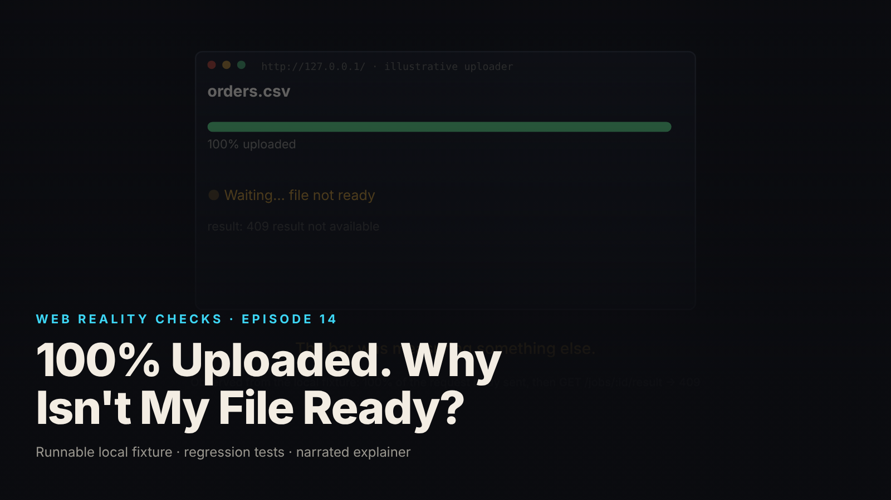

SEO title (≤60 chars): 100% Uploaded Is Not Ready: The Four Stages of a File Upload
Meta description (≤155 chars): A progress bar measures request-body bytes, nothing else. Transfer, acceptance, processing and availability are four stages. A Node fixture shows each one.
Slug: upload-stages
Primary keyword: upload progress bar   Secondary keywords (3–5): XMLHttpRequest upload progress, 202 Accepted job status, multipart overhead, file upload processing state, content sniffing uploads
Medium tags (5): Web Development, Node.js, JavaScript, Software Engineering, UX Design

# 100% Uploaded. Why Isn't My File Ready?



The bar says 100%. The file is not ready. Nothing is wrong with the bar: it was measuring something else, and the interface never said so.

This is episode 14 of Web Reality Checks. An upload is four separate stages, and a single progress bar only ever reports the first. The fixture is a small CSV uploader with synthetic data. It shows a file reach 100%, get accepted, and still not be usable; then a second file reach 100%, get accepted, and fail. Then it replaces the bar with four statuses that each report something the system can measure.

## What actually happens

Pull an upload apart and there are four stages, each settled by a different component:

1. **Transfer.** The request body leaves the browser. `XMLHttpRequest.upload.onprogress` reports `e.loaded` over `e.total`, only when `e.lengthComputable` is true. `fetch()` has no upload progress events, which is why the fixture's browser page uses XHR.
2. **Acceptance.** The server reads the body and answers with a status: here `202 Accepted` plus a job ID, or `413` or `415` with no job. The response arrives after the last byte, as a separate event.
3. **Processing.** A worker parses the stored file and validates rows, ending in `ready` or `failed`. The server does not measure a percentage for this stage, so it does not report one.
4. **Availability.** The result endpoint answers `200` only when the job is `ready`, otherwise `409` with the current status and reason.

The mechanism behind the misleading bar sits in stage 1. The bytes being counted are request-body bytes: multipart part headers, the file, and the boundaries. In the fixture an 82-byte file traveled as a 232-byte request body, 150 bytes of overhead (local synthetic fixture). The bar is accurate about bytes and silent about everything after the socket drains. The server may still reject the body. The worker may still fail the rows. The bar reads 100% in every case, because 100% of the body did leave.

A demo hides this because on the happy path the stages collapse into one visual moment: the bar fills, the server accepts, the worker finishes within the same millisecond, the result appears. You have to build a fixture where the stages can come apart.

## The fixture

`fixtures/ep14-upload-stages/` is a loopback-only Node 22 CSV uploader with zero npm dependencies. `server.mjs` handles a multipart `POST /uploads` and an authorized `GET /jobs/:id` and `/jobs/:id/result`. `worker.mjs` parses and validates in-process. `client.mjs` streams the multipart body in chunks and records progress from bytes written to the socket. `public/index.html` and `public/app.js` are a browser uploader with four stage-specific statuses, provided but not executed, since the build environment has no browser.

Acceptance is decided on the request body's size and content, never on the client's filename or MIME type:

```js
export const MAX_UPLOAD_BYTES = 64 * 1024; // limit on the REQUEST BODY (includes multipart overhead)
export const REQUIRED_COLUMNS = ['id', 'email', 'amount'];

export const sniffCsv = (buf) => {
  if (buf.length === 0) return {ok: false, reason: 'empty file'};
  const head = buf.subarray(0, Math.min(buf.length, 4096));
  if (head.includes(0)) return {ok: false, reason: 'binary content (NUL byte) is not CSV'};
  let text;
  try { text = new TextDecoder('utf-8', {fatal: true}).decode(head); } catch { return {ok: false, reason: 'not valid UTF-8 text'}; }
  const firstLine = text.split(/\r?\n/)[0] ?? '';
  const cols = firstLine.split(',').map((c) => c.trim().toLowerCase());
```

An accepted file is stored under a generated name in a per-process temp directory that is never served, a job record is created, and the `202` says what `202` means:

```js
const sniff = sniffCsv(file.data);                 // decision is made on CONTENT, not on file.filename / file.type
const storedPath = path.join(uploadDir, `${seededId('', 16)}.csv`); // generated name; never derived from client filename
res.writeHead(202, {'content-type': 'application/json', location: `/jobs/${job.id}`});
return res.end(JSON.stringify({accepted: true, ...publicJob(job), storedBytes: file.data.length, requestBodyBytes: r.body.length, note: 'accepted for processing; not processed yet'}));
```

The browser page computes a percentage only when the total is known, and labels what the bytes are:

```js
xhr.upload.onprogress = function (e) {
  if (e.lengthComputable) {
    const pct = Math.round((e.loaded / e.total) * 100);
    bar.classList.remove('indeterminate');
    bar.firstElementChild.style.width = pct + '%';
    set('transfer', pct + '% of request body sent (' + e.loaded + ' / ' + e.total + ' bytes, multipart overhead included)');
  } else {
    bar.classList.add('indeterminate');
    set('transfer', e.loaded + ' bytes sent (total unknown: indeterminate)');
  }
};
```

One detail matters for reading the evidence. The worker's `setPace(ms)` delays the start of processing; tests and demo set it to 400 ms so the not-ready state can be observed through polling. That delay is artificial, labeled in `evidence.json`, and never a measured processing time.

## The test that proves it

`node --test fixtures/ep14-upload-stages/test.mjs` runs eight tests and reports `# tests 8  # pass 8  # fail 0` (local synthetic fixture):

- `success path: 202 accepted -> processing -> ready; result only when ready`
- `stored filename is generated, lives outside public/, and ignores the client name`
- `HTTP rejection: oversized body -> 413, no job created`
- `HTTP rejection: non-CSV content with a CSV filename and MIME -> 415, no job created`
- `KNOWN-POSITIVE CONTROL: trusting the client label alone would have accepted the PNG`
- `processing failure: fully transferred CSV with invalid rows -> job failed with reason; result 409`
- `status access: another user's job -> 404; absent job -> 404; unauthenticated -> 401`
- `uploads directory is not reachable through the served paths`

The success test asserts the stages separately: the last progress event is 100% and `sentBytes` equals the request body length, which is larger than the file; the response is 202; an immediate status read is `accepted` or `processing` and the result endpoint returns 409; after polling, status is `ready` and the result is 200 with 3 rows and `totalAmount` 114.75. It also asserts that at least one poll observed a non-ready state, so the suite fails if the stages ever collapse into one.

The known-positive control is the one most teams skip. It states the flawed policy ("accept if the filename ends in `.csv` or the MIME is `text/csv`"), shows it would accept PNG bytes, then shows `sniffCsv` rejecting them. The assertion message says why: "the flaw must be observable or the content check proves nothing."

`demo.mjs` writes `evidence.json`. From that file (local synthetic fixture; fixture-measured transfer bytes, multipart overhead included): the valid CSV was 82 file bytes in a 232-byte request body, 8 progress events, the last at 100%; response 202 with `job_89b35fbbbe7a`; result before ready 409; five polls saw `accepted`, the sixth saw `ready`; result 200 with `rows: 3`, `totalAmount: 114.75`; the same job as Bob, 404. The poll count varies with scheduling between runs.

## The repair

The server already keeps the stages separate. The repair is in what the interface claims. Replace the single bar with four statuses, each sourced from the component that can measure it:

- **Transfer**, from upload progress events, labeled as request-body bytes with multipart overhead, indeterminate when `lengthComputable` is false.
- **Accepted**, from the HTTP status read in `xhr.onload`. `202` shows the job ID with "accepted ≠ processed." Anything else shows the status and reason and says "fully transferred, not accepted. No job was created."
- **Processing**, as a plain state from the status endpoint. No percentage, because the server does not report one, because the worker does not measure one.
- **Available**, only when status is `ready`, with a link to the result.

Every number on screen traces back to a measurement: socket bytes, a response, the worker finishing. A fabricated processing percentage traces to nothing, which is why the fixture refuses to draw one.

## Retest

From `evidence.json` (local synthetic fixture), the three paths a single bar cannot distinguish:

- **PNG bytes labeled `totally.csv` / `text/csv`.** 210 file bytes in a 361-byte request body, 12 progress events, last at 100%. Response 415, reason "binary content (NUL byte) is not CSV", with `claimedFilename` and `claimedType` echoed back and the note "client filename and MIME type were not trusted." No job created.
- **Oversized body.** 66,576 file bytes in a 66,723-byte request body, 100% sent. Response 413, `limitBytes: 65536`, note "limit applies to the request body, multipart overhead included." No job created.
- **Valid shape, invalid rows.** 81 file bytes in a 231-byte request body, 100% sent. Response 202 with `job_a664e78fb5bf`. Seven polls saw `accepted`, the eighth saw `failed`. Reason: `validation failed: line 3: invalid email "not-an-email"; line 4: amount is not a number "lots"`. Result endpoint 409 with `status: failed`. As Bob, 404.

In all three the transfer stage read 100%. The four-status view shows a green transfer line and a red line somewhere below it, which is the truth.

## What this does not prove

- The browser uploader was provided, not executed. Browser `upload.onprogress` behavior is described from the code, not demonstrated. Transfer numbers come from the Node client's bytes written to the socket.
- All timestamps are `Date.now()` in one loopback process, labeled fixture-measured. They say nothing about real networks or servers, and the 400 ms pacing is artificial.
- For an 82-byte file the parse finishes within the millisecond it starts, so polls see `accepted` and then the terminal state. The `processing` status exists but is too brief to catch here.
- Nothing survives a process restart. Job records are in memory; stored files live in a temp directory removed on close.
- Parsing is not malware scanning. `ready` means the CSV parsed and its rows validated, not that the file is safe; it could still be hostile to a downstream spreadsheet, for example through formula injection.
- The content sniff is a shape check (UTF-8, no NUL bytes, required header columns), not a CSV grammar. Quoted fields with embedded commas are unsupported.
- The session mechanism (`GET /login/:user`) is a test harness, and multipart parsing buffers the whole size-limited body instead of streaming to disk.

## Launch checklist

1. The transfer indicator is labeled as request-body bytes, not file bytes, and goes indeterminate when `lengthComputable` is false.
2. Upload completion and HTTP status are separate UI states; `xhr.upload.onload` never shows success.
3. A `202` is displayed as "accepted, not processed," with the job ID, and triggers polling.
4. Processing is shown as a state the server reports. No percentage is drawn unless something measures it.
5. The result link appears only when status is `ready`; the result endpoint refuses with `409` otherwise.
6. Acceptance is decided by body size and content sniffing; the client filename and MIME type are recorded but never trusted.
7. Stored files use generated names outside anything served, and a test tries to fetch them through served paths.
8. Job status is authorized against the server-side session; another user's job and an absent job return the same `404`.

## FAQ

**Why does my upload progress bar hit 100% before the file is processed?**
Because upload progress events count request-body bytes leaving the browser, nothing more. The server's response, the processing job and the result's availability are three later stages that arrive separately. A bar at 100% means the body was sent, not that it was accepted or processed.

**Does a 202 Accepted response mean the upload succeeded?**
It means the server stored the file and queued a job. In this fixture, a CSV with a bad email and a non-numeric amount received 202 and then failed in processing with a line-level reason. Treat 202 as "check the job status," not as success.

**Should I show a percentage for server-side processing?**
Only if the server measures one. This fixture's worker reports a state (`accepted`, `processing`, `ready`, `failed`) and no percentage, so the UI shows the state and says no percentage is available. An invented figure would trace back to nothing.

## Watch the episode

[YouTube link]

- 00:00 The bar says 100%. The file is not ready.
- 00:09 Four stages: transfer, acceptance, processing, availability
- 00:23 XHR upload events and multipart overhead: 82 bytes travel as 232
- 00:40 202 Accepted means stored and queued; result now is 409
- 00:52 Polling to ready; another user gets 404
- 01:08 Same flow, bad rows: 100% transferred, 202, then failed
- 01:25 The repair: four statuses, no invented percentage
- 01:39 Bytes transferred is not the same as work completed

Related episodes: [You Clicked Pay Once. Why Did the App Create Two Orders?](../../ep15/content/article-technical.md) and [Your Dashboard Says 'Live.' Its Data Is Ten Minutes Old.](../../ep17/content/article-technical.md)

> This episode uses a deliberately constructed local fixture with synthetic data. Nothing here is a finding about a real product or company. Fixture, tests and video source: github.com/mizcausevic-dev/web-reality-checks

Bytes transferred is not the same as work completed. Show the user the stage you can measure, and name the ones you cannot.

Miz Causevic, Kinetic Gain LLC
