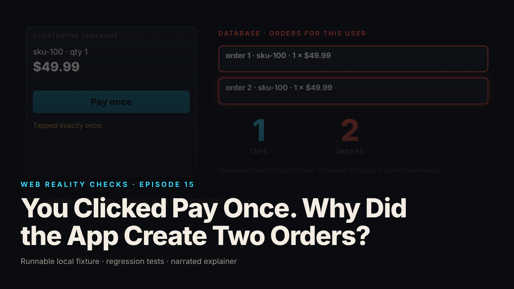

SEO title (≤60 chars): Idempotency Keys: Why a Retry Created a Second Order
Meta description (≤155 chars): A lost response after a database commit makes a retry create a duplicate order. The fixture, the control test, and the atomic idempotency-key repair.
Slug: idempotency-keys-duplicate-orders
Primary keyword: idempotency key   Secondary keywords (3–5): duplicate orders on retry, idempotent POST, exactly-once delivery, unique constraint race condition, lost response retry
Medium tags (5): Software Engineering, Distributed Systems, Node.js, Backend Development, API Design

# You Clicked Pay Once. Why Did the App Create Two Orders?



One tap on Pay. Two orders in the database. The customer did not click twice, and the button was not broken: the first request committed, its response never arrived, and the retry that followed was treated as a brand new intention.

This is episode fifteen of Web Reality Checks. The whole episode is a single gap between what the server knows (the order exists) and what the client can know (nothing, after a network error), demonstrated on a local fixture with synthetic data, then repaired and retested. The repair is an idempotency key, but the interesting part is where correctness has to live for the key to mean anything.

## What actually happens

Follow one request through the stack. The browser sends `POST /orders`. The server authenticates the session, validates the body, and writes a row. The database commits. From the server's point of view the work is done and a 201 is on its way back.

Now lose the response. Not the request, the response. The socket drops after the commit and before the client reads a status line. The client sees a network error. That error carries no information about the server's state: the commit may have happened, or the request may never have arrived. Both look identical from the browser. This is not a bug in any one library; it is a property of every network. No transport gives you exactly-once delivery, so a client that cares about the outcome must retry, and a retry is a second request.

The vulnerable endpoint has no memory of the first request. It sees a valid POST and inserts again. Two attempts, two orders. Note what did not cause this: a double click. Disabling the Pay button after the first tap does nothing here, because the second request is a deliberate retry after an error, issued by the client's own error handling, a refresh, or a second tab. The fix has to be on the server, and it has to let the server recognize "this is the same intention I already fulfilled."

## The fixture

`fixtures/ep15-idempotency/` is a loopback-only Node 22 mock order service on `node:sqlite` (`DatabaseSync`, in-memory). "Pay" means "insert a mock order row". No payment provider is contacted and no money moves. There are two synthetic users, Alice and Bob, with identity coming only from a server-side session cookie. `X-User-Id` and `body.userId` are read by nothing.

Two endpoints sit side by side. `POST /vuln/orders` inserts one order per request. `POST /orders` requires an `Idempotency-Key` header (8 to 128 characters), scoped to the tuple `(session user, create_order, key)`. The schema puts the guarantee where a race cannot bypass it:

```sql
CREATE TABLE idempotency (
  user_id     TEXT NOT NULL,
  operation   TEXT NOT NULL,
  key         TEXT NOT NULL,
  fingerprint TEXT NOT NULL,
  status      INTEGER NOT NULL,
  body        TEXT NOT NULL,
  order_id    INTEGER NOT NULL REFERENCES orders(id),
  created_at  TEXT NOT NULL,
  UNIQUE (user_id, operation, key)
);
```

The fingerprint is SHA-256 of canonical JSON of the validated, normalized fields only (`sku` lower-cased, `currency` upper-cased, `qty` and `amountCents` as integers). Field order and casing do not change it. A different quantity does. Because validation drops everything else, a client-supplied `userId` cannot reach the fingerprint either.

The corrected write is one transaction. The order row and the idempotency record are inserted together, and the `UNIQUE` constraint decides who wins:

```js
sql.exec('BEGIN IMMEDIATE');
try {
  const orderId = Number(insOrder.run(userId, fields.sku, fields.qty, fields.amountCents, fields.currency, via, now()).lastInsertRowid);
  const body = JSON.stringify({endpoint: 'corrected', orderId, authenticatedAs: userId, sku: fields.sku, qty: fields.qty, amountCents: fields.amountCents, currency: fields.currency});
  insIdem.run(userId, operation, key, fingerprint, 201, body, orderId, now());
  sql.exec('COMMIT');
  return {kind: 'created', status: 201, body, orderId};
} catch (e) {
  sql.exec('ROLLBACK'); // the order insert is undone with the failed key insert
  if (/UNIQUE constraint failed/.test(e.message)) {
    return resolveExisting(getIdem.get(userId, operation, key), fingerprint);
  }
```

A losing writer hits the constraint, its transaction rolls back (order insert included), and the stored record is returned instead. If the stored fingerprint matches the incoming one, the response is the original 201 with `Idempotent-Replayed: true`. If it differs, the response is 422: the key was reused for a materially different request.

The controlled fault is three lines in the response path. The write has already committed either way:

```js
const respond = (req, res, code, body, headers) => {
  if (req.headers['x-fault'] === 'lose-response') { res.socket?.destroy(); return; } // commit happened; response lost
  json(res, code, body, headers);
};
```

The client sees `UND_ERR_SOCKET` and cannot tell whether the commit happened. That is the real-world ambiguity, reproduced on demand.

## The test that proves it

`node --test fixtures/ep15-idempotency/test.mjs` reports `# tests 13  # pass 13  # fail 0` (local synthetic fixture). The names state the contract:

- `unauthenticated POST is rejected on both endpoints`
- `KNOWN-POSITIVE CONTROL: lost response + retry on the vulnerable endpoint creates TWO orders`
- `corrected endpoint: lost response + retry with the same key creates ONE order (two attempts)`
- `corrected endpoint: Idempotency-Key is required`
- `same key, same request (different field order / casing) -> identical stored result, no new order`
- `same key, materially different request -> 422 and no new order`
- `concurrent same-key requests -> exactly ONE order; the second waits and receives the stored result`
- `DB layer: the UNIQUE constraint alone (pre-check skipped) resolves a lost race and rolls back the extra order`
- `control: concurrent requests on the vulnerable endpoint create N orders`
- `different logical purchases need different keys -> two orders`
- `keys are scoped to the session user: Bob reusing Alice's key gets his own order, not hers`
- `client-supplied user id is ignored: body.userId / X-User-Id cannot move the order or the key scope`
- `invalid payload is rejected before any write, and does not create an idempotency record`

Two of these deserve attention. The known-positive control asserts that the vulnerable endpoint ends with two orders after a lost response and one retry. Its assertion message says why: "the flaw must be observable or the fix test proves nothing." Without it, a passing retest on the corrected endpoint could be passing because the fault injection silently stopped working.

The DB-layer test is the one that proves where correctness lives. It calls `createOrderIdempotent` with `skipPrecheck: true`, so the optimizing `SELECT` before the transaction never runs, then writes the same key twice plus a third time with a different quantity. Result: one `created`, one `replayed` with the same `orderId`, one `mismatch` with status 422, and exactly one order row. The `UNIQUE` constraint and the transaction alone resolve the race. No check-then-insert logic decides the outcome, which matters because check-then-insert is exactly the pattern that loses under concurrency: two requests both read "no record", both insert, two orders.

## The repair

Generate one idempotency key per logical checkout attempt on the client and send it on every retry of that attempt. On the server, scope the key to the session user and the operation name, never to any identity the client claims. Validate and normalize the body, derive a fingerprint from the validated fields, and write the order and the idempotency record in one transaction with a `UNIQUE` constraint on `(user_id, operation, key)`.

Three decisions in the fixture are policies, documented in its README, not universal laws. First, concurrent in-flight requests with the same key wait for the first writer and then receive the stored result, with `Idempotent-Waited: true`. An immediate 409 would be an equally valid policy. Second, idempotency records live for the lifetime of the in-memory test database. That is not a recommendation of indefinite retention in production. Third, a same-key request whose fingerprint differs returns 422 rather than being silently honored or silently replayed, because a changed quantity is a different purchase, and a key that silently covers two different purchases is worse than no key at all.

The in-process wait map and the pre-read are optimizations. If you deploy on more than one node, the map does not span nodes. The database constraint does. That is why the guarantee is placed in the constraint and the test that skips the pre-read exists.

## Retest

From `evidence.json` (local synthetic fixture), same order payload throughout: `SKU-100`, `qty` 1, `amountCents` 4999, `USD`.

- Vulnerable, lost response then retry: attempt 1 `UND_ERR_SOCKET`, attempt 2 status 201. Order count 2.
- Corrected, lost response then retry, one key: attempt 1 `UND_ERR_SOCKET`, attempt 2 status 201 with `Idempotent-Replayed: true` and the same `orderId` (1) the first request committed. Order count 1.
- Corrected, same key, `qty` changed from 1 to 3: status 422, body `idempotency key reused with a different request`. Order count still 1.
- Corrected, five concurrent requests with one key: all five status 201, all five return `orderId` 1, four replayed, four waited. Order count 1.
- Corrected, two purchases with two keys: two status 201 responses, order count 2.

The last line is as important as the first. Idempotency is not deduplication of similar-looking orders. A customer who buys the same item twice on purpose gets two orders because the client generated two keys. The key identifies the attempt, not the cart.

## What this does not prove

The brief and both READMEs are explicit about scope.

- Nothing here gives exactly-once network delivery. The repair makes a repeated request safe; it does not make repetition impossible.
- The transaction covers the local `orders` and `idempotency` rows only. A real payment-provider call is an external side effect outside that transaction. It needs its own idempotency key at the provider and a reconciliation path. Not modeled, not tested.
- Record expiry is not implemented. In a service that expires idempotency records, a retry arriving after expiry would be treated as a new request. Stated, not demonstrated.
- The lost response is a deliberate server-side socket destroy, not a real network partition. The order counts, statuses and headers are actual fixture outputs; the fault is simulated.
- Single process, single SQLite connection. Multi-node deployments need the same `UNIQUE` constraint in the shared database.
- The session harness (`GET /login/:user`) is not production authentication. The vulnerable fixture binds to 127.0.0.1 on an ephemeral port and must never be deployed.
- `node:sqlite` is experimental in Node 22 and prints an `ExperimentalWarning`.

## Launch checklist

1. Every state-changing endpoint that a client may retry accepts an idempotency key, and the client generates one key per logical attempt and reuses it on every retry of that attempt.
2. The key is scoped server-side to the authenticated user and the operation. No client-supplied user ID participates in the scope.
3. Uniqueness is enforced by a database constraint, not by a read followed by a write. A test exists that skips any pre-read and still ends with one row.
4. The result record and the business row are committed in one transaction, so a rolled-back write leaves no orphan on either side.
5. A fingerprint of the validated, normalized request is stored with the key, and a same-key request with a different fingerprint is rejected (422 in this fixture) rather than replayed.
6. The policy for concurrent in-flight requests with the same key (wait, or 409) is written down and tested.
7. The retention period for idempotency records is written down, and the consequence of expiry (a late retry counts as new) is stated to whoever owns the client retry policy.
8. Any external side effect, above all a payment-provider call, carries its own provider-side idempotency key and has a reconciliation path, because the local transaction does not cover it.

## FAQ

**What is an idempotency key and how does it prevent duplicate orders?**
It is a unique value the client generates once per checkout attempt and sends with every retry of that attempt. The server stores it with the result in the same transaction as the order, under a unique constraint. A retry with the same key gets the stored result back instead of a second order.

**Why does disabling the Pay button not prevent duplicate orders?**
Because the duplicate comes from a retry after a lost response, not a double click. The client's error handling, a page refresh or a second tab can all resend the request. Only the server can recognize the second request as the same intention, which is what the idempotency key is for.

**Should an idempotency key be checked with a SELECT before the INSERT?**
A pre-read is fine as an optimization, but correctness must not depend on it. Two concurrent requests can both read "no record" and both insert. Put a unique constraint on (user, operation, key) and write the order and key record in one transaction; the losing writer rolls back.

## Watch the episode

[YouTube link]

- 00:00 One tap, two orders
- 00:10 The first request commits order 1
- 00:19 The response is lost after the commit
- 00:32 The client retries (a disabled button would not help)
- 00:42 The vulnerable endpoint inserts again
- 00:48 The repair: key, scope, fingerprint, one transaction, UNIQUE
- 01:09 Retest: commit, lose the response, retry with the same key
- 01:18 Two attempts, one order; 422; five concurrent, one order
- 01:28 Limits: payment provider, record expiry

Related episodes: [Your Webhook Arrived Twice. Then an Older Update Arrived.](../../ep18/content/article-technical.md) and [One Click. Three Purchase Events. Here's What Went Wrong.](../../ep02/content/article-technical.md)

> This episode uses a deliberately constructed local fixture with synthetic data. Nothing here is a finding about a real product or company. Fixture, tests and video source: github.com/mizcausevic-dev/web-reality-checks

A new request is not always a new intention. Give the client a way to say "same attempt," and give the database, not the handler, the job of enforcing it.

Miz Causevic, Kinetic Gain LLC
