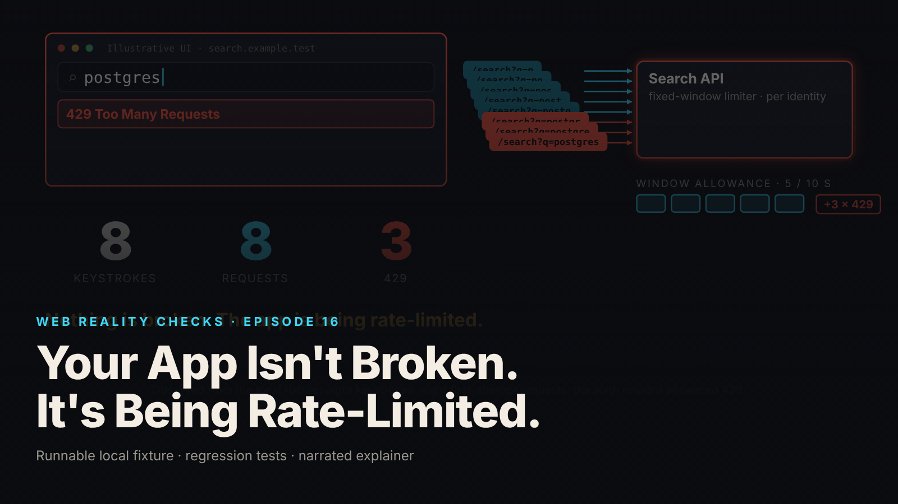

SEO title (≤60 chars): Search Feels Broken? Your App May Be Rate-Limiting Itself
Meta description (≤155 chars): Users type, results stall or show the wrong thing, and nothing in the logs says "error." How a request budget gets spent on keystrokes, and what to ask.
Slug: rate-limit-429-search
Primary keyword: API rate limiting explained   Secondary keywords (3–5): 429 errors in production, search feels slow, vendor API limits, request budget, product reliability questions
Medium tags (5): Product Management, Startup, Software Development, SaaS, Leadership

# Your App Isn't Broken. It's Being Rate-Limited.

## The symptom as a business event

Support tickets start arriving. "Search is broken." "I typed the customer's name and got results for a different customer." "It just spins." Engineering checks the dashboards: no outage, no error spike, the API is answering. The vendor whose search API you pay for says their service is healthy, and they are right. The app is being rate-limited, and the thing doing the limiting is the app's own typing behavior.

That is the event this episode reproduces on a local fixture with synthetic data. A search box sends one request per keystroke. The API allows five requests per ten seconds per signed-in identity. "Postgres" is eight keystrokes. The sixth request is refused with status 429, "Too Many Requests", and a header saying how long to wait. The flawed app does not read the header. It retries at once, and is refused again, and again. Eight keystrokes became 17 requests and 12 refusals, and the results list showed matches for the letter "p" while the box said "postgres" (local synthetic fixture).

The corrected app, driven through identical typing, made 1 request, was refused 0 times, and showed results for "postgres" (local synthetic fixture).

## Why a demo cannot show this

A demo is one person typing at a comfortable pace into an app with a fresh budget. The limiter never trips. Even when the presenter types quickly, a slightly stale results list looks like a loading delay rather than a defect.

The failure needs three things demos do not have: a real request budget, a user who types a full word without pausing, and a slow response for a short prefix arriving after a fast one for a long prefix. The fixture constructs all three. In production they arrive on their own, usually on the busiest day, when the budget is tightest and the typing fastest.

A 429 is also a correct, intended response from a server doing its job. Monitoring that counts errors will often count it as nothing at all.

## The mechanism in plain terms

Think of a toll road with a per-car pass good for five trips every ten minutes. A driver who makes a wrong turn and loops back through the toll, then does it again, burns the pass on corrections and is turned away at the gate. The attendant hands over a note: "come back in three minutes." A driver who ignores the note and tries again right away is turned away again. The road is not broken. The pass is spent.

The search box is the driver. Each keystroke is a trip. A user who types "postgres" without pausing makes eight trips in under a second, and only the first five count. The flawed client then ignores the note and keeps circling. The analogy holds because the budget really is per identity and per time window, the refusal carries a wait time in this fixture, and retrying before that time accomplishes nothing.

The corrected client waits until the user stops typing for a quarter of a second, so a full word becomes one trip. It numbers each request and only shows a result if it is still the newest, so a slow answer for "p" cannot overwrite a fast answer for "postgres". It cancels requests no longer wanted. And when refused, it reads the wait time, rounds it up, waits, and retries once, canceling even that if the user has moved on.

One caution: not every real API sends the wait-time note. The corrected client has a fallback for when it is missing.

## What to ask your team or vendor

1. For every search or autosuggest box, does the app wait for a pause in typing before sending, and how long? Ask for the number.
2. When a slow response arrives after a faster one for a newer query, what does the user see? Ask whether out-of-date answers are discarded, and ask to see the test.
3. What does the app do on a 429? If "retry", how many times, how long does it wait, and does it read the server's wait time when given?
4. Is retry behavior different for actions that change data, like placing an order, than for reads like search? It must be. Retrying a write can create duplicates; episode 15 covers that.
5. Is there a deliberately flawed client that the tests catch bursting and showing stale results? If the tests cannot see the flaw, a pass on the fixed version proves little.

Vague answers mean "we have not looked," not "fine."

## What it costs if ignored

No invented figures, only the shape of the cost.

The direct cost is budget. If you pay a vendor per request or per tier, a client that fires on every keystroke and retries into a wall pays for requests that return nothing, and those wasted requests may be the ones that push you into the next tier or a hard ceiling that affects every user at once.

The user-facing cost is trust in the feature people touch most. A search box that shows the wrong results, or stalls on the busiest day, reads as "unreliable" even when every backend is healthy. Users do not report "stale results"; they report that search is broken, and engineering spends the afternoon proving it is not.

The hidden cost is misdiagnosis. Because 429 is a correct response and not an error, the symptom lands on the wrong team first: the vendor, the network, the database. The fix is small and in the client, but a team that does not know where to look can spend a long time not looking there.

## FAQ

**Is a 429 error the vendor's fault?**
Usually not. A 429 means the server refused a request because the caller exceeded its allowance, which is the server doing what it was configured to do. The question is why the client exceeded it. In this fixture: one request per keystroke plus immediate retries.

**Will a bigger API plan fix this?**
It raises the ceiling; it does not change the behavior that hits it. A client that sends eight requests for one word and retries immediately on refusal will find the new ceiling too. Fix the coordination first, then size the plan.

**Can our team see this in monitoring?**
Only if monitoring counts 429 responses and stale renders, and most error dashboards do not, because 429 is not a server error. Ask for 429s per user session and a test that catches results shown for an out-of-date query.

## Watch the episode

[YouTube link]

Related episodes: [You Clicked Pay Once. Why Did the App Create Two Orders?](../../ep15/content/article-technical.md) and [Why This Beautiful Website Feels Slow](../../ep08/content/article-technical.md)

> This episode uses a deliberately constructed local fixture with synthetic data. Nothing here is a finding about a real product or company. Fixture, tests and video source: github.com/mizcausevic-dev/web-reality-checks

Coordinate the work. Don't just repeat it faster. Before escalating to the vendor, ask what your own app does between the first keystroke and the first refusal.

Miz Causevic, Kinetic Gain LLC
