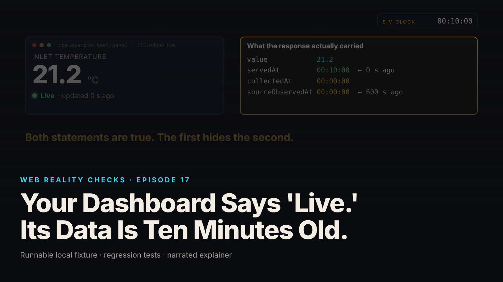

SEO title (≤60 chars): Your Dashboard Says Live. The Measurement Is Ten Minutes Old
Meta description (≤155 chars): A 200 OK response can carry a ten-minute-old reading. A four-stage fixture on one shared clock shows why "Live" lies, and how measurement age fixes it.
Slug: stale-dashboard
Primary keyword: dashboard data freshness   Secondary keywords (3–5): stale data detection, measurement age vs response age, sourceObservedAt timestamp, telemetry pipeline latency, real-time dashboard design
Medium tags (5): Software Engineering, Observability, Data Engineering, Node.js, Dashboard Design

# Your Dashboard Says 'Live.' Its Data Is Ten Minutes Old.



The panel says Live, updated 0 seconds ago. The measurement behind it was observed ten minutes ago. Both are true at the same instant, and the first is hiding the second.

This is episode 17 of Web Reality Checks. The whole episode is one conflation: a dashboard that reports how recently it received a response and calls that number the freshness of the data. We build a four-stage synthetic pipeline on one controlled clock, watch it go stale while every poll returns 200 OK, replace Live with two separate facts, then break the collector and the API.

## What actually happens

A value does not travel from sensor to screen in one hop. Here it crosses four stages, each with its own notion of "now." The source observes a value and stamps it `sourceObservedAt`. A collector samples the source every 600 simulated seconds and stamps `collectedAt`. An API serves whatever the collector last stored and stamps `servedAt`. A browser polls the API every 30 simulated seconds. Four timelines, one value.

The naive dashboard looks only at the last timeline. If the most recent poll succeeded, show Live and "updated N seconds ago" counted from the poll. Every successful poll resets N to zero. That rule answers a real question, "is my connection working?", and presents the answer as if it answered a different one, "how old is the number on screen?"

The two diverge as soon as the collector's interval is longer than the browser's. With 600 second collection and 30 second polling, the browser makes 19 successful requests between collections, all carrying the same `sourceObservedAt`. Response freshness is 0 seconds on every one. Measurement freshness climbs 30, 60, 90, up to 570 seconds. The panel reports only the first number.

Polling faster does not help. The API can only serve what the collector stored. A WebSocket changes delivery, not the upstream sampling schedule, so it delivers the same old reading sooner. The fixture tests the first claim and states the second as reasoning.

## The fixture

`fixtures/ep17-stale-dashboard/` is plain Node 22 ESM with zero dependencies, no sockets, no HTTP and no `Date.now()`. Every stage reads one shared clock advanced explicitly in one-second steps. "Ten simulated minutes" is 600 calls to `advanceSeconds(1)`, not 600 seconds of waiting, hence the on-screen tag SIMULATED PIPELINE · COMPRESSED CLOCK. The clock is monotonic and throws on a negative advance.

No stage rewrites another's stamp. The API is a pure read that never samples; it adds `servedAt` and nothing else:

```js
getLatest() {
  api.requests += 1;
  const servedAt = clock.iso();
  if (api.failing) return {ok: false, status: 503, error: '503 Service Unavailable', servedAt};
  if (!collector.latest) return {ok: true, status: 204, body: null, servedAt};
  return {ok: true, status: 200, body: {...collector.latest, servedAt}};
},
```

`state-rules.mjs` is a pure function with no clock access. Measurement age comes from `sourceObservedAt` alone:

```js
const ageMs = nowMs - obs;
if (ageMs < 0) {
  reason = 'impossible-future';
} else {
  measurementAgeSeconds = Math.floor(ageMs / 1000);
  freshness = measurementAgeSeconds > STALE_THRESHOLD_SECONDS ? 'stale' : 'fresh';
}
```

Two constants are product policy for this fixture only. `STALE_THRESHOLD_SECONDS = 300` labels a measurement older than five minutes stale. `CONNECTION_WINDOW_SECONDS = 90` is three poll intervals. Neither is universal: a daily report or a slow-moving sensor could set the threshold at hours.

The flawed `naiveStatus()` stays in the file as a known-positive control.

## The test that proves it

`node --test fixtures/ep17-stale-dashboard/test.mjs` reports `# tests 12  # pass 12  # fail 0` (local synthetic fixture):

- `shared clock is monotonic and explicit`
- `healthy scenario: successful polls do not reset measurement age; age grows between polls`
- `healthy scenario: the next collection (t=600) refreshes the measurement and age drops`
- `polling faster does not change collectedAt or sample the source faster`
- `collector failure: API still answers 200 with the old reading; dashboard says connected but stale`
- `API failure: failed poll keeps the last known value with an explicit warning; nothing is fabricated`
- `API failure before any reading: no value, unknown freshness, disconnected`
- `future timestamp is flagged impossible-future, never shown as a negative age`
- `missing or invalid timestamps produce an unknown state`
- `stale threshold is the documented policy constant and is applied at the boundary`
- `connection becomes unknown when the last successful poll is older than the connection window`
- `intervals match the brief: collect every 600 s, poll every 30 s`

The second test is the one that matters. It advances 570 simulated seconds and asserts for each of the 19 poll rows that `pollStatus` is 200, `collectedAt` is unchanged, `measurementAgeSeconds` equals the elapsed time `t`, and the naive label is Live with `naiveUpdatedSecondsAgo` 0. The assertion message reads "KNOWN-POSITIVE CONTROL: the naive label resets to 'updated 0 s ago' on every poll." Without it the suite could not see the bug it exists to catch.

`demo.mjs` writes `evidence.json`. Healthy scenario (local synthetic fixture): 19 polls, all 200, `naiveLabel` Live on every one, `measurementAgeSeconds` climbing 30 to 570, first `stale` row at t=330. At t=600 the collector samples again, 21.2 becomes 22.8, and the age drops to 0.

## The repair

Replace Live with two facts, each from the timeline that owns it.

Measurement age is `now - sourceObservedAt`, never `collectedAt`, `servedAt` or the poll time. An arriving response does not reset it, because the response did not make the measurement. The boundary test locks the threshold: 300 seconds is fresh, 301 is stale.

Connection status comes from the last poll alone: disconnected if it failed, connected if it succeeded within the 90 second window, unknown otherwise. Connected and stale can both be true; in the healthy scenario they are, from t=330 to t=570.

Three further documented policies shape the panel under failure. A failed poll retains the last known value with the warning `Last poll failed (503 Service Unavailable); showing last known value.`; the dashboard only replaces its reading when a real body arrives. A future `sourceObservedAt` is flagged `impossible-future` with age `null`, never a negative number. Missing or unparseable timestamps produce `invalid-timestamp`. Warnings are text, never a colored dot: `Measurement is 330 s old (policy threshold 300 s).`

## Retest

From `evidence.json` (local synthetic fixture):

Collector failure. Marked failing at t=570; collections at t=600 and t=1200 fail. The API keeps returning the t=0 reading with 200 because that is the latest it has. At t=1200: `pollStatus` 200, `connection: connected`, `freshness: stale`, `measurementAgeSeconds: 1200`. The naive label still says Live.

API failure. 503 from t=60 to t=120; polls at t=90 and t=120 fail. The value 21.2 is retained, `connection: disconnected`, the warning names the failure, and age continues from `sourceObservedAt`: 120 at t=120. The recovery poll at t=150 returns 200, connected, `collectedAt` unchanged, age 150. Nothing invented, nothing reset.

Polling faster. 5 second versus 30 second polling over 599 simulated seconds: 119 polls versus 19, one collector sample in both runs, identical 570 second age at t=570.

Timestamp checks. A `sourceObservedAt` 45 seconds in the future produces `impossible-future`, age null, connection still connected, because only the measurement is suspect. A missing timestamp and `"yesterday-ish"` both produce `invalid-timestamp`, age null.

## What this does not prove

- One shared clock. Real sources, collectors, APIs and browsers each have their own. Skew, drift and timezone errors between them cause wrong ages, including apparent negative ones, and are not modeled. The `impossible-future` flag exists because production code must expect them.
- No sockets, no HTTP, no real browser. The API and dashboard are in-process objects; status codes are simulated. The on-screen panel is illustrative chrome, not a real product.
- Polling faster does not make the collector sample faster; demonstrated. WebSockets do not fix a stale upstream measurement by themselves; stated, not implemented.
- The 300 second threshold and 90 second connection window are this fixture's policies, not universal values.
- Not tested: garbled responses, clock skew, retries and backoff, multiple sources, aggregation windows.

## Launch checklist

1. Every reading carries its source observation timestamp, separate from when it was collected and served.
2. Displayed measurement age comes from the source observation time, never from the arrival of the response that carried it.
3. Connection health and measurement freshness are separate indicators; the UI can show connected and stale at once.
4. The stale threshold is written down as a product decision for this display, and a boundary test locks it.
5. A failed fetch keeps the last known value with an explicit warning; nothing is fabricated.
6. Future timestamps are flagged, not shown negative; missing timestamps produce an explicit unknown state.
7. A known-positive control exists: a naive "Live" variant the tests assert is misleading.
8. Polling faster or switching to push has been checked against the upstream sampling schedule, not only delivery speed.

## FAQ

**Why does my dashboard say Live when the data is old?**
Because the label is derived from the last successful request, not from when the measurement was taken. Each poll resets the visible age to zero. In this fixture all 19 polls said Live while the measurement aged from 30 to 570 seconds (local synthetic fixture).

**How should a dashboard calculate data freshness?**
Measurement age is now minus the source observation timestamp, carried unchanged through every stage. Compare it against a threshold your product chose and documented. Show connection status separately. The two can disagree, and the UI should say so.


**Does polling more often or using WebSockets fix stale data?**
No. Both change how fast the same stored reading reaches the browser. Neither makes the upstream collector sample sooner. Here, 5 second polling produced 119 polls versus 19 and an identical 570 second age (local synthetic fixture).

## Watch the episode

[YouTube link]

- 00:00 Live, updated 0 s ago. Observed ten minutes ago.
- 00:11 Four timelines: source, collector, API, browser
- 00:26 19 polls, 19 × 200 OK, same reading
- 00:37 Response freshness vs measurement freshness
- 00:46 The fix: measurement age and connection status
- 00:59 Advance the clock; the source value does not change
- 01:09 Age grows past the 300 s policy, still 200 OK
- 01:20 Collector failure, then API failure
- 01:36 Freshly fetched does not mean freshly observed

Related episodes: [Your Website Updated. Why Am I Still Seeing the Old Version?](../../ep12/content/article-technical.md) and [Your Webhook Arrived Twice. Then an Older Update Arrived.](../../ep18/content/article-technical.md)

> This episode uses a deliberately constructed local fixture with synthetic data. Nothing here is a finding about a real product or company. Fixture, tests and video source: github.com/mizcausevic-dev/web-reality-checks

Freshly fetched does not mean freshly observed. Give the measurement its own clock, give the connection its own indicator, and let the panel say both when both are true.

Miz Causevic, Kinetic Gain LLC
