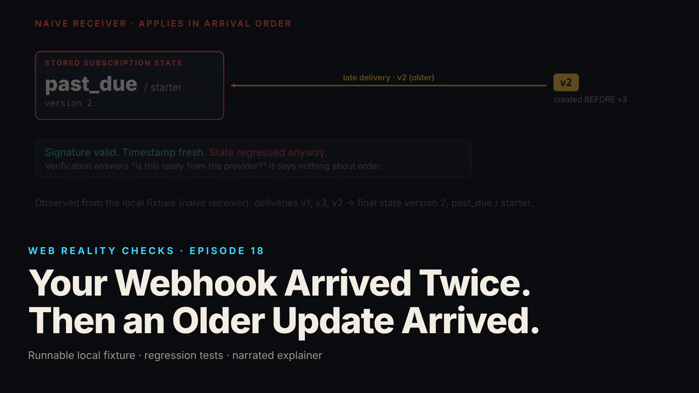

SEO title (≤60 chars): Paid, but Marked Past Due: How Late Messages Confuse Apps
Meta description (≤155 chars): Apps update each other by sending messages, and messages arrive late, twice or out of order. How a real message can set a wrong record, in plain language.
Slug: webhook-duplicates-ordering
Primary keyword: why apps show wrong account status   Secondary keywords (3–5): how apps talk to each other, webhooks explained simply, duplicate notifications, account status wrong after payment, software explainer
Medium tags (5): Technology, Explainer, Software, Internet, Consumer Tech

# Your Webhook Arrived Twice. Then an Older Update Arrived.

Imagine your bank mails you a statement after every change to your account. Monday's says you are overdrawn. Tuesday's says your paycheck landed and you are fine. The carrier delivers Tuesday's first, and Monday's arrives two days late. If you file whichever arrived last as current, your folder says you are overdrawn, and every statement in it is real.

That is the whole of this episode. When one piece of software tells another that something changed, it sends a message. Messages arrive late, twice, or in the wrong order. A program that files each one the moment it lands will sometimes believe an old truth.

## What the episode shows

We built a small, deliberately flawed system on a laptop. One part plays a made-up subscription company, SubHub; the other is the app that listens for its messages. Nothing here is real data, and SubHub is not a real company (local synthetic fixture).

SubHub sends three messages about one customer's subscription, in order: a trial on the starter plan, then past due on starter, then active on the pro plan. The correct final state is active on pro, what the customer paid for.

The messages arrive first, third, then the second one late. The flawed app files each as it comes. After the late "past due" lands on top of "active on pro," the record says past due, starter. The customer paid, the subscription company knows it, and the app has it wrong (local synthetic fixture).

Every message was authentic. Each carried a seal, a cryptographic signature, that the app checked and found valid. The seal proved who sent the letter, not which letter was newest.

## The fix, in plain words

Back to the statements. Three habits keep the folder right. Check the seal on each envelope before reading it, so a forgery never gets in. Keep one copy of each statement, so a duplicate mailed because the first "seemed lost" is not filed twice. And read the statement number: if a lower number arrives after a higher one, note that it came, but do not let it replace the newer page.

The fixed app does these in that order. It checks the seal over the exact bytes received, before reading the contents. It checks the message was sent within the last five minutes, because a real seal on an old letter is still an old letter. It saves the message under its unique ID, and the database refuses the same ID twice. And it updates the subscription only when the message's version number is higher than the stored one; an older version is logged and left alone. All of that is saved as one step, and only then does the app tell SubHub "got it." If saving fails, it says "try again later" and nothing has changed.

Given the same mixed-up deliveries plus a repeat, the fixed app ends on active, pro. Six copies of a new message at the same instant: one filed, five recognized as copies. Six old messages replayed in shuffled order: nothing changed (local synthetic fixture).

One thing the analogy must carry carefully. Skipping the old statement is only safe because each statement shows the whole account. If the letters said "add fifty dollars" and "take away twenty," you could not skip any. SubHub's messages are the whole-account kind, by design. Not every real company's are, and the episode does not claim they are.

## What this means for you

- If an app shows your account as unpaid, downgraded or canceled right after you did the opposite, it may be an old message that arrived late and was filed as new. Take a screenshot, note the time, and contact support; the timing helps them find it.
- "The payment went through" and "the app knows the payment went through" are two facts held by two systems. When they disagree, check the system that took your money first.
- If you build software, or pay people who do: ask what happens when two updates about the same thing arrive in the wrong order, and when the same update arrives twice. The episode has a test for each, plus one proving the flawed version gets it wrong, so the passing tests mean something.

## FAQ

**How can a message be real and still cause a wrong result?**
The seal proves who sent it, not when it should be applied. In the episode every message was authentic. The flaw was treating arrival order as the order things happened, so a late older message overwrote a newer one.

**Why would a company send the same notification twice?**
When it does not hear back quickly, it cannot tell whether your side failed or just replied slowly. Sending again is the safe choice from their side. The receiving app has to recognize the repeat, which the fixed version does by refusing to save the same message ID twice.

**Should the app just use the time stamped on each message?**
Not on its own. The time says when the message was written, not whether a newer one has already arrived, and clocks on different computers disagree. The fixed app uses a version number the sender puts on each message; the time is information only.

## Watch the episode

[YouTube link]

Related episodes: [You Clicked Pay Once. Why Did the App Create Two Orders?](../../ep15/content/article-technical.md) and [Your Dashboard Says 'Live.' Its Data Is Ten Minutes Old.](../../ep17/content/article-technical.md)

> This episode uses a deliberately constructed local fixture with synthetic data. Nothing here is a finding about a real product or company. Fixture, tests and video source: github.com/mizcausevic-dev/web-reality-checks

The newest envelope is not always the newest news. Delivery order is not business order.

Miz Causevic, Kinetic Gain LLC
