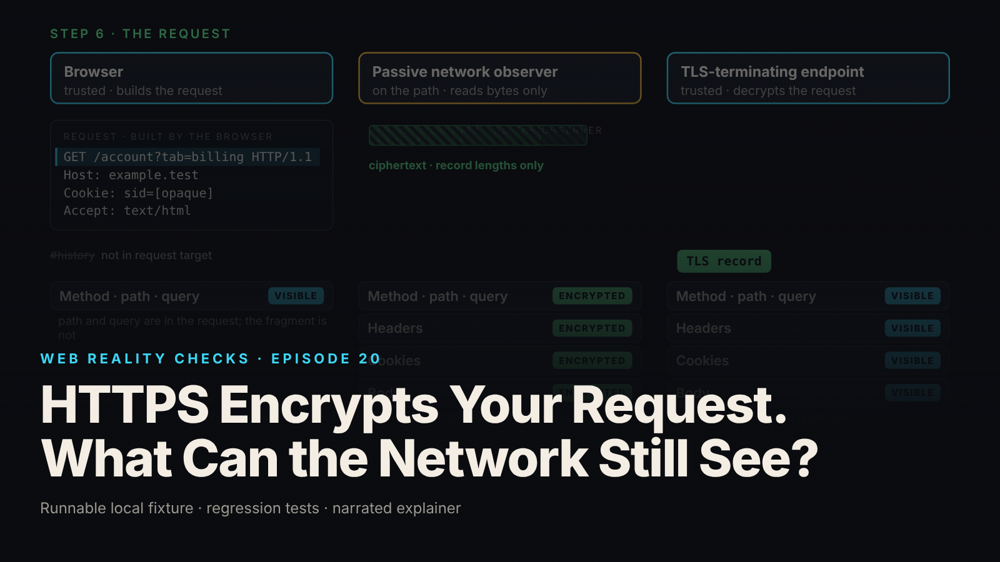

SEO title (≤60 chars): What HTTPS Still Exposes: DNS, IP, SNI and Timing Explained
Meta description (≤155 chars): TLS 1.3 encrypts the request, not the connection around it. A hand-authored visibility matrix shows what a passive observer reads, what it cannot, and why.
Slug: https-visibility
Primary keyword: what HTTPS does not hide   Secondary keywords (3–5): TLS 1.3 metadata, SNI leak, encrypted DNS, Encrypted Client Hello, URL fragment not sent
Medium tags (5): HTTPS, TLS, Web Security, Networking, Privacy

# HTTPS Encrypts Your Request. What Can the Network Still See?



The padlock is on, so the team stops thinking about the network. Then someone asks what a shared Wi-Fi segment can still learn about a user who opens `https://example.test/account?tab=billing#history`, and the answer is not "nothing": the resolved name, the address and port, timing and volume, and, without Encrypted Client Hello, the hostname in the TLS ClientHello.

This is episode twenty of Web Reality Checks, and it differs from the rest of the series: no packet capture, no real TLS session. The environment has no isolated network and no trusted HTTPS, and the brief forbids fabricating captures, so every scene carries the tag `CONCEPTUAL ILLUSTRATION · NO TRAFFIC CAPTURED`. The fixture instead writes down, from the protocol specifications, who can see which part of one HTTPS navigation, and tests that document for consistency. The one thing that executes is a WHATWG URL split.

## Scope, stated up front

Every claim here depends on these assumptions from `scope-notes.md`: TLS 1.3 over TCP (not HTTP/3); plain DNS over an unencrypted transport; no VPN or proxy; no Encrypted Client Hello (ECH); no session resumption or 0-RTT; a trusted browser and TLS-terminating server; a passive observer on the path between the browser and both the DNS resolver and the TLS endpoint, reading bytes and changing nothing. These are illustration assumptions, not every modern browser connection. Real connections commonly use HTTP/3, encrypted DNS, resumption and increasingly ECH, and each changes cells in the matrix.

## What actually happens

Encryption is applied per layer, not to "the connection." The browser first needs an address for `example.test`. With plain DNS, the question crosses the network as cleartext. Whether the observer reads it depends on the DNS transport and on whether it sits between the browser and the resolver; one that only sees the resolver's upstream traffic cannot tell which client asked.

Then TCP. IP headers are never encrypted by TLS, because routers need them. Destination address, port 443, packet times and sizes are visible to anyone on the path. An address alone does not necessarily identify one website: shared hosting and CDNs put many unrelated sites behind one IP.

Then TLS. The ClientHello is the first TLS message and is sent in plaintext, because no keys exist yet. Without ECH, its `server_name` extension carries `example.test`, the name DNS just carried. The ServerHello answers, both sides derive handshake traffic keys, and the rest of the handshake is encrypted. In TLS 1.3 the Certificate message follows inside it, so the observer sees a record length, not a certificate. TLS 1.2 sent it in plaintext.

Then HTTP. The request line `GET /account?tab=billing HTTP/1.1`, the headers, the Cookie header and any body are application data inside TLS records. The observer sees ciphertext, record lengths and timing, which do not by themselves reveal the exact content. The fixture claims no more than that.

Finally the ends. The browser built the request and holds the plaintext. The TLS-terminating endpoint decrypts it and may log it. If a CDN terminates TLS, the CDN edge is that endpoint, and any onward connection to the origin is separate, with its own visibility. And the fragment `#history` never left the browser, which the fixture proves rather than asserts.

## The fixture

`fixtures/ep20-https-visibility/` is plain Node 22 ESM, zero dependencies, no sockets. Its center is `visibility-matrix.json`: 11 hand-authored rows against 3 columns (browser, passive observer, TLS endpoint). Each cell is `visible`, `encrypted` or `not-sent`, with a one-line reason and the scope assumption it depends on. The SNI observer cell:

```json
"observer": {
  "state": "visible",
  "reason": "The ClientHello is the first TLS message and is sent in plaintext; without ECH the server_name extension is readable.",
  "scope": "No ECH. With ECH the inner ClientHello is encrypted and the outer one carries a public name."
}
```

The scope field is the point: a reader can see which cells flip under ECH, encrypted DNS, a VPN or a CDN. Three variants (`ech`, `encrypted_dns`, `cdn_termination`) list what changes and what stays visible.

The only executed code is `url-parts.mjs`, a WHATWG `URL` split of the example:

```js
export function splitUrl(input) {
  const u = new URL(input);
  const defaultPort = u.protocol === 'https:' ? 443 : 80;
  const port = u.port === '' ? defaultPort : Number(u.port);
  // RFC 9110 §7.1 origin-form request-target = absolute-path [ "?" query ]. The fragment is not part of it.
  const requestTarget = u.pathname + u.search;
  return {
    resolutionName: u.hostname, port, requestTarget, fragment: u.hash,
    fragmentInRequestTarget: u.hash.length > 1 && requestTarget.includes(u.hash),
  };
}
```

It is a pure string function; it resolves and connects to nothing. The `192.0.2.10` on screen is an RFC 5737 documentation address used as a label.

## The test that proves it

`node --test fixtures/ep20-https-visibility/test.mjs` reports `# tests 18  # pass 18  # fail 0` (local synthetic fixture). The URL tests, including the control:

- `hostname is the resolution name; https defaults to port 443`
- `request target is path + query`
- `fragment is parsed but absent from the request target`
- `KNOWN-POSITIVE CONTROL: a fragment-like string placed in the query IS in the request target`

The control matters. The fragment test asserts that `history` is absent from `/account?tab=billing`, which could pass vacuously if the function dropped everything. The control feeds `https://example.test/account?tab=billing&h=history` and asserts the same substring is then present in the request target. The test can see the difference, so the pass means something.

The matrix invariants encode the brief's accuracy bullets:

- `observer never sees encrypted HTTP content or the TLS 1.3 certificate (A01, A02)`
- `observer sees metadata in the illustrated scope (A03, A04, A05, A06)`
- `fragment is not-sent to observer and endpoint, matching the URL module (E03)`
- `variants reference real rows/columns and keep IP visible (A07, A08, A09)`

The variants test asserts that encrypted DNS still leaves SNI visible, because the ClientHello carries the name anyway, and that every variant keeps destination IP visible. Coverage tests assert that `accuracy-checklist.md` maps every id `A01–A11`, `S01`, `E01–E04` to a real scene in `script.json` and that every scene carries the illustration tag.

`demo.mjs` writes `evidence.json`. From it (local synthetic fixture): resolution name `example.test`, port `443`, request line `GET /account?tab=billing HTTP/1.1`, fragment `#history`, `fragmentInRequestTarget: false`. Observer tally: 5 visible (DNS question, destination IP, port, timing/volume, SNI), 5 encrypted (TLS 1.3 certificate, method/path/query, headers, cookies, body), 1 not-sent (URL fragment). The browser sees all 11; the endpoint sees 9, never receiving the DNS question or fragment.

## The repair

There is no bug to fix, so "repair" means closing the gap between what a team believes HTTPS does and what it does, with three measures, each partial.

Encrypted DNS (DoH or DoT) moves the question inside TLS to the resolver; the observer sees a connection to a resolver, not the queried name. It does not hide the destination IP of the later connection, and without ECH the SNI still carries the name.

Encrypted Client Hello moves the real `server_name` into an encrypted inner ClientHello; the outer one carries a public fronting name. SNI becomes `encrypted` for the observer. Destination IP, port, timing and volume stay visible, and so does a plain DNS question.

Terminating TLS at a CDN changes who the endpoint is, not whether there is one. The edge reads and may log the plaintext request.

None of these stop phishing, a compromised endpoint or server-side logging; HTTPS never did.

## Retest

From `evidence.json` (local synthetic fixture), the variant deltas match the scope notes: `ech` changes `sni/observer → encrypted` and still lists `destination_ip`, `port`, `timing_volume`, `dns_question`; `encrypted_dns` changes `dns_question/observer → encrypted` and still lists `destination_ip`, `port`, `timing_volume`, `sni`; `cdn_termination` keeps `method_path_query/endpoint → visible`. No variant hides the destination IP, and the suite enforces that.

## What this does not prove

- Nothing was observed on a network. The matrix is derived from RFC 8446, RFC 6066, RFC 9110, RFC 1035 and the WHATWG URL Standard; the tests check its consistency and the brief's invariants, not the wire.
- Record sizes and timings in the video are shapes, not measurements.
- Not covered: HTTP/3 over QUIC, TLS 1.2, resumption, 0-RTT, OCSP stapling, client certificates.
- The fixture claims only that sizes and timing do not by themselves reveal exact content, not that traffic analysis can never infer it.
- Page JavaScript could read `location.hash` and send `#history` in a separate request, outside the illustrated one.
- HTTPS is not claimed to prevent phishing, compromised endpoints or logging.

## Launch checklist

1. Write down which observer you are defending against and where it sits. DNS and SNI visibility depend on position.
2. Decide whether hostnames in transit are sensitive. If yes, plain DNS and plaintext SNI both carry them; encrypted DNS alone fixes one of the two.
3. Know who your TLS endpoint is. A CDN or proxy that terminates TLS reads and may log the full request.
4. Never put secrets in the path or query because "it is encrypted." In transit, yes; in endpoint logs, plaintext.
5. Do not rely on the fragment to keep data off the wire if page JavaScript can read `location.hash` and send it elsewhere.
6. Keep the padlock out of your threat model for phishing and endpoint compromise.
7. State the scope when documenting transport security: version, transport, DNS mode, ECH, resumption.

## FAQ

**What can an ISP see when I use HTTPS?**
Under this episode's scope (TLS 1.3, plain DNS, no ECH, no VPN): the DNS question, destination IP and port, timing and volume, and the SNI hostname. Not the path, query, headers, cookies, body or TLS 1.3 certificate. Encrypted DNS and ECH each hide one name channel, not the address.

**Does HTTPS hide the URL?**
Partly. Path and query are inside encrypted application data. The hostname is not: it travels in the DNS question and, without ECH, in the TLS ClientHello. The fragment is never sent, because RFC 9110's request-target excludes it; the fixture's URL test proves this.

**Does Encrypted Client Hello make browsing private?**
No. ECH encrypts the inner ClientHello, hiding the real server name behind a public fronting name. Destination IP, port, timing and volume remain visible, and a plain DNS question still carries the name. It hides the name in the hello, not everything.

## Watch the episode

[YouTube link]

- 00:00 Navigation and the passive observer
- 00:16 Plain DNS: the question is visible
- 00:30 Destination IP, port 443, timing and volume
- 00:42 ClientHello: SNI names the server
- 00:49 ServerHello: the handshake goes encrypted
- 00:56 TLS 1.3 certificate inside the encrypted handshake
- 01:06 The request: encrypted application data
- 01:18 Both ends hold plaintext; the fragment never left
- 01:32 Encrypted content, visible metadata

Related episodes: [I Changed One DNS Record and Broke My Website](../../ep10/content/article-technical.md) and [The Browser Shows Your Page. What Does the Server Send?](../../ep19/content/article-technical.md)

> This episode uses a deliberately constructed local fixture with synthetic data. Nothing here is a finding about a real product or company. Fixture, tests and video source: github.com/mizcausevic-dev/web-reality-checks

Encrypted content can still travel with visible metadata. Name the observer, the layer and the assumptions, and the padlock becomes a claim you can check instead of a feeling.

Miz Causevic, Kinetic Gain LLC
