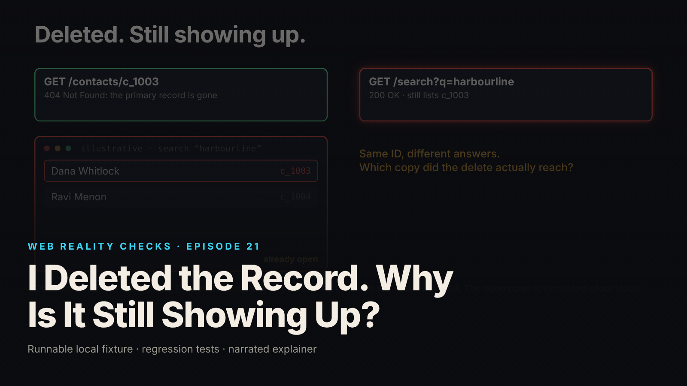

SEO title (≤60 chars): Deleted Record Still in Search? Use an Outbox to Clean Up
Meta description (≤155 chars): A delete returns 404 on the record but search and cache still return it. The fixture, the 20-test suite, and the outbox repair, with its limits.
Slug: deletion-copies
Primary keyword: deleted record still showing in search   Secondary keywords (3–5): transactional outbox, cache invalidation after delete, search index stale data, idempotent cleanup worker, derived data deletion
Medium tags (5): Software Engineering, Backend Development, Databases, Caching, Node.js

# I Deleted the Record. Why Is It Still Showing Up?



The delete succeeded. The primary table has no row for `c_1003`, and `GET /contacts/c_1003` answers 404. Then a search for the same person still returns her, because the search index and the response cache each hold a copy that the delete never touched.

This is episode 21 of Web Reality Checks. The point is a design fact, not a bug in one query: when data has more than one home, deleting it is a workflow, and one `DELETE` performs only the first step. The episode reproduces the failure on a local synthetic fixture, repairs it with an outbox and cleanup worker, injects a fault, and states what remains uncovered.

## What actually happens

One contact, `c_1003`, lives in four places in this fixture:

1. The primary `contacts` table.
2. A `search_index` table holding denormalized copies of the same fields. It has no foreign key to `contacts`, on purpose: it stands in for a separate search system that the primary database cannot cascade into.
3. An in-process response cache, a `Map` keyed by normalized query. A repeat search is served from it without touching the index at all.
4. The browser: a page that already fetched the results keeps displaying them.

A database cascade only reaches what the database owns. The index and the cache are separate stores with their own write paths, and the fetched page lives on another machine. So deleting the primary row leaves three copies answering as if nothing happened. The record lookup reads the primary table and says 404. Search reads the cache or the index and says the contact exists. Each answer is consistent with the copy it read.

The cache adds a twist: it answers a repeated query without consulting the index, so a query cached before the delete keeps returning the old result even after the index is fixed.

## The fixture

`fixtures/ep21-deletion-copies/` is a loopback-only Node 22 service with no npm dependencies. It uses `node:sqlite` in memory for the `contacts`, `search_index` and `outbox` tables, an in-process cache, and a worker that acts only when called: no timers, sleeps or backoff, so every run is deterministic. Contacts are fictional (`example.test` addresses). IDs come from `AUTOINCREMENT`, so a deleted ID is never reused.

The flawed endpoint, `DELETE /vuln/contacts/:id`, calls a function that touches only the primary table:

```js
const deleteContactFlawed = (pid) => {
  const n = parseId(pid);
  if (n == null) return {deleted: false};
  return {deleted: Number(delContact.run(n).changes) === 1};
};
```

The corrected endpoint, `DELETE /contacts/:id`, deletes the row and records the cleanup intent in the same transaction:

```js
const deleteContact = (pid) => {
  const n = parseId(pid);
  if (n == null) return null;
  return tx(() => {
    if (Number(delContact.run(n).changes) !== 1) return null; // absent or already deleted: no second event
    maybeFail('outbox_insert'); // failure here rolls the primary delete back as well
    const ev = insEvent.run(n);
    return {contactId: publicId(n), eventId: Number(ev.lastInsertRowid), cleanup: 'pending'};
  });
};
```

A worker then runs two idempotent steps, in this order:

```js
const stepImpl = {
  search_index: (n) => {
    maybeFail('search_index');
    delIndex.run(n);
  },
  cache: () => {
    maybeFail('cache');
    cache.clear(); // whole-directory invalidation: no dependency tracking is pretended
    cacheStats.clears += 1;
  },
};
```

Cache invalidation clears the entire directory cache on purpose; the fixture does not pretend to track which queries contain which contact.

The already-open browser is not a browser. `client.mjs` defines `BrowserSim`, a plain object that shows the results it fetched earlier until it fetches again. The video tags those scenes `SIMULATED CLIENT STATE`. It models one fact: a server-side delete cannot recall data a client already holds.

## The test that proves it

`node --test fixtures/ep21-deletion-copies/test.mjs` reports `# tests 20`, `# pass 20`, `# fail 0` (local synthetic fixture). The names that carry the argument:

- `CONTROL (known positive): deleting only the primary row leaves the index and the cached response returning the contact`
- `corrected delete: primary row and outbox event are written together; derived copies are untouched until the worker runs`
- `partial failure: cache invalidation fails once after the index entry was removed; event stays pending and stale data is served from the cache`
- `replay: re-running every cleanup step of a processed event is safe and changes nothing else`
- `retries exhausted: explicit failed state, an alert is raised, and the event is NOT silently completed`
- `SIMULATED CLIENT STATE: an already-open display keeps showing the contact after backend cleanup until it fetches again`

The first is the known-positive control. It deletes through the flawed endpoint and asserts a 404 on the record lookup, a cached `harbourline` hit that still includes `c_1003`, an uncached `dana` miss that still returns `c_1003` from the index, and an empty outbox. The last assertion matters: the flawed path records no cleanup intent, so nothing in the system knows other copies need attention. Without this control, a pass on the corrected code would prove nothing.

`demo.mjs` writes `evidence.json`. From it (local synthetic fixture): after the flawed delete, `GET /contacts/c_1003` is 404, the index row is still present, the cached `harbourline` search still returns `c_1003` and `c_1004`, and there are 0 outbox events.

## The repair

The corrected delete returns 202, not 204, because the work is not finished: the body says `"cleanup":"pending"`. Immediately afterward the primary row is gone, but the index row and both cached queries (`harbourline`, `dana`) still hold the contact. That window is tested.

The worker then performs the steps and handles the failure cases explicitly:

- **Idempotent steps.** Index entry first, then cache. Each step is a no-op if its target is already gone, so a retry or replay cannot break anything.
- **Retry runs only what is missing.** The event records `steps_done`, so after a partial failure the next attempt skips the index step.
- **Processed means finished.** `processed` is set only after both steps succeed.
- **Exhaustion is loud.** After 3 attempts the status becomes `failed`, an alert record is appended, and the worker stops picking the event up. An operator can reopen it with `retryFailed`.
- **IDs are not reused.** A replay can never delete a newer contact that reuses the number.

The outbox is easy to oversell. It records cleanup intent in the same transaction as the primary delete, so the system cannot delete the row and forget that cleanup is owed. It does not make the primary database, index and cache update atomically. Between commit and cleanup, the derived copies still return the contact, and the tests assert exactly that.

## Retest

From `evidence.json` (local synthetic fixture), corrected run:

- Attempt 1, with one cache failure injected: status `pending`, attempts 1, `stepsDone` is `[search_index]`, last error `injected failure: cache`. The index entry is gone, but the cached `harbourline` search still returns `c_1003` as a hit, and a simulated-browser refresh during the failure got the same stale hit.
- Attempt 2: status `processed`, attempts 2, `stepsDone` is `[search_index, cache]`. Primary, index and cache are all clean.
- Simulated browser: still displays `c_1003` until refresh. After refresh, `harbourline` returns `[c_1004]` and `dana` returns `[]`.
- Replay twice: state unchanged. The next new contact is `c_1006` and stays indexed.
- Retries exhausted: with the cache fault persisting, 3 attempts end in `failed` with 1 alert. The cache still serves `c_1003`, and a further worker pass returns nothing.

A failed cleanup leaves stale data live. The fixture guarantees only that the failure is visible rather than silent.

## What this does not prove

- This is not a privacy-erasure implementation. Backups, logs, exports, analytics copies and third-party copies are outside the fixture.
- A stale browser display can remain after backend cleanup. Deletion cannot retrieve information a client already downloaded, and the browser here is a client-state simulation, not a real browser. HTTP caches, service workers and multiple tabs were not executed.
- The index is a SQLite table in the same process and the cache is an in-process `Map`: not a real search engine, CDN or shared cache.
- Whole-cache invalidation is a fixture simplification, not a recommended design.
- Not tested: concurrent workers, a real process crash mid-step, a search repopulating the cache with pre-delete data after invalidation (that race needs versioned cache writes), retry backoff, durable alert delivery, and authentication on `/admin/*`.

## Launch checklist

1. List every place a record is copied: indexes, caches, replicas, exports, analytics, client storage.
2. Write the cleanup intent in the same transaction as the primary delete.
3. Make every cleanup step idempotent and record which steps are done.
4. Mark an event processed only after all steps succeed; give exhausted retries a failed state and an alert.
5. Never reuse deleted IDs.
6. Keep a known-positive control: a flawed delete your test shows leaving stale copies.
7. Document what clients may still display after a delete, and when they fetch again.
8. State which copies (backups, logs, third parties) the workflow misses.

## FAQ

**Why does search still show a deleted record?**
Search usually reads a separate index or a cached response, not the primary table, and deleting the primary row touches neither. Until cleanup removes the index entry and invalidates the cache, search keeps answering from stale copies.

**What is the transactional outbox pattern for deletes?**
You delete the primary row and insert a cleanup event in one transaction. A worker later reads the event and updates the other stores. The event survives a crash, so cleanup is retried. It does not make all the stores change atomically.

**Can I make an already-open page forget deleted data?**
Not from the server. A client keeps what it downloaded until it fetches again. Refetching shortens the window, but deletion cannot retrieve information a client already holds. The fixture shows the old list until refresh.

## Watch the episode

[YouTube link]

- 00:00 Record gone, search still returns it
- 00:11 One contact, four homes
- 00:20 Flawed delete: primary row only
- 00:29 The fix: delete plus outbox event
- 00:46 Partial failure: cache invalidation fails
- 00:56 Retry, replay and exhausted retries
- 01:11 Verify the backend copies
- 01:17 The open page until refresh
- 01:27 What this does not cover

Related episodes: [Your Website Updated. Why Am I Still Seeing the Old Version?](../../ep12/content/article-technical.md) and [You Clicked Pay Once. Why Did the App Create Two Orders?](../../ep15/content/article-technical.md)

> This episode uses a deliberately constructed local fixture with synthetic data. Nothing here is a finding about a real product or company. Fixture, tests and video source: github.com/mizcausevic-dev/web-reality-checks

Deletion is a workflow when data has more than one home. Write down the homes, record the intent with the delete, and test that you can see the copies that remain.

Miz Causevic, Kinetic Gain LLC
