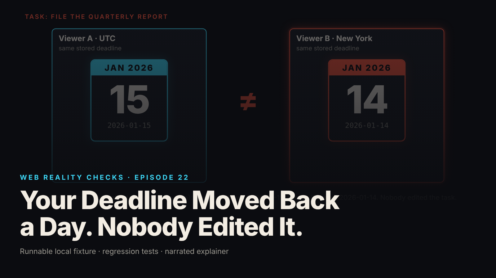

SEO title (≤60 chars): Why Your App Shows the Wrong Deadline in Another City
Meta description (≤155 chars): A deadline that reads Jan 15 on one screen and Jan 14 on another is not a typo. Why demos miss it, what to ask your team, and what it costs if ignored.
Slug: date-only-timezones
Primary keyword: app shows wrong date time zone   Secondary keywords (3–5): deadline date bug, software time zone risk, questions to ask your developers, calendar date vs timestamp, distributed team software quality
Medium tags (5): Product Management, Startup, Software Development, Quality Assurance, Leadership

# Your Deadline Moved Back a Day. Nobody Edited It.

## The symptom as a business event

A customer in New York opens a task and sees a deadline of January 14. A colleague in Tokyo opens the same task and sees January 15. The record was not edited. Someone files a day early, argues the system "moved" the due date, or stops trusting every date in the product.

Support cannot reproduce it, because the engineer who looks sits in a zone where the date is right. The ticket closes, and the same complaint arrives again from another city.

This episode reproduces that event on a local fixture with synthetic data. The task is "File the quarterly report" and the stored deadline is `2026-01-15`. In the flawed version, the fixture shows 2026-01-15 for UTC, 2026-01-14 for New York and 2026-01-15 for Tokyo. In the repaired version, all three show 2026-01-15 (local synthetic fixture).

## Why a demo cannot show this

A demo runs in one place, on one laptop, with sample data typed by the person watching. From that seat the date is correct every time.

The failure needs a viewer on a particular side of the clock. In this fixture, UTC and Tokyo show the right date. New York shows the previous day, and the fixture's tests show Los Angeles does too. If your team and your demo audience all sit on the correct side, the product looks flawless, and the first person to find the bug is a customer on the other side.

## The mechanism in plain terms

Software handles two kinds of time values, and they behave differently.

A calendar date says "the 15th" and means the same thing for everyone: a deadline, a birthday, an invoice date. A moment says "the instant it was 15:00 on the world's reference clock": a meeting, a payment timestamp. Each person's wall clock reads that instant differently.

Think of a birthday versus a flight departure. Your birthday sits on one square of the wall calendar whether you are in Boston or Tokyo. A flight leaves at one instant, and each city's departure board shows its own local time, sometimes on a different calendar day. Both are correct. Treating a birthday like a departure time moves it from square to square, which is what happened to the deadline.

In the fixture, the software took the stored date, assumed midnight on the reference clock, and showed that moment on each viewer's local clock. Midnight on the reference clock is 7 in the evening on the 14th in New York. That is the lost day.

The meeting in the same task shows the correct behavior for a moment. It is fixed at 15:00 on the reference clock and shows 10:00 in New York and 00:00 in Tokyo, where it is already the 16th (local synthetic fixture). The deadline should not have been converted at all.

The repair checks that the deadline is a real date, so a day like February 30 is rejected, and displays it as written. No conversion, so no viewer loses a day. Shifting the stored time to noon does not work: it looks right in New York and Tokyo, but a zone far ahead of Tokyo still shows the 16th.

## What to ask your team or vendor

1. For each date field in the product, is it a calendar date or a moment in time? Ask for the list.
2. Where do we convert dates between time zones, and why is that conversion there for a deadline? If the answer is "the library does it by default," that is the bug.
3. Do our tests display a date-only value from a zone behind the reference clock and a zone far ahead of it? Ask to see the test.
4. Do we store zones by name, like America/New_York, or by a fixed offset like minus five hours? A fixed offset is right in winter and wrong in summer for places that change their clocks. The fixture's New York is UTC-05:00 in January and UTC-04:00 in July.
5. How do recurring schedules, such as "every Monday at 9 local time," survive clock changes? This episode does not test that, so do not assume it works. Ask for evidence.

Vague answers mean the behavior is unknown, not safe.

## What it costs if ignored

No invented figures here, only the shape of the cost.

Trust in the data comes first. A user who sees two deadlines for one task will not debug the clock. They will decide the product is unreliable and keep their own spreadsheet.

Real-world mistakes come next. A deadline that reads a day early produces rushed work. One that reads a day late produces a missed filing, a missed renewal, or a disputed contract date. The software announces neither error.

Engineering time follows. The bug is hard to reproduce, so the first investigation tends to end with "works on my machine." A team that fixes one screen at a time may leave the same conversion in the export, the email reminder and the calendar feed.

## FAQ

**Why does my app show a different date in another country?**
A deadline stored as a plain date can be turned into a moment in time and then shown on each viewer's local clock. Depending on which side of the reference clock the viewer sits, the date can shift by a day. The fix is to treat deadlines as dates and never convert them.

**Is this a problem only for international companies?**
No. In the fixture, New York alone shows the wrong day. Any customer, contractor or server in a zone behind the reference clock can see it.

**Will switching to a newer date library solve it?**
Not by itself. The mistake is treating a date as a moment, and a library can make either choice. This fixture uses no date library: it validates the string and displays it.

## Watch the episode

[YouTube link]

- 00:00 Same deadline, two screens
- 00:07 The stored value is a plain date string
- 00:17 new Date reads it as UTC midnight
- 00:27 New York shows the 14th, Tokyo the 15th
- 00:41 A deadline is a date, a meeting is an instant
- 00:51 The repair: validate, then render
- 01:03 Retest: the meeting converts correctly
- 01:15 What this does not cover

Related episodes: [Your Dashboard Says 'Live.' Its Data Is Ten Minutes Old.](../../ep17/content/article-technical.md) and [Your Webhook Arrived Twice. Then an Older Update Arrived.](../../ep18/content/article-technical.md)

> This episode uses a deliberately constructed local fixture with synthetic data. Nothing here is a finding about a real product or company. Fixture, tests and video source: github.com/mizcausevic-dev/web-reality-checks

A deadline is a date, not a moment. Before launch, ask which of your fields are which, and ask to see the test that views them from a zone your team does not live in.

Miz Causevic, Kinetic Gain LLC
