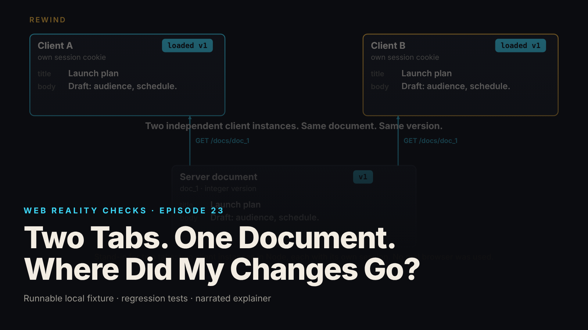

SEO title (≤60 chars): Lost Update Bug: Fix It With expectedVersion and a 409
Meta description (≤155 chars): Two tabs save the same document and the older copy wins with a 200 OK. See the fixture, the atomic conditional UPDATE, the 409 repair and its limits.
Slug: optimistic-concurrency-lost-update
Primary keyword: optimistic concurrency   Secondary keywords (3–5): lost update, 409 conflict, expectedVersion, atomic conditional UPDATE, last write wins
Medium tags (5): Software Engineering, Web Development, Databases, Node.js, API Design

# Two Tabs. One Document. Where Did My Changes Go?



Tab A saves a new title and the server answers 200 OK. Tab B saves a body edit a moment later, the server answers 200 OK again, and the old title is back with no error anywhere.

This is episode 23 of Web Reality Checks, and it is the lost update problem: an endpoint that accepts unconditional writes cannot tell a current edit from a stale one, so the last request to arrive wins. The repair is small. What makes it correct is where the check lives.

## What actually happens

When a tab loads a document, it keeps a local copy: title, body and, in this fixture, a version number. The user edits one field, and a typical client saves by sending the whole document, not just the changed field. That detail is the trap.

Tab A and tab B both loaded version 1. A changes the title. B changes only the body, but B's local copy still carries the old title, and B's save request carries it too. The flawed endpoint runs one statement: set the title and body on the row where the ID matches. It never asks which version B was looking at, because it has no way to ask. The database applies the statement, A's title is overwritten by B's stale one, and both requests return 200.

Nothing failed, so nothing is logged. Each request was valid on its own. The bug lives in the relationship between the two requests, and a single-user demo never creates that relationship.

## The fixture

`fixtures/ep23-optimistic-concurrency/` is a loopback-only Node 22 document service built on `node:http` and `node:sqlite`, with zero npm dependencies. It has three synthetic users and two documents. "Two tabs" are two independent `EditorClient` instances in Node, each with its own session cookie and local copy. No real browser was used, and the video says so on screen.

The store keeps the flawed and corrected writes side by side in `db.mjs`:

```js
const flawedQ = sql.prepare('UPDATE docs SET title = ?, body = ?, version = version + 1, updated_by = ? WHERE id = ?');
// THE corrected statement: match document id AND current version; replace content; increment version.
const condQ = sql.prepare('UPDATE docs SET title = ?, body = ?, version = version + 1, updated_by = ? WHERE id = ? AND version = ?');
```

The only difference is `AND version = ?`. The corrected function then lets `changes` decide, with no read in front of it:

```js
updateIfVersion: (id, expectedVersion, {title, body}, userId) => {
  const r = condQ.run(title, body, userId, id, expectedVersion);
  const changes = Number(r.changes);
  return {changes, version: changes === 1 ? expectedVersion + 1 : null};
},
```

The route in `server.mjs` turns `changes` into a status. Zero rows matched means 409:

```js
const r = db.updateIfVersion(id, ev, parsed.fields, userId); // ONE atomic conditional UPDATE
if (r.changes === 1) return reply(200, {endpoint: 'corrected', id, version: r.version, ...parsed.fields});
const cur = db.getDoc(id); // read only to REPORT; it plays no part in the decision
return reply(409, {error: 'version_conflict', expectedVersion: ev, currentVersion: cur.version, current: cur});
```

## Why the check must be one statement

The tempting design is a read followed by a write: select the version, compare it in application code, then update. Two requests can both read version 1, both pass the comparison, and both write. The check and the write have to be indivisible.

A conditional UPDATE makes them indivisible. The database evaluates "does the version still match?" and "replace the content and increment the version" as one atomic statement. Two writers holding the same expected version cannot both match, because the first one to run changes the version the second one is looking for. The number of rows changed, 1 or 0, is the only input to the decision.

## The test that proves it

`node --test fixtures/ep23-optimistic-concurrency/test.mjs` reports `# tests 16`, `# pass 16`, `# fail 0` (local synthetic fixture). The README notes the suite was run five times in a row, all green. Selected test names:

- `KNOWN-POSITIVE CONTROL: unconditional update lets B silently overwrite A (lost update)`
- `corrected: A saves (200, version 2); B, same expectedVersion, gets 409 with the current server version`
- `COORDINATED CONCURRENT SAVE (separate threads + connections, barrier): only one same-version update is accepted`
- `only a version mismatch yields 409: the status set across all failure kinds is disjoint`

The first one is the control. It asserts that the flawed endpoint really does lose A's accepted title. Without it, a green test on the corrected path proves nothing, because the test has never been shown to see the bug.

The concurrency tests matter because sequential tests can pass on racy code. A companion HTTP test releases two same-version requests with a barrier so both are in flight together. The thread test uses six worker threads, each with its own SQLite connection to one database file, released by an `Atomics` barrier. Exactly one update reports `changes() = 1` and five report 0.

## The repair

The client sends `expectedVersion` with every save, set to the version it loaded. The server validates it as an integer of at least 1 (otherwise 400), checks the session, checks membership, and only then runs the conditional UPDATE. Authorization is separate from versioning on purpose. A non-member gets 404 whatever version they send, because a 409 body carries document content.

The status policy is deliberate:

- 200: saved, response carries the new version.
- 409: version conflict only, meaning zero rows matched the ID and version.
- 503: SQLite busy or locked, with `Retry-After`. Retryable, not a conflict.
- 500: any other database failure. Not a conflict.

Keeping 409 narrow matters: a lock timeout that returned 409 would show a "someone else edited this" screen to a person whose only problem was a busy database.

The client is half the repair. On a 409 the `EditorClient` keeps the unsaved text exactly as typed, keeps the server's current document, and refuses to save again until `resolve()` is called with `take-theirs`, `keep-mine` or `merged`. It never retries by itself and never merges automatically. An overwriting retry would rebuild the original bug one layer up.

## Retest

From `evidence.json` (local synthetic fixture), both clients load "Launch plan" at version 1:

- Flawed path: A saves the title, 200, version 2. B saves a whole stale document, 200, version 3. The title is back to "Launch plan"; A's change is lost.
- Corrected path: A saves with `expectedVersion` 1, 200, new version 2. B sends `expectedVersion` 1 and gets 409 with `currentVersion` 2. The server stays at version 2 with A's title. B's unsaved text is preserved, and B sent exactly one PUT.
- Explicit resolution: a person chose the merged content (A's title, B's body). Saved with `expectedVersion` 2, it returns 200 and version 3.
- Concurrent saves, same expected version, barrier: 200 and 409, one accepted, final version 2.
- Locked database: a second connection held `BEGIN IMMEDIATE`, the server used a 50 ms busy timeout. Result: 503 `database_busy`, `retryable: true`, not a conflict. The client kept its text; the server stayed at version 1.

## What this does not prove

- No real browsers, no real network, no real-time sync and no multi-process server. Clients are in-process objects.
- The HTTP barrier test runs in one Node process, where the event loop serializes SQLite writes. The thread test exercises parallel connections, in SQLite rollback-journal mode only, not WAL or a networked database. Production databases report lock and timeout errors with different codes.
- This is one integer version per whole document. There is no field-level merge, no history and no deletion.
- It detects conflicting saves. It is not real-time collaboration, not a CRDT and not operational transformation.
- The same idea can travel as an ETag with `If-Match`; this fixture does not test that transport.
- The `x-fault: db-error` header is a fault injector. Do not deploy this server.
- Only status codes, versions and document text are measured. No timings are claimed.

## Launch checklist

1. Every update carries the version the client loaded; a missing or non-integer value gets 400.
2. The version check and the write are one statement, and rows changed decides the outcome.
3. A known-positive control proves the unconditional path loses an update.
4. A barrier-coordinated test sends two same-version saves in parallel and asserts exactly one wins.
5. 409 means version mismatch only. Lock timeouts and other failures use separate, documented statuses.
6. Authorization runs before the version check, so a 409 never leaks content to a non-member.
7. The client keeps unsaved text on conflict, shows both versions, and never retries by overwriting.
8. The record ID is part of the match, so one document's version cannot authorize a write to another.

## FAQ

**What is a lost update in a web app?**
Two clients read the same record, each changes it, and the second write replaces the first with no error on either side. The server accepts both because each request is valid alone. The loss exists only in the combination, so single-user testing misses it.

**How do I return a 409 for a stale save?**
Send the loaded version with the save and run one `UPDATE ... WHERE id = ? AND version = ?`. If zero rows changed, return 409 with the current version and document. Do not read the version first and compare it in application code.

**Does a version number replace real-time collaboration?**
No. It detects that two saves conflict and stops the second one. It does not merge them. Merging while people type needs a CRDT or operational transformation, which this fixture does not implement.

## Watch the episode

[YouTube link]

00:00 Tab A saves, tab B undoes it
00:10 Rewind: two clients load version 1
00:18 A edits the title, B edits the body
00:27 The flawed update: last writer wins
00:39 The repair: expectedVersion and one atomic UPDATE
00:53 Retest: 200 for A, 409 for B
01:04 Compare: a person resolves the conflict
01:15 Limits: 409 vs 503, one winner, not a CRDT
01:32 Before saving, check what you are replacing

Related episodes: [You Clicked Pay Once. Why Did the App Create Two Orders?](../../ep15/content/article-technical.md) and [Your Webhook Arrived Twice. Then an Older Update Arrived.](../../ep18/content/article-technical.md)

> This episode uses a deliberately constructed local fixture with synthetic data. Nothing here is a finding about a real product or company. Fixture, tests and video source: github.com/mizcausevic-dev/web-reality-checks

A save is a claim about what you are replacing. Make the server check the claim in the same statement that acts on it.

Miz Causevic, Kinetic Gain LLC
