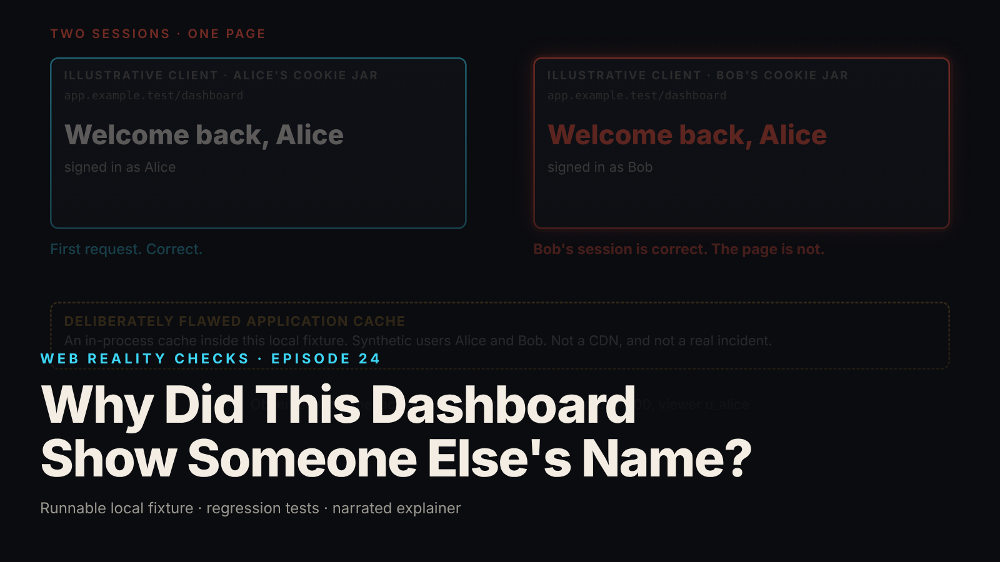

SEO title (≤60 chars): When Your App Shows Customers Each Other's Pages
Meta description (≤155 chars): A customer logs in and sees someone else's name. Why demos miss shared-cache leaks, what the mechanism is, five questions to ask your team or vendor.
Slug: shared-cache-leak
Primary keyword: cache data leak   Secondary keywords (3–5): personalized page caching, customer data exposure, software launch review, vendor security questions, application cache risk
Medium tags (5): Startup, Product Management, Cybersecurity, Software Development, Leadership

# Why Did This Dashboard Show Someone Else's Name?

## The symptom as a business event

A support ticket arrives on a Tuesday: "I logged in and the dashboard said Welcome back, and then somebody else's name." Support asks the customer to log out and back in, and the page shows the right name. Engineering finds no failed logins, no errors, no alerts. The ticket is closed as a glitch.

It was not a glitch. It was a stranger's name, delivered to the wrong person by a system that worked as designed. This episode reproduces it on a local fixture with two synthetic users, Alice and Bob. Alice opens her dashboard: "Welcome back, Alice." Bob signs in with his own account, opens the same page, and reads: "Welcome back, Alice." Bob's response carried Alice's name, Alice's email and the same render number as Alice's (local synthetic fixture).

To be clear about scope: this is a deliberately flawed cache written inside the fixture's own application code. It is not a CDN incident, and the episode makes no claim that CDNs or browsers cache signed-in pages by default.

## Why a demo cannot show this

A demo has one presenter, signed in as one person. The first visit builds the page and stores a copy. Every later visit by that person gets the stored copy, and it is correct, because it is theirs.

The leak needs two different people, in sequence, asking for the same page. Staging often has one test account, and load tests usually hit the page as a single user. The bug shows up only when person A has filled the shared copy and person B arrives next.

It also hides because everything that looks like security is working. Login works, and the session is correct: in the fixture, a lookup of Bob's session says Bob. No alarm fires, because from the system's point of view nothing went wrong.

## The mechanism in plain terms

A cache is a shortcut. Instead of building a page from scratch for every visitor, the system keeps a copy and hands it out again. To know when a copy can be reused, it labels each copy with a short key. Same key, same copy.

Think of a coat check where the ticket only names the cloakroom, not the owner. You hand in a red coat and get a ticket that says "Cloakroom." The next person arrives with a ticket that says "Cloakroom," and the attendant hands over the red coat. The attendant followed the procedure. The ticket did not say whose coat it was.

In the fixture, the key is the page address, `/dashboard`, for every user. Alice's visit stores her page under that key. Bob's visit, a few seconds later, produces the same key and receives Alice's page. The login check ran first and was correct. The cache lookup came after it and never asked whose page it was giving out.

The tempting fix is a setting: tell the cache not to store private pages. The fixture tests exactly that. It runs the flawed code again with a `Cache-Control: private, no-store` header on every response, and Bob still receives Alice's page. The setting is an instruction, and the custom cache never reads instructions.

The repair in the fixture is to stop caching this personalized page in the shared slot. Every request is checked for identity and permission, the page is built for the person asking, the safe header is sent, and the old stored copy is deleted. After the repair, four requests (Alice, Bob, Alice, Bob) produced four separately built pages, each showing only its own user (local synthetic fixture).

## What to ask your team or vendor

1. Which pages or API responses change depending on who is signed in, and where is each one stored or cached on its way to the user? Include caches your own engineers wrote.
2. For each cache, what exactly is in the key? If the response depends on the user, either the user is in the key or the response is not cached. Ask to see it.
3. Is there a test that signs in as two different users, in both orders, and checks that each sees only their own data? Is there a deliberately broken version that the test catches?
4. If we set a privacy header on responses, which components actually read it? A header only works where something implements it.
5. When we fix a leak, who deletes the copies already stored, and what is our plan for the responses already delivered? A fix changes future responses. It cannot recall past ones.

Vague answers mean "unknown," not "safe."

## What it costs if ignored

No invented figures here, only the shape of the cost.

The direct cost is disclosure. A page that showed one customer's name and email to another is personal data in the wrong hands. Depending on jurisdiction and content, that can trigger duties to notify affected customers, and the clock usually starts when you learn of it.

The harder cost is that the fix does not undo the exposure. In the fixture, the repair changes later responses only; the leaked response had already been delivered. You can purge the stored copy. You cannot take back what has already been received.

The slow cost is credibility. A customer who sees a stranger's name on their own dashboard does not wonder how the cache key was built. They wonder what else is visible. Enterprise buyers will ask the questions above, and "we tested for it and purged it" beats "a customer reported it."

The recurring cost is engineering time. The fixture repairs one route, `GET /dashboard`. Every other personalized route behind a shared cache needs the same review.

## FAQ

**Does a privacy header such as Cache-Control: private, no-store prevent this?**
Only where the software that handles the page reads and obeys it. In the fixture, the custom cache ignored the header, and Bob still received Alice's page. The header is a useful instruction, not a guarantee.

**Is this a problem with CDNs?**
This episode does not say so. The fixture is a flawed cache inside the application's own code, and it makes no claim about how any CDN or browser treats signed-in pages. Ask your vendor how their caching treats personalized responses.

**If we fix the cache, are we done?**
No. A fix protects future requests only. Responses already delivered cannot be pulled back, and other personalized pages may share the flaw. Review every personalized route, and decide what to tell people who were already shown the wrong data.

## Watch the episode

[YouTube link]

Related episodes: [Your Website Updated. Why Am I Still Seeing the Old Version?](../../ep12/content/article-technical.md) and [I Deleted the Record. Why Is It Still Showing Up?](../../ep21/content/article-technical.md)

> This episode uses a deliberately constructed local fixture with synthetic data. Nothing here is a finding about a real product or company. Fixture, tests and video source: github.com/mizcausevic-dev/web-reality-checks

A cache key defines which requests you treat as equivalent. Before launch, ask who decided that two different customers are the same request, and ask to see the test where they are not.

Miz Causevic, Kinetic Gain LLC
