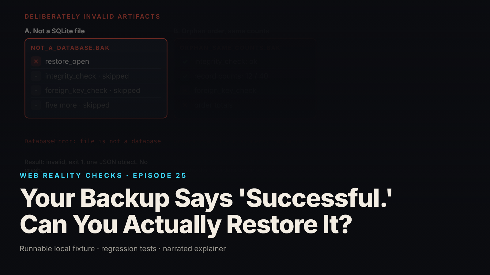

SEO title (≤60 chars): Backup Succeeded. Can You Restore It? SQLite Restore Tests
Meta description (≤155 chars): A SQLite backup reported success. Restoring it into a fresh path and running eight checks shows what "successful" never proved. Fixture, tests, repair.
Slug: backup-restore-tests
Primary keyword: test database backup restore   Secondary keywords (3–5): SQLite backup validation, integrity_check vs foreign_key_check, SQLite Online Backup API, WAL mode backup, backup restore test checklist
Medium tags (5): Databases, SQLite, Backup, Software Engineering, Reliability

# Your Backup Says 'Successful.' Can You Actually Restore It?



The backup job exits cleanly. A file exists and the call returned no error, so the dashboard says "successful." But nothing opened that file or read a row back. You have evidence that bytes were written, not that your data can be recovered.

This is episode 25 of Web Reality Checks. A backup artifact and usable application data are different outcomes, and only a restore plus validation tells you which one you hold. The fixture builds a good backup and five deliberately broken artifacts to show which checks catch which failure.

## What actually happens

A backup tool answers one question: did the copy finish without raising? That describes the process, not the output file. Judging the file is a separate step, and it only happens if someone writes it.

Three things can be wrong with a file written without error.

First, it may not be all the data. A live SQLite database in WAL mode keeps recent committed writes in a separate `-wal` file until a checkpoint merges them into the main file. Copy only the main file and you get a valid SQLite file missing committed data. The copy succeeds and the file opens.

Second, it may be structurally sound and logically wrong. `PRAGMA integrity_check` verifies the file's internal structure: page layout, indexes, record formats. It does not verify that every order points at a customer that exists. That is `PRAGMA foreign_key_check`, and a file can pass the first and fail the second.

Third, it may have the right shape and the wrong values. Counts match, no row is orphaned, and one amount is off. Only a check against known values or the application's own queries notices.

Each failure has its own detector. A single "did it open?" test catches none of the subtle ones, so the restore test must be a set of checks, each aimed at one way the artifact can be wrong.

## The fixture

`fixtures/ep25-restore-tests/` is a synthetic SQLite shop: 12 customers, 40 orders, a fixed seed, and `PRAGMA user_version` set to 3. Application connections turn foreign-key enforcement on because SQLite treats it as a per-connection setting; a plain connection reports it off (local synthetic fixture).

The source runs in WAL mode and is quiescent when the backup is taken, so the expected contents are unambiguous. The backup uses SQLite's Online Backup API through Python's standard library, not a file copy:

```python
src = sqlite3.connect(src_path)
dst = sqlite3.connect(dest_path)
try:
    src.backup(dst, pages=-1, progress=lambda status, remaining, total: pages.append((remaining, total)))
    dst.commit()
    page_count = dst.execute("PRAGMA page_count").fetchone()[0]
finally:
    dst.close()
    src.close()
```

The backup report, from `evidence.json` (local synthetic fixture): `ok: true`, 20480 bytes, 5 pages.

The validator, `validate.py`, never opens the source. It copies the artifact to a fresh temporary directory and runs eight checks on the copy: `restore_open`, `integrity_check`, `foreign_key_check`, `schema_version` (must be 3), `tables`, `record_counts` (12 and 40), `known_values` (five cell values plus a sum of 244580) and `order_totals_query`. It prints one JSON object, never a traceback.

The two checks people conflate sit next to each other:

```python
def integrity():
    r = [x[0] for x in conn.execute("PRAGMA integrity_check")]
    return r, r == ["ok"]
run("integrity_check", ["ok"], integrity)

def fkcheck():
    r = [list(x) for x in conn.execute("PRAGMA foreign_key_check")]
    return r, len(r) == 0
run("foreign_key_check", "no rows", fkcheck)
```

The last check runs the application's real query, the one that renders customer order totals, and compares all twelve rows to totals derived from the seed in pure Python:

```sql
SELECT c.id, c.name, COUNT(o.id) AS orders, COALESCE(SUM(o.amount_cents), 0) AS total_cents
FROM customers c
LEFT JOIN orders o ON o.customer_id = c.id AND o.status <> 'cancelled'
GROUP BY c.id
ORDER BY c.id
```

The real query exercises the join, filter and grouping that users see. A row count never touches them.

## The test that proves it

`node --test fixtures/ep25-restore-tests/test.mjs` runs 16 tests and reports `# tests 16`, `# pass 16`, `# fail 0` (local synthetic fixture). The good-path tests include:

- `good backup restores into a fresh path and every check passes`
- `restored copy contains the backup's data, not later source writes`

The last one is a scope guard. After the backup, the fixture writes order 5001 to the source: 41 orders in the source, 40 in the restored copy. A backup holds a point in time.

The failure tests are why the suite exists:

- `INVALID: a file that is not a SQLite database fails gracefully (structured result, no crash)`
- `INVALID: valid SQLite file missing the orders table passes integrity_check but fails validation`
- `INVALID: wrong schema version is caught by the schema-version check alone`
- `KNOWN-POSITIVE CONTROL: integrity_check does not replace foreign_key_check (orphan order, same counts)`
- `KNOWN-POSITIVE CONTROL: record counts alone do not establish recovery (one wrong value, same counts)`
- `KNOWN-POSITIVE CONTROL: copying only the main file of a live WAL database is not a backup`

From `evidence.json` (local synthetic fixture):

- The text file named like a backup fails at `restore_open` with `DatabaseError: file is not a database`. The other seven checks are skipped, and the validator returns a structured result with exit code 1.
- The orphan artifact has order 23 re-pointed at customer 999 through a plain connection with foreign keys off. Counts stay at 12 and 40, and `integrity_check` returns `ok`. `foreign_key_check` returns one row (`orders`, 23, `customers`) and the order-totals query shows Hugo Placeholder with 2 orders and 16274 where 3 orders and 19911 were expected.
- The wrong-value artifact adds 100 cents to order 23. Integrity, foreign-key and count checks pass. `known_values` and `order_totals_query` fail: Hugo Placeholder expected 19911, found 20011.
- The main-file-only copy of a live WAL database is 4096 bytes while 49472 bytes were still in the `-wal` file. It passes `integrity_check` and `foreign_key_check` and fails the other five data checks. The Online Backup API on the same live database passes all eight.

The known-positive controls matter most. Each broken artifact passes at least one check people commonly treat as proof. If a restore test cannot fail on these, its green result tells you nothing.

## The repair

The flaw is a missing step: restore every backup into a new, isolated path and run independent checks against the copy.

1. **Restore into a fresh path.** The validator opens only a copy. Tests hash `source.db` (and any `-wal` and `-shm` files) and the backup before and after validation to prove nothing changed.
2. **Use the supported backup API.** `sqlite3.Connection.backup()` reads through the SQLite engine and yields one standalone file (`sidecarsNextToBackup` is empty in `evidence.json`).
3. **Name each check.** A result naming the failed check tells the on-call engineer where to look. A boolean does not.
4. **Compare against values from outside the database under test.** Expected totals come from the seed in plain Python, with no SQL, so a faulty query cannot agree with itself.
5. **Return a structured failure.** A broken artifact must not crash the pipeline reporting it.

## Retest

After the suite exists, the same eight checks give these results (local synthetic fixture):

| Artifact | Valid | Failed checks |
|---|---|---|
| Good backup (quiescent WAL-mode source) | yes | none |
| Not a SQLite database | no | restore_open |
| Orders table missing | no | tables, record_counts, known_values, order_totals_query |
| Wrong schema version | no | schema_version |
| Orphan order, same counts | no | foreign_key_check, order_totals_query |
| One wrong amount, same counts | no | known_values, order_totals_query |
| Main file only, live WAL database | no | schema_version, tables, record_counts, known_values, order_totals_query |
| Online Backup API, live WAL database | yes | none |

On the good backup, `integrity_check` returns `ok`, `foreign_key_check` returns no rows, and the order-totals query reproduces all 12 customer totals.

## What this does not prove

- One small synthetic database. No claim about recovery time, recovery point, large databases, or concurrent-write backups beyond the one WAL control.
- Real on-disk corruption (bit rot, torn pages, truncation) is not simulated. The invalid artifacts are built by explicit edits, and no specific SQLite corruption error is asserted. `integrity_check` is shown passing on wrong artifacts, not detecting low-level damage.
- External files, object storage, secrets, infrastructure, encryption, retention and off-site copies are out of scope.
- A passing validation shows the copy matches these checks, not that the application is correct.
- Durations measured on one machine on a 20 KB file are not recovery-time figures.

## Launch checklist

1. A scheduled job restores the latest backup into a new, isolated location and never touches the source.
2. The backup uses the database's supported mechanism, not a main-file copy of a live database.
3. Structural and referential integrity are separate checks, and both must pass.
4. Schema version, tables and counts are asserted.
5. Known values and one real application query are checked against expectations computed outside the database.
6. A deliberately broken artifact is kept as a control, so you can see the suite fail.
7. Validation failures return a structured result and an alert, not a crash or a silent pass.
8. The team has written down what the test does not cover, including recovery time and recovery point.

## FAQ

**Is PRAGMA integrity_check enough to validate a SQLite backup?**
No. It checks internal structure, not whether every order points at an existing customer. In this fixture an orphan artifact returns `ok` from `integrity_check` and fails `foreign_key_check`. Run both, plus value checks.

**Why not just copy the SQLite file to make a backup?**
In WAL mode, recent committed writes can still sit in the `-wal` file. In this fixture's control, a main-file-only copy opened and passed `integrity_check` but failed the schema, tables and count checks. The Online Backup API passed all eight.

**How do I test that a database backup actually restores?**
Restore it into a new path, never over the source, then run independent checks: integrity, foreign keys, schema version, tables, counts, known values and a real application query. Keep one broken artifact so the suite can fail.

## Watch the episode

[YouTube link]

- 00:00 Backup reports success
- 00:10 What success established
- 00:24 Restore into a fresh path
- 00:41 Two checks, two questions
- 00:56 Known values and the real query
- 01:07 Invalid backups fail validation
- 01:27 What this does not cover

Related episodes: [I Deleted the Record. Why Is It Still Showing Up?](../../ep21/content/article-technical.md) and [Two Tabs. One Document. Where Did My Changes Go?](../../ep23/content/article-technical.md)

> This episode uses a deliberately constructed local fixture with synthetic data. Nothing here is a finding about a real product or company. Fixture, tests and video source: github.com/mizcausevic-dev/web-reality-checks

A backup is a claim. The restore is the test.

Miz Causevic, Kinetic Gain LLC
