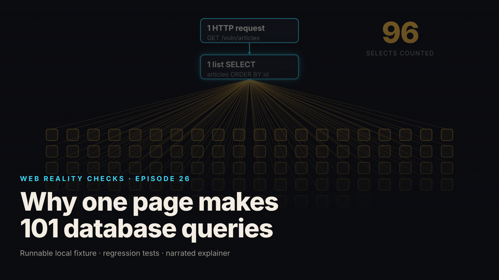

SEO title (≤60 chars): One Page, 101 Queries: Finding the N+1 With a Counter
Meta description (≤155 chars): One HTTP request ran 101 SELECTs on a local fixture. How the N+1 pattern works, the scoped counter that proves it, and the one-JOIN repair.
Slug: n-plus-one-queries
Primary keyword: N+1 query problem   Secondary keywords (3–5): N+1 queries, count SQL queries per request, SQL JOIN vs loop, query counter test, database query optimization
Medium tags (5): Databases, SQL, Node.js, Software Engineering, Backend Development

# One Page. 101 Database Queries. Here's Why.



One page makes one HTTP request, and behind it the database runs 101 SELECT statements. The page looks fine, the JSON is correct, and nothing in the browser hints that the backend multiplied the work.

This is episode 26 of Web Reality Checks. The pattern is called N+1: one query for a list, then one more query for each item in it. This episode builds it on a local fixture with synthetic data, counts it with instrumentation instead of trusting narration, repairs it with one JOIN, and then proves the counter itself can see a mistake.

## What actually happens

The endpoint has to return 100 articles, each with its author's name and handle. The author lives in a separate table. The natural way to write that is the way the flawed handler does it: fetch the articles, then walk the result and ask for each article's author as you go.

Each step looks innocent. The loop body is a single, fast, correct lookup. The cost is in the shape: the number of statements grows with the number of rows. With 100 articles you get 1 list query plus 100 author lookups, which is 101. Add a row and you add a statement. Nothing in the code says "101"; the count is a consequence of the data.

There is a second effect. The 100 articles in this fixture share only 12 authors. The loop does not know that, because it has no identity cache and no batching, so it asks for the same author again and again. From `evidence.json` (local synthetic fixture): 12 distinct authors across 100 lookups, so 88 lookups repeated an author already fetched, and the most-fetched author, Ana Petrov (`apetrov`), was looked up 14 times.

Why does this hide so well? The browser sees one request and one response. The response is correct. Anything that only looks at the interface, or only at the final JSON, passes. The extra work is invisible unless something counts statements at the database boundary.

## The fixture

`fixtures/ep26-n-plus-one/` is a loopback-only Node 22 server on `node:http` and in-memory `node:sqlite`, with zero npm dependencies. The seed is deterministic: exactly 100 articles, 12 authors, `author_id INTEGER NOT NULL REFERENCES authors(id)`, and `PRAGMA foreign_keys = ON`. There is no ORM, so the "no identity cache, no batching" condition is met by plain SQL in a loop.

The flawed handler, copied from `server.mjs`:

```js
export const listArticlesFlawed = (db) => {
  db.exec('BEGIN');
  const listStmt = db.prepare('SELECT id, title, published_on, author_id FROM articles ORDER BY id');
  const authorStmt = db.prepare('SELECT id, name, handle FROM authors WHERE id = ?');
  const rows = listStmt.all();
  const articles = rows.map((r) => {
    const au = authorStmt.get(r.author_id); // <-- the per-item query
    return toArticle(r.id, r.title, r.published_on, au.id, au.name, au.handle);
  });
  db.exec('COMMIT');
  return articles;
};
```

The counter lives in `db.mjs`. Handlers receive only the wrapper, never the raw connection, so they cannot bypass it by accident. The classification is four lines:

```js
const kind = kindOf(sql);
let counted = false;
let excluded = null;
if (!scope) excluded = 'outside-scope';
else if (api === 'exec') excluded = 'transaction-control';
else counted = kind === 'SELECT';
```

The counting policy is explicit, because "101 queries" is easy to overstate. Counted: SELECT statements executed through the wrapper while the `article-list` scope is active. Excluded: setup (runs on the raw connection before the wrapper exists), authentication (the session lookup is logged as `outside-scope`), `BEGIN` and `COMMIT` (logged as `transaction-control`), and instrumentation (the wrapper issues no SQL). Any non-SELECT inside the scope is reported as `otherScoped`, which must be 0. So the flawed request logs 103 statements in scope, and 101 of them are the counted SELECTs.

## The test that proves it

`node --test fixtures/ep26-n-plus-one/test.mjs` reports `# tests 15`, `# pass 15`, `# fail 0` (local synthetic fixture). The tests that carry this episode:

- `FLAWED endpoint executes exactly 101 SELECTs: one list query + one author lookup per article`
- `CORRECTED endpoint executes exactly 1 SELECT, an explicit JOIN`
- `authentication and transaction control are excluded from the demonstrated count`
- `result equivalence: same shape, same ORDER BY id, byte-equal JSON from both endpoints`
- `repeated author lookups are visible in the scoped log (100 lookups, 12 distinct authors)`
- `KNOWN-POSITIVE CONTROL: a hidden extra query makes the counter report 102, so the "101" assertion would fail`

The first test does more than compare a number. It checks that the first counted statement is the list query returning 100 rows, that the other 100 are the author lookup, and that their parameters follow article order. The 101 is also read back from the `x-db-selects` response header, which is derived from the instrumentation and never from a constant.

The last test is the one teams skip. It starts a fixture with one doctored statement hidden in the handler. The bytes returned are identical, which a second control test asserts, so the response gives no sign anything changed. The counter reports 102, and the test asserts that the real "101" assertion throws on it. If an extra query can slip in and the count does not move, a passing "101" means nothing. The control shows the instrument can see a one-statement difference.

## The repair

Replace the loop with one explicit JOIN, returning the same fields, with the ordering preserved:

```js
const rows = db.prepare(`
  SELECT a.id AS article_id, a.title AS title, a.published_on AS published_on,
         u.id AS author_id, u.name AS author_name, u.handle AS author_handle
  FROM articles a
  JOIN authors u ON u.id = a.author_id
  ORDER BY a.id
`).all();
```

Two details matter. First, `ORDER BY a.id` keeps the ordering deterministic, so the output is the same list in the same order. Without an explicit ORDER BY, a JOIN gives you no ordering guarantee, and "same results" would be luck. Second, an INNER JOIN equals the loop only because `author_id` is `NOT NULL` and the foreign key is enforced. With a nullable or dangling reference, the loop and the join could disagree: an article with no valid author would break the loop and silently vanish from an inner join. The tests insert an orphan and a NULL author and assert both are rejected (`FOREIGN KEY constraint failed`, `NOT NULL constraint failed`).

## Retest

From `evidence.json` (local synthetic fixture):

- `GET /vuln/articles`: status 200, 101 SELECTs (1 list query, 100 author lookups), `otherScoped` 0, 103 statements logged in scope.
- `GET /articles`: status 200, 1 SELECT, `otherScoped` 0, 3 statements logged in scope (the SELECT plus `BEGIN` and `COMMIT`).
- Both bodies are 13,544 bytes with the same SHA-256, so they are byte-equal.
- Control with one hidden extra query: flawed endpoint reports 102, corrected endpoint reports 2, and `detected` is true.

## What this does not prove

- This counted statements. Nothing is timed, so there is no latency, throughput or speed-up claim. Fewer queries do not universally mean a faster page.
- The fixture is in-memory SQLite with no network hop. It says nothing about how a networked database behaves.
- No ORM is used. Lazy loading, `includes` and `select_related` behavior are not tested.
- No index, pagination or caching change is part of the fix.
- This is one N+1 shape: a per-row lookup in a loop. Nested N+1, N+1 across services and lazy collection loads are not covered.
- The counter sees only what passes through its wrapper. These handlers cannot reach the raw connection, but the suite cannot prove that for arbitrary code.
- The login route is a test harness, not production authentication.

## Launch checklist

1. Know which endpoints return lists with related records, and count the statements for each, not just the response time.
2. Put a statement counter around the operation, scoped so setup, authentication and transaction control are excluded and logged as such.
3. Assert the count in a test, so a new loop that adds a query fails the build.
4. Keep a known-positive control: a doctored variant with one extra query that the counter must report.
5. When you switch a loop to a JOIN, add an explicit ORDER BY and a byte-equality or shape-equality test against the old output.
6. Check that the join is valid for your data: nullable and dangling references can change the result set.
7. Measure latency separately, on the database you actually deploy, before claiming an improvement.

## FAQ

**What is the N+1 query problem?**
It is one query to fetch a list, followed by one extra query per item to fetch a related record. For 100 articles with authors that is 101 SELECTs. The statement count grows with the number of rows, and the response still looks correct, so it is easy to miss.

**How do I count SQL queries per request?**
Wrap the database connection so every prepared statement is recorded at execution, and open a scope around the request handler. Count only SELECTs inside the scope and log everything else with a reason. Then assert the number in a test, with a control that adds one hidden query.

**Does a JOIN always fix N+1?**
Not always. A JOIN replaced the loop here and returned byte-identical JSON, but only because the foreign key was enforced and not null. Other forms need other repairs, and this episode measured statement counts, not speed.

## Watch the episode

[YouTube link]

- 00:00 One request, 101 SELECTs
- 00:13 One list query plus 100 lookups
- 00:26 12 authors, 88 repeated lookups
- 00:39 The fix: one explicit JOIN
- 00:49 Same 100 articles, byte-equal JSON
- 01:00 Retest: 101 vs 1, control at 102
- 01:15 What we counted and what we did not

Related episodes: [Why This Beautiful Website Feels Slow](../../ep08/content/article-technical.md) and [One Click. Three Purchase Events. Here’s What Went Wrong.](../../ep02/content/article-technical.md)

> This episode uses a deliberately constructed local fixture with synthetic data. Nothing here is a finding about a real product or company. Fixture, tests and video source: github.com/mizcausevic-dev/web-reality-checks

The interface made one request. The backend multiplied the work. Count the statements before you trust the page.

Miz Causevic, Kinetic Gain LLC
