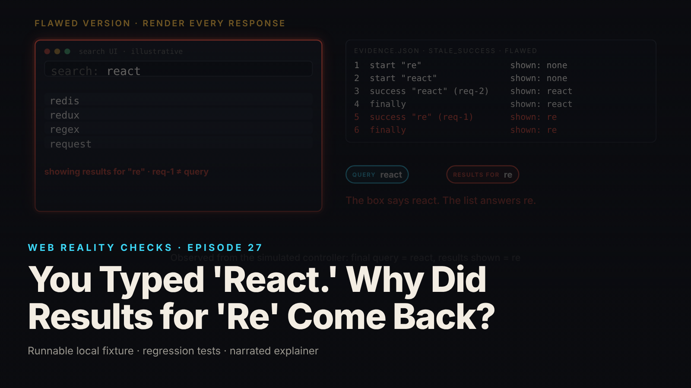

SEO title (≤60 chars): Stale Search Responses: Why 're' Results Replace 'react'
Meta description (≤155 chars): Request order is not response order. A simulated search controller shows an old response overwriting new results, then a generation counter that fixes it.
Slug: stale-search-responses
Primary keyword: stale search responses   Secondary keywords (3–5): out-of-order responses, request race condition, generation counter, AbortController, debounce vs response order
Medium tags (5): JavaScript, Web Development, Software Engineering, Async Programming, Frontend

# You Typed 'React.' Why Did Results for 'Re' Come Back?



The search box says "react". The list underneath shows redis, redux, regex and request, which are the answers to "re". The older request finished last, the code rendered whatever arrived last, and the interface now disagrees with itself.

This is episode 27 of Web Reality Checks. The fixture is a simulated state-machine controller driven by a mock API. It is not a browser, there is no DOM, no framework, no network and no timer. It models a search handler's control flow, and the test releases each response by hand so the ordering is reproducible.

## What actually happens

A search-as-you-type handler fires a request per keystroke batch. Requests leave in order: "re" first, "react" second. Nothing in HTTP, `fetch` or a promise promises that responses come back in that order. Any difference in how long the server takes lets request two finish before request one.

The flawed handler has no notion of "which request is current." Each call awaits its own promise, and when the promise settles it writes the result into shared state. So the sequence is: request 2 answers, `react` results render, then request 1 answers and its callback runs against the same state. The callback is right about its own data and wrong about whether anyone still wants it.

The same hole exists in three more places, and the fixture covers each one:

- An old failure sets an error beside current results.
- An old `finally` block clears the loading spinner while the current request is still pending.
- A response that lands after the user cleared the box, or after the component was disposed, writes state anyway.

All four are one defect: an async continuation writes shared state without asking whether it still matters.

## The fixture

`fixtures/ep27-stale-search-responses/` is plain Node 22 ESM with zero dependencies. The pieces:

- `mock-api.mjs`: `search(query)` returns a promise that stays pending until the test calls `release(n)` or `fail(n)`. Each response carries `{requestId, query, items}`.
- `search-controller.mjs`: `FlawedSearchController` (the known-positive control) and `SearchController` (the repair).
- `driver.mjs`: `runSchedule` executes an explicit list of steps: `type`, `release`, `fail`, `clear`, `dispose`.

Nothing in the mock resolves on its own, which is why every run is identical:

```js
release(n) {
  const r = api.byN(n);
  if (r.state !== 'pending') return false; // already aborted/settled: nothing to deliver
  r.state = 'released';
  r.settle.resolve({requestId: r.id, query: r.query, items: resultsFor(r.query)});
  return true;
},
```

The flawed handler never compares a response to the current query:

```js
async search(query) {
  this.write(`start "${query}"`, {query, loading: true, error: null});
  try {
    const res = await this.api.search(query);
    this.write(`success "${res.query}" (${res.requestId})`, {results: res, error: null});
  } catch (e) {
    this.write(`error "${e.message}"`, {error: e.message});
  } finally {
    this.write('finally', {loading: false});
  }
}
```

The repair is a request-generation guard. Every `search()` increments a counter, captures the value in a local, and compares it again before it writes anything:

```js
const gen = ++this.generation; // 1. new generation for every search
// ...
try {
  const res = await this.api.search(query, ac ? {signal: ac.signal} : {});
  if (gen !== this.generation) return this.#discard('success', gen, {query: res.query, requestId: res.requestId}); // 3a. success path
  this.write(`success "${res.query}" (${res.requestId}) gen ${gen}`, {results: res, error: null});
} catch (e) {
  if (gen !== this.generation) return this.#discard('error', gen, {message: e.message, abort: isAbortError(e)}); // 3b. error path
```

The same comparison sits in the `finally` block (3c). `clear()` and `dispose()` also increment `generation`, which invalidates everything pending without needing a list of pending requests. A discarded outcome is recorded in `discards` and in the timeline, but it never writes state.

One deliberate policy: the guard uses its own local counter. Server request IDs are displayed, never compared, because nothing says a server's IDs are ordered.

## The test that proves it

`node --test fixtures/ep27-stale-search-responses/test.mjs` runs 22 tests and reports `# tests 22`, `# pass 22`, `# fail 0` (local synthetic fixture).

Five of the tests are known-positive controls on the flawed controller, and they are the ones that make the passing tests mean something:

- `KNOWN-POSITIVE CONTROL (flawed): late response for "re" overwrites results for "react"`
- `KNOWN-POSITIVE CONTROL (flawed): an obsolete failure replaces current state`
- `KNOWN-POSITIVE CONTROL (flawed): an older finally clears loading while the current request is pending`
- `KNOWN-POSITIVE CONTROL (flawed): a pending response repopulates an emptied search box`
- `KNOWN-POSITIVE CONTROL (flawed): state keeps being written after dispose`

The first asserts the bug in its message: `BUG OBSERVED: results for "re" are on screen under a "react" query`. If the flawed code cannot fail a test, a pass on the corrected code proves nothing.

From `evidence.json` (local synthetic fixture), the `stale_success` schedule is: type re, type react, release 2, release 1. The flawed controller ends with query `react`, results for `re` (request `req-1`), and 6 state writes. The corrected controller ends with results for `react` (`req-2`) and 4 state writes, because the two discarded outcomes write nothing.

## The repair

Run the corrected controller through the same schedule. Typing "re" makes generation 1. Typing "react" makes generation 2. Request 2 returns, its captured generation equals the current one, and `react` results render. Request 1 returns. Its captured generation is 1, the current is 2, so the success is discarded. Its `finally` is discarded too, and that detail matters: if the old `finally` were allowed to run, it would clear `loading` for a request that is not the one the user is waiting on.

The evidence makes that visible with a different schedule (`loading`: type re, type react, release 1, release 2). After step 3, with request 2 still pending, the flawed controller reports `loading=false` and shows results for `re`. The corrected controller reports `loading=true` and shows no results yet. Showing nothing is correct when the only response in hand belongs to an old query.

Aborting is optional. With `abortSuperseded: true`, a superseded request is aborted and its `AbortError` lands in the discard path, never as a user-facing error. But abort is an optimization. The fixture replays the `stale_success` schedule with guard only, guard plus abort, and guard plus abort against an API that ignores the signal, and the final state is identical (`true` in `abortComparison`). A client abort says nothing about whether a server stopped working, so correctness cannot depend on it.

## Retest

From `evidence.json` and the test run (local synthetic fixture):

- `stale_success`: flawed final is query `react` with results for `re`; corrected final is results for `react`, discards `success, finally`.
- `stale_failure` (type re, type react, release 2, fail 1): flawed shows the error `network error (simulated)` over `react` results; corrected error is `null`, discards `error, finally`.
- `loading`: flawed `loading=false` with request 2 pending; corrected `loading=true`.
- `cleared` (type re, clear, release 1): flawed shows results for `re` under an empty query; corrected shows none.
- `disposed` (type react, dispose, release 1): flawed makes 2 state writes after dispose; corrected makes 0.

Two tests guard the guard. `current failure (corrected): the guard does not swallow errors that belong to the current request` proves a real error still surfaces. `request ids are opaque: the guard uses its own local counter, never server id ordering` gives the newer request the smaller ID (`aa-001` against `zz-900`) and the guard still picks the right answer.

## What this does not prove

- Nothing here ran in a browser. The controller models a component's search handler; it is not that component, and no framework lifecycle was exercised.
- Real `fetch`, real abort semantics, HTTP, server behavior, caching, retries and pagination are not tested. The abort rejection is produced by the mock.
- Debouncing is not simulated. The debounce test models two requests already in flight and shows that a later request can still answer first. It does not claim debouncing is useless, only that it does not order responses.
- Out of scope: IME input, several controllers sharing one store, and races elsewhere.
- This is local UI concurrency control for one search box. It is not a distributed-ordering solution.

## Launch checklist

1. Every async handler that writes shared state captures a token (generation, version or request key) before it awaits.
2. The comparison runs in the success path, the error path and the `finally` path, not just success.
3. Clearing the input and tearing down the component invalidate pending work.
4. An abort rejection is classified as an abort and never shown as an error.
5. Correctness holds with abort turned off; abort is added for saved work, not for ordering.
6. Identity of "the current request" comes from a local counter, not from comparing server IDs or timestamps.
7. A known-positive control exists: a flawed variant that your test catches under an explicit release order.
8. Tests release responses in reverse order and cover a late failure and a late `finally`.

## FAQ

**Why do search results sometimes show the wrong query's results?**
Responses are not guaranteed to arrive in the order requests were sent. If the handler renders every response as it lands, an older request that finishes last overwrites newer results. The fix is to ignore any response whose request is no longer the current one.

**Does debouncing fix out-of-order responses?**
No. A debounce only changes when requests are sent, so there are fewer of them. Two requests can still be in flight, and the later one can still answer first. You still need a check that discards obsolete responses.

**Is AbortController enough to stop stale results?**
No. Aborting is a useful optimization, but a client abort does not prove the server stopped, and some responses still arrive. In the fixture the final state is identical with and without abort, because the generation guard is what makes it correct.

## Watch the episode

[YouTube link]

- 00:00 The fail: results for "re" replace "react"
- 00:12 Request order is not response order
- 00:23 The late response still says "re"
- 00:34 The fix: a generation counter
- 00:45 Retest: same release schedule
- 00:55 Generation 1 is not generation 2: discarded
- 01:05 Failures need the same guard
- 01:14 Clear, dispose, abort and debounce
- 01:30 The last response is not always the latest

Related episodes: [Your Webhook Arrived Twice. Then an Older Update Arrived.](../../ep18/content/article-technical.md) and [Two Tabs. One Document. Where Did My Changes Go?](../../ep23/content/article-technical.md)

> This episode uses a deliberately constructed local fixture with synthetic data. Nothing here is a finding about a real product or company. Fixture, tests and video source: github.com/mizcausevic-dev/web-reality-checks

The last response is not always the latest answer. Give every async write a way to ask whether it is still wanted, and keep a flawed twin around to prove the question gets asked.

Miz Causevic, Kinetic Gain LLC
