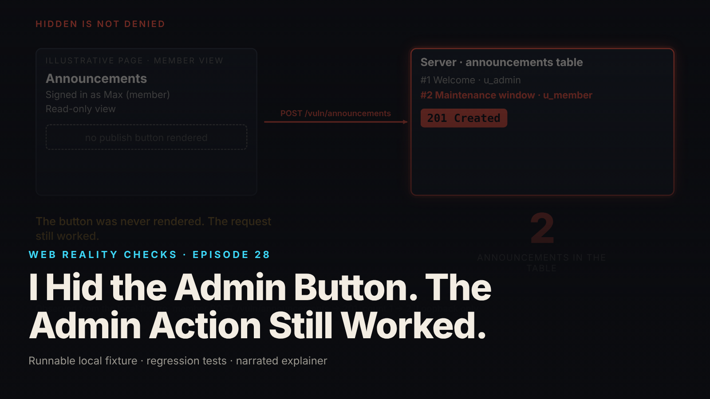

SEO title (≤60 chars): Hiding the Admin Button Is Not Access Control
Meta description (≤155 chars): A member's page had no publish button, yet the member's request published. The fixture, 12 tests and the server-side permission gate that repairs it.
Slug: hidden-admin-button-permission-check
Primary keyword: server-side permission check   Secondary keywords (3–5): broken function level authorization, hidden button security, CSRF vs authorization, role-based access control, Express permission middleware
Medium tags (5): Web Security, Authorization, Node.js, Express, Software Engineering

# I Hid the Admin Button. The Admin Action Still Worked.



The member's page has no publish button. The interface hides it. Yet a request from that member, with a valid session and a valid CSRF token, just published an announcement and the row count went from 1 to 2.

This is episode 28 of Web Reality Checks. Hiding a control decides what a person sees. It decides nothing about what the server will accept. The only thing that denies an action is a permission check on the server, run before the side effect.

## What actually happens

A privileged route has to answer three separate questions, and each one fails in its own way.

1. Authentication: is there a live server-side session? If not, 401.
2. CSRF: does this request carry a token bound to this session, which shows it came from our page? If not, 403 with the code `EBADCSRFTOKEN`.
3. Authorization: does the server's own store grant this user's role the permission to do this? If not, 403 with the code `PERMISSION_DENIED`.

The flawed route in this fixture runs the first two and then inserts. A signed-in member passes authentication, because the session is real. The member passes CSRF, because the token is real and bound to that session. Nothing in the chain ever asks whether a member may publish, so the insert runs.

The hidden button never enters into it. The render function decides whether to emit a `<form>` with a publish button, using the same permission data the server holds. That is a courtesy to the person looking at the page. The route is a separate door, and anyone who can send an HTTP request with the right cookie and header can walk through it without touching the page at all. A CSRF token does not change that. It proves the request is not forged by another site. It says nothing about whether the legitimate user is entitled to the action.

This is why a demo cannot find the bug. The demo clicks the buttons that exist. The member has no publish button, so nobody ever sends the publish request, and the flaw stays invisible until someone builds that request on purpose.

## The fixture

`fixtures/ep28-hidden-admin-button/` is a loopback-only Express app on an ephemeral port, using `node:sqlite` in memory. It has two synthetic users, `u_admin` (role `admin`) and `u_member` (role `member`), a server-side session table, a role and permission store, and one harmless action: publish a synthetic announcement. CSRF protection comes from `csrf-csrf` 3.1.0, a maintained library, because Express has no built-in CSRF protection and a hand-rolled one would muddy the lesson. The flawed endpoint was constructed by hand and says nothing about any real product.

The two routes differ in exactly one middleware:

```js
// FLAWED: authenticated + CSRF-valid is treated as "allowed".
app.post('/vuln/announcements', authenticate, csrf, (req, res) => insertAnnouncement(req, res, 'vulnerable'));
// CORRECTED: the same chain plus one permission gate before the side effect.
app.post('/announcements', authenticate, csrf, requirePermission(PUBLISH), (req, res) => insertAnnouncement(req, res, 'corrected'));
```

The UI render function hides the button in both versions of the page. A test asserts the button is absent for the member on `/vuln/app` and on `/app`, so the hiding is a fixed condition of the experiment, not a variable:

```js
${canPublish
    ? `<form method="post" action="${esc(action)}" data-testid="publish-form">...<button data-testid="publish-button">Publish announcement</button></form>`
    : '<p data-testid="read-only">Read-only view</p>'}
```

## The test that proves it

`node --test fixtures/ep28-hidden-admin-button/test.mjs` runs 12 tests and reports `# tests 12`, `# pass 12`, `# fail 0` (local synthetic fixture). Every authorization assertion uses a valid session and a valid CSRF token, so a CSRF failure can never pass for an authorization result. Four test names carry the argument:

- `KNOWN-POSITIVE CONTROL: member (valid session, valid CSRF token) publishes through the FLAWED endpoint`
- `CORRECTED: member with valid session and valid CSRF token gets 403 PERMISSION_DENIED; announcement count unchanged`
- `CSRF and authorization are distinguishable: member with a BAD token gets CSRF error, member with a GOOD token gets permission error`
- `browser-submitted role / permission fields are ignored (body, query string and headers)`

The control is the one to copy. It first asserts that the store does not grant publish to the member, then publishes through the flawed route and expects 201. The assertion message says why: "the flaw must be observable or the fix test proves nothing." Without that, a 403 on the corrected route could come from any cause.

Counts are read straight from the sqlite store after each request rather than inferred from response bodies. From `evidence.json` (local synthetic fixture): the flawed member publish returns 201 with `publishedBy: u_member` and the announcement count goes from 1 to 2. Another test records the server's own step order: `authenticate, csrf, insert` on the flawed route, and `authenticate, csrf, permission` with no `insert` for a denied request.

## The repair

The corrected route adds one gate between CSRF and the insert:

```js
const requirePermission = (permission) => (req, res, next) => {
  trace.push('permission');
  if (!hasPermission(db, req.user.id, permission)) return res.status(403).json({error: 'forbidden', code: 'PERMISSION_DENIED', required: permission});
  next();
};
```

The user comes from the session. The permission comes from a join of `user_roles` and `role_permissions`, read at request time:

```js
export const hasPermission = (db, userId, permission) =>
  Boolean(db.prepare(
    `SELECT 1 FROM user_roles ur JOIN role_permissions rp ON rp.role = ur.role
     WHERE ur.user_id = ? AND rp.permission = ? LIMIT 1`).get(userId, permission));
```

Three design choices matter more than the middleware itself.

First, the permission is never copied into the session. Because it is looked up on every request, revoking it takes effect on a live session. A test deletes the admin's publish permission, confirms the next request is 403 and the UI loses the button, then restores it and confirms 201 again.

Second, nothing the browser sends is read. A `role` or `permissions` field in the body, `?role=admin` in the query string, or `x-role`, `x-user-id` and `x-ui-role` headers all have no effect, because the gate only consults the store.

Third, the permission check runs before body validation. A denied member who sends an invalid body gets 403, not 400, so a caller without the permission cannot use validation errors to learn how the endpoint behaves.

## Retest

From `evidence.json` (local synthetic fixture), same member session and same valid token:

- Corrected endpoint, member: 403 `PERMISSION_DENIED`, count 2 before and 2 after.
- Corrected endpoint, member with `role=admin` claims: 403.
- Corrected endpoint, member with a bad CSRF token: 403 `EBADCSRFTOKEN`, a different code from the permission failure.
- No session: 401 `NO_SESSION` on both routes.
- Corrected endpoint, administrator: 201, count goes from 2 to 3, `publishedBy: u_admin`.

The last line is part of the proof. A gate that denies everyone also passes the member test. The administrator case shows the check allows who it should.

## What this does not prove

- This is a function-level check: may this role perform this action at all? It does not decide which objects a user may touch. That needs ownership checks, which episode 1 covers.
- The "member" and "administrator" are a cookie-jar test client. No real browser, no real cross-site request, no real SameSite enforcement and no HTTPS (cookies are not `Secure`).
- Sign-in is a test harness, and sessions have no expiry or rotation.
- Only the publish route is covered. Every other privileged route needs its own check and test. The application is not claimed to be fully secure.
- The flawed endpoint must never be deployed.

## Launch checklist

1. List every route that changes state or reveals privileged data, and name the permission each one requires.
2. Put the permission check in server middleware that runs before any write, not in the UI.
3. Resolve permissions from a server-side store at request time, keyed by the session's user.
4. Never read a role, permission or admin flag from the request body, query string or headers.
5. Keep a known-positive control: a deliberately flawed route that your test can see succeed.
6. Test with a valid session and valid CSRF token, so only authorization can be the reason for refusal.
7. Assert the database state after a denied request, not just the status code.
8. Give authentication, CSRF and authorization failures distinct, documented codes.

## FAQ

**Is hiding a button a security control?**
No. Hiding a button changes what a person sees. The server still accepts any request that passes its checks. A privileged action needs a permission check on the server, resolved from trusted state before any side effect.

**How is CSRF protection different from authorization?**
CSRF protection checks that a request came from your own page, using a token bound to the session. Authorization checks whether the signed-in user may perform the action. A member can pass CSRF and still need to be denied.

**Where should an Express permission check run?**
As middleware after authentication and CSRF, and before any handler that writes data. It should read the user from the session and the permission from a server-side store, never from the request.

## Watch the episode

[YouTube link]

- 00:00 Hidden button, working request
- 00:09 Controlled test: valid session, valid token
- 00:17 The leak: 201 Created, count 1 to 2
- 00:27 Three questions: who, from where, may they
- 00:42 The repair: server-side permission gate
- 00:56 Retest: 403 PERMISSION_DENIED, count stays 2
- 01:08 Administrator: 201, count becomes 3
- 01:15 What this does not fix

Related episodes: [Your AI-Built App Works. Is It Safe to Launch?](../../ep01/content/article-technical.md) and [Watch What Happens When You Click 'Sign In'](../../ep03/content/article-technical.md)

> This episode uses a deliberately constructed local fixture with synthetic data. Nothing here is a finding about a real product or company. Fixture, tests and video source: github.com/mizcausevic-dev/web-reality-checks

The browser can hide the action. Only the server can deny it.

Miz Causevic, Kinetic Gain LLC
