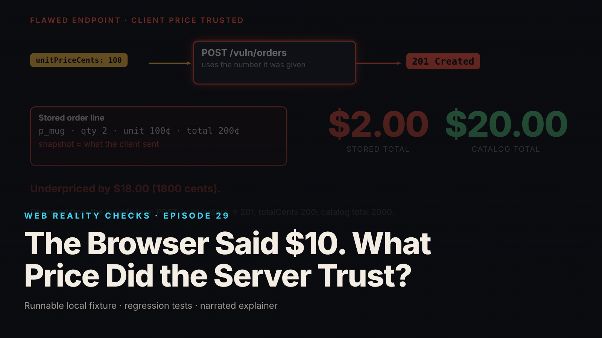

SEO title (≤60 chars): Never Trust a Client Price: Server-Side Pricing in Node
Meta description (≤155 chars): A checkout stored $1.00 while the page showed $10.00. The tampered request, the catalog-authority repair, and the SQLite transaction behind it.
Slug: server-side-price-validation
Primary keyword: server-side price validation   Secondary keywords (3–5): never trust client price, price tampering, parameter tampering, SQLite BEGIN IMMEDIATE, order price snapshot
Medium tags (5): Web Security, Node.js, E-commerce, SQLite, Software Engineering

# The Browser Said $10. What Price Did the Server Trust?



The page shows ten dollars and the checkout works, but the order endpoint reads the unit price from the request body. Anyone who edits that field before it leaves the browser gets the price they typed. In the fixture, two mugs that should cost $20.00 were stored at $2.00, and the server answered 201 Created.

This is episode 29 of Web Reality Checks. The question is which side of the connection holds the authority to say what the price is, and what happens when the real price changes legitimately between page load and submit.

## What actually happens

An HTTP request is a message the client composes. Nothing in the protocol stops a user from changing a field first: a developer-tools edit, a proxy, a script. The server receives bytes and cannot know which ones the page "meant" to send.

So a field named `unitPriceCents` in a request body is a claim made by the client. It is not a fact held by the server. If the handler multiplies that claim by the quantity and writes the result into the order, the client has set its own price. The page displaying $10.00 is irrelevant: the page is just one possible author of the request.

The repair has two parts, and the second is the one people skip. First, the server's catalog becomes the only source of the price. Second, the price read and the order insert must happen as one unit, otherwise a price change can land in the gap and the stored order can describe a price no longer in force.

## The fixture

`fixtures/ep29-server-side-price/` is a loopback-only Node 22 mock checkout on `node:sqlite`, with zero npm dependencies. It has a server-side `products` table, integer cents, one currency (USD), quantities bounded to 1..100, and synthetic orders. No payment provider is contacted and no money moves. Orders go through `POST /vuln/orders` (flawed) or `POST /orders` (corrected).

The flawed path takes the client's `unitPriceCents` as the price and stores it as the order-line snapshot:

```js
db.exec('BEGIN IMMEDIATE');
try {
  const orderId = Number(insOrder.run('flawed', CURRENCY, total, now()).lastInsertRowid);
  insLine.run(orderId, f.productId, f.quantity, f.price, total); // <-- client price stored as the snapshot
  db.exec('COMMIT');
  return {status: 201, body: orderBody(orderId, 'flawed', f.productId, f.quantity, f.price, total)};
} catch (e) { rollback(); throw e; }
```

This path still checks that the product exists and is available, and it still uses a transaction. Only the price is trusted, so the flaw is trust, not arithmetic.

From `evidence.json` (local synthetic fixture): the page displays $10.00, the catalog price is 1000 cents, and the submitted request is `{"productId": "p_mug", "quantity": 2, "unitPriceCents": 100}`. The flawed endpoint returns 201, stores a total of 200 cents, and the correct total was 2000 cents. The order is underpriced by 1800 cents, and the order count is 1.

## The test that proves it

`node --test fixtures/ep29-server-side-price/test.mjs` ends with `# tests 37`, `# pass 37`, `# fail 0` (local synthetic fixture). Two of those tests are known-positive controls, which are tests that make the bug observable so the passing tests on the fixed code mean something:

- `KNOWN-POSITIVE CONTROL: flawed endpoint stores the client-submitted price (page shows $10.00, order priced $1.00)`
- `KNOWN-POSITIVE CONTROL (race): without a transaction the price can change between the catalog read and the insert`

The first asserts a 201 from the flawed endpoint, with the assertion message "the flaw must be observable or the fix test proves nothing". The second appears in the retest. The contract tests include:

- `corrected: the same altered-price request creates NO order (409 price_changed with the current quote)`
- `changed price after page load: 409 + updated quote, no order; retrying unchanged is NOT silently accepted`
- `explicit confirmation: confirmPriceCents equal to the current price creates the order at the current price`
- `transaction consistency: while the order transaction is open, a second connection cannot change the price; the snapshot equals the price in force`

## The repair

The corrected request carries `productId`, `quantity` and `expectedUnitPriceCents`. The expected price is a comparison value only: never stored, never used to compute a total. Extra client fields such as `unitPriceCents` or `totalCents` are ignored, and a test locks that in.

Inside one `BEGIN IMMEDIATE` transaction, the server reads the catalog row, compares the client's price to it, and either rejects or inserts the order with a snapshot of the price it just read:

```js
const accepted = f.confirmPriceCents ?? f.price;
if (accepted !== unit) {
  rollback();
  return {status: 409, body: {
    error: 'price_changed',
    // ... quote and confirmWith fields omitted here
  }};
}
const orderId = Number(insOrder.run('corrected', CURRENCY, total, now()).lastInsertRowid);
insLine.run(orderId, p.id, f.quantity, unit, total); // snapshot = price read inside this transaction
db.exec('COMMIT');
```

The policy is deliberate: any difference between expected and current price, up or down, returns `409 price_changed` with the current quote and creates no order. A new attempt must send `confirmPriceCents` equal to the current price, checked again inside the new transaction. If the price moved again, the client gets a fresh 409.

Why `BEGIN IMMEDIATE`? SQLite normally takes its write lock lazily, at the first write. `BEGIN IMMEDIATE` takes it at the start, so no other connection can modify `products` until `COMMIT` or `ROLLBACK`. The catalog read and the order insert therefore see the same price. This is a SQLite-specific strategy. Other databases need their own (row locks, `SERIALIZABLE` isolation, and so on).

Quantity must be an integer from 1 to 100; strings, floats, zero and negatives get a 400. Money is integer cents with BigInt formatting, and the multiplication is checked against `Number.MAX_SAFE_INTEGER` (422 `total_out_of_range`).

## Retest

From `evidence.json` (local synthetic fixture):

- The same altered request, `expectedUnitPriceCents: 100`, to `POST /orders`: 409 `price_changed`, current quote 1000 cents, total 2000 cents, orders created: 0.
- An honest request with `expectedUnitPriceCents: 1000`: 201, snapshot 1000 cents.
- Rejected inputs, each with orders created: 0: quantity 0, -1, 1.5, the string "2" and 101 return 400; an unknown product returns 404; an unavailable one returns 409.

Then a legitimate change: the page loaded at $10.00, then the catalog moved to 1200 cents. The same request returns 409 with a current quote of 1200 cents and a total of 2400 cents, and orders created is still 0. A retry without confirmation returns 409 again. With `confirmPriceCents: 1200` the response is 201 and the snapshot is 1200 cents.

For the transaction itself, the fixture uses a second SQLite connection in a worker thread, synchronized with `SharedArrayBuffer` and `Atomics`, to try repricing the product at a chosen moment inside the order transaction:

```js
const r = store.createOrderCorrected({productId: 'p_mug', quantity: 2, price: 1000}, {
  afterCatalogRead: () => { duringTxn = writer.setPrice(1200); }, // barrier: other thread/connection tries to reprice NOW
});
assert.equal(duringTxn, 'busy', 'the write lock taken by BEGIN IMMEDIATE must keep the price change out until commit');
```

Result: the second connection gets `busy` and the snapshot stays at 1000 cents. After the commit, the same change succeeds. In the control (`createOrderNoTransaction`, with the read and insert as separate statements), the same second connection gets `ok`, the snapshot is 1000 cents, and the catalog says 1200 cents at insert time. That is the race the transaction closes.

## What this does not prove

- **This is not a price lock.** Nothing reserves a price for a customer. The transaction makes this request's catalog read and order insert atomic with respect to other writers on the same SQLite file. Each new attempt is compared to the catalog again.
- The transaction test calls the store function directly, not through HTTP, and exercises one deterministic interleaving, not every possible one.
- One machine and one SQLite file. Multi-node or other-database behavior is not tested.
- Taxes, discounts, shipping, inventory reservation, payment, refunds, idempotency and authentication are not modeled. Duplicate submissions are the subject of episode 15, and identity is the subject of episode 1.
- The flawed endpoint was written by hand. This is not a finding about any real shop or product.

## Launch checklist

1. The order endpoint never reads a price, total or discount from the request as an authority. Extra price fields are ignored, and a test proves it.
2. The price comes from a server-side catalog inside the same transaction that writes the order.
3. The client sends the price it was shown only as a comparison value, and any difference returns the current quote without creating an order.
4. The order line stores a price snapshot, so a later catalog change cannot rewrite history.
5. Quantity and price fields are validated by type and range; money is integer minor units, never floats.
6. A known-positive control exists: a deliberately flawed variant that your test can see.
7. The transaction strategy is chosen for your actual database and written down, and nobody calls it a price lock unless it is one.
8. Tax, shipping, stock and payment are handled and tested separately; this fix covers none of them.

## FAQ

**Why can't I trust the price my own page sends?**
Your page is only one possible author of the request. A user can edit the field in developer tools or send it from a script. The server must look the price up itself and treat the submitted value as a claim to compare, never the amount to charge.

**What should happen when the price changes between page load and checkout?**
Return the current quote and create no order until the customer explicitly confirms it. In this fixture that is a 409 `price_changed` response, then a retry carrying `confirmPriceCents` equal to the current price.

**Does BEGIN IMMEDIATE lock the price for my customer?**
No. It takes SQLite's write lock for one short transaction, so the catalog read and order insert are consistent. It does not hold a price for any customer across requests. A price lock is a separate feature.

## Watch the episode

[YouTube link]

- 00:00 The page says $10, the request says $1
- 00:09 Flawed endpoint: 201 Created at $2.00
- 00:19 The trusted field: unitPriceCents
- 00:31 The repair: catalog authority in one transaction
- 00:47 Retest: 409 price_changed, 0 orders
- 01:00 A legitimate change: 409 with the $24.00 quote
- 01:14 Confirmation: snapshot at $12.00
- 01:29 What is not modeled

Related episodes: [You Clicked Pay Once. Why Did the App Create Two Orders?](../../ep15/content/article-technical.md) and [Your AI-Built App Works. Is It Safe to Launch?](../../ep01/content/article-technical.md)

> This episode uses a deliberately constructed local fixture with synthetic data. Nothing here is a finding about a real product or company. Fixture, tests and video source: github.com/mizcausevic-dev/web-reality-checks

A price in a request is a claim, not a fact. Let the client request the purchase, and let the server determine the price.

Miz Causevic, Kinetic Gain LLC
