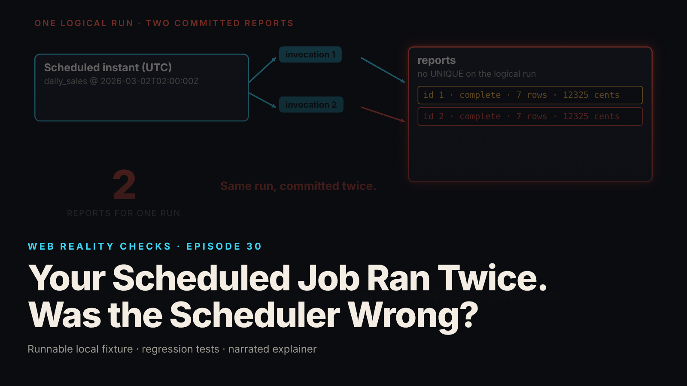

SEO title (≤60 chars): Scheduled Job Ran Twice? Fix It With a Unique Key
Meta description (≤155 chars): Two workers passed the same "absent" check and both committed. The race, the failing control test, and the unique-key repair with real test output.
Slug: scheduled-job-twice
Primary keyword: scheduled job ran twice   Secondary keywords (3–5): duplicate scheduled job, cron job idempotency, SQLite unique constraint, BEGIN IMMEDIATE, check-then-insert race
Medium tags (5): Software Engineering, Databases, SQLite, Backend Development, Reliability

# Your Scheduled Job Ran Twice. Was the Scheduler Wrong?



Two invocations reached one logical job, and the database now holds two committed reports for the same scheduled instant. The job had no way to say "this run already exists," and coordination was the application's job.

This is episode 30 of Web Reality Checks. The fixture does not accuse any scheduler of anything: it forces two invocations, then shows what the application commits with and without a constraint that names the logical run.

## What actually happens

A logical run is the thing you mean by "the 02:00 UTC daily sales report on March 2." In the fixture it is the pair `(report_type, scheduled_utc)`. An invocation is a process that was told to work on it. Those are different objects, and nothing makes them one-to-one. Retries, overlapping deploys and manual re-runs can all produce a second invocation.

The flawed worker handles that with check-then-insert. It runs `SELECT COUNT(*)` for the run in autocommit mode, sees zero, computes the report, and inserts it. The read holds nothing afterward, so the answer "absent" is already stale when the insert happens. If a second worker did the same check in the same moment, both saw zero, and both are now entitled, by their own logic, to insert.

Why do both inserts succeed? The fixture uses SQLite in WAL mode, where readers do not block the writer, but writers still serialize: one write lock at a time. The second writer waits on that lock, and the connection's busy timeout (5000 ms by default) absorbs the short wait. Then its insert runs and commits. The lock serializes the writes. It does not know the second write is a duplicate, because no constraint in the schema says so.

## The fixture

`fixtures/ep30-scheduled-job-twice/` runs two real worker processes with `child_process.fork`. Each opens its own `node:sqlite` connection to one shared database file. The report is a small aggregate of synthetic `sales_source` rows, stored in the same database. There is no email, no external file and no network call.

Schedule instants are UTC strings ending in `Z`, and `windowFor()` rejects anything else. The report covers the 24 hours before the instant, end exclusive.

The interleaving is not left to luck. A test-controlled IPC barrier collects a `checked` message from each worker, and only then sends `go` to both. The flawed insert is ordinary:

```js
if (variant === 'flawed') {
  if (stale === 0) {
    const rep = computeReport(db, scheduledUtc);
    const r = insertComplete.run(reportType, scheduledUtc, ref, name, rep.row_count, rep.total_cents, JSON.stringify(rep)); // autocommit: commits here
    await finish({outcome: 'inserted', changes: r.changes, rowId: Number(r.lastInsertRowid), stale}, 0);
  }
  await finish({outcome: 'skipped-saw-existing', stale}, 0);
}
```

The corrected schema names the logical run as a constraint. `ref` is a second, unrelated unique column, kept on purpose so a different violation can be tested later:

```sql
CREATE TABLE reports (
  id            INTEGER PRIMARY KEY AUTOINCREMENT,
  report_type   TEXT NOT NULL,
  scheduled_utc TEXT NOT NULL,
  ref           TEXT NOT NULL UNIQUE,
  worker        TEXT NOT NULL,
  status        TEXT NOT NULL DEFAULT 'pending',
  row_count     INTEGER,
  total_cents   INTEGER,
  body          TEXT,
  UNIQUE (report_type, scheduled_utc)
);
```

And the corrected worker claims the run inside an immediate write transaction:

```js
db.exec('BEGIN IMMEDIATE'); // take the write lock now; waits up to the bounded busy timeout
const r = claim.run(reportType, scheduledUtc, ref, name);
if (r.changes === 0) {
  // Someone else's committed row owns this logical run. Look at it, release the lock, report.
  const existing = existingStmt.get(reportType, scheduledUtc);
  db.exec('ROLLBACK');
  if (existing && isComplete({...existing})) {
    await finish({outcome: 'already-committed', changes: 0, existingId: Number(existing.id), existingWorker: existing.worker, stale}, 0);
  }
```

The `claim` statement is `INSERT ... ON CONFLICT (report_type, scheduled_utc) DO NOTHING`. The conflict target names only the logical-run constraint. `INSERT OR IGNORE` would have swallowed the `ref` violation too, which is exactly the mistake the targeted clause avoids.

## The test that proves it

`node --test fixtures/ep30-scheduled-job-twice/test.mjs` reports `# tests 17`, `# pass 17`, `# fail 0` (local synthetic fixture; the README records 3 consecutive runs plus 6 in parallel, all green). The names that carry the argument:

- `KNOWN-POSITIVE CONTROL: coordinated race on the flawed schema commits TWO reports for ONE logical run`
- `corrected: both workers pass a stale "absent" check, yet exactly one report is committed (5 rounds)`
- `pre-commit failure (hard crash): the row is invisible, the crash leaves no report, the lock is released, a retry commits exactly one`
- `lock contention: exhausted busy timeout is a RETRYABLE failure, not "already completed"; no row is written`
- `a UNIQUE violation from a DIFFERENT constraint (reports.ref) is not reported as "already completed"`
- `an in-process Boolean stops a repeat inside one process but cannot coordinate two processes (demonstration)`

The control comes first for the same reason as in episode 1. It asserts three distinct process IDs, both `checked, found 0` arrivals before the barrier releases, and then `assert.equal(got.length, 2, 'the flaw must be observable or the fix test proves nothing')`. If the race cannot be made to fail, a green result on the corrected code says nothing.

## The repair

Three pieces, and each answers a specific failure.

First, the constraint. `UNIQUE (report_type, scheduled_utc)` moves "one per logical run" out of application hope and into the schema, where every writer meets it.

Second, `BEGIN IMMEDIATE`. It takes the write lock at the start, so the claim and the work happen under one lock instead of after a stale read. A deferred transaction would only discover the contention at its first write.

Third, a strict reading of the outcomes. `changes() == 0` means a committed row owns the run, so the worker reads it, rolls back, confirms it is `complete`, and exits as `already-committed`. A busy lock after the bounded wait is `retryable-busy` (exit 75), which says nothing about whether anyone finished. A different constraint is a real error (exit 4). No incomplete placeholder is ever committed: the `pending` claim row exists only inside the open transaction, and the report is computed from source rows and stored in full before `COMMIT`. The transaction is short and database-local, never held around slow external work.

## Retest

From `evidence.json` and the README (local synthetic fixture):

- Flawed, both checks `absent`, barrier, both insert: 2 rows for one run, both complete.
- Corrected, same stale check and barrier: 1 row. Outcomes `committed` and `already-committed`. Which worker wins varies per run, so the fixture never asserts a winner.
- Worker killed with `SIGKILL` after the insert and before the commit: 0 rows visible to another connection while the transaction is open, 0 after the kill, 1 after a retry.
- Exception before commit: `failed-rolled-back` (exit 3), 0 rows, 1 after retry.
- 30 ms busy timeout with a third connection holding the write lock: `retryable-busy` (errcode 5, exit 75), 0 rows, and a retry commits 1.
- A `reports.ref` violation: `constraint-violation` (errcode 2067, exit 4), 0 rows for the requested run.
- An in-process Boolean across two processes: each process skipped its own repeat, and the database still held 2 rows.
- Every committed row holds the same report: 7 source rows, 12325 cents total.

The Boolean result is the quiet one. A flag in memory stops a repeat inside one process, which is why it passes a single-process test. A second process never sees the flag.

## What this does not prove

- The guarantee is one committed database report per logical run. It is not exactly-once execution: both workers still run, and a worker can run its code and then do nothing.
- Anything outside the database (email, files, API calls) is outside this transaction and needs its own coordination, such as an idempotency key, an outbox or a lease.
- A unique constraint does not retry anything. Retry after `retryable-busy` or a crash is the scheduler's or operator's job.
- Nothing here claims any particular scheduler fires twice, or how often.
- Tested on one machine, a local file, WAL mode. Network filesystems, other journal modes and other databases are not tested. No timing claims, and the `SIGKILL` and lock hold are injected by the test, not measured from real incidents.
- No lease, heartbeat, retry scheduler or expiry of old reports.

## Launch checklist

1. Name the logical run in one sentence, then encode that key as a UNIQUE constraint.
2. Replace check-then-insert with a claim that the database arbitrates (`ON CONFLICT` with an explicit target).
3. Take the write lock up front where your database offers it.
4. Never commit a placeholder that looks like a finished result; compute fully, then commit.
5. Classify errors: lock timeout is retryable, a different constraint is an error, only a verified committed row means done.
6. Keep slow or external work out of the transaction and give it its own idempotency key or outbox.
7. Store schedule instants as UTC strings and reject anything else at the boundary.
8. Ship a known-positive control: a variant without the constraint that your test proves produces two rows.

## FAQ

**Why did my cron job run twice?**
The cause can sit outside the job: a retry, an overlapping deploy or a manual re-run. This fixture does not measure any scheduler. It forces two invocations and shows that the job needs its own guard.

**Does a unique constraint make a job run exactly once?**
No. Both workers still run. The constraint makes the database commit one report per logical run, and the loser exits after verifying the winner's row. External effects like email need their own coordination.

**Can a boolean flag stop a duplicate scheduled job?**
Only inside one process. In the fixture, two processes each skipped their own repeat and still committed 2 rows, because the flag lives in each process's memory and the database never saw a conflict.

## Watch the episode

[YouTube link]

00:00 Two reports for one scheduled run
00:10 Two processes pass the same stale check
00:23 The repair: a unique key on the logical run
00:41 Rerun with the same barrier
00:51 One worker commits, one verifies
01:05 Killed before commit: nothing visible
01:17 Rollback, retry, and busy is not done
01:30 What the guarantee is and is not

Related episodes: [You Clicked Pay Once. Why Did the App Create Two Orders?](../../ep15/content/article-technical.md) and [Your Webhook Arrived Twice. Then an Older Update Arrived.](../../ep18/content/article-technical.md)

> This episode uses a deliberately constructed local fixture with synthetic data. Nothing here is a finding about a real product or company. Fixture, tests and video source: github.com/mizcausevic-dev/web-reality-checks

Scheduling starts work. Coordination decides what commits.

Miz Causevic, Kinetic Gain LLC
