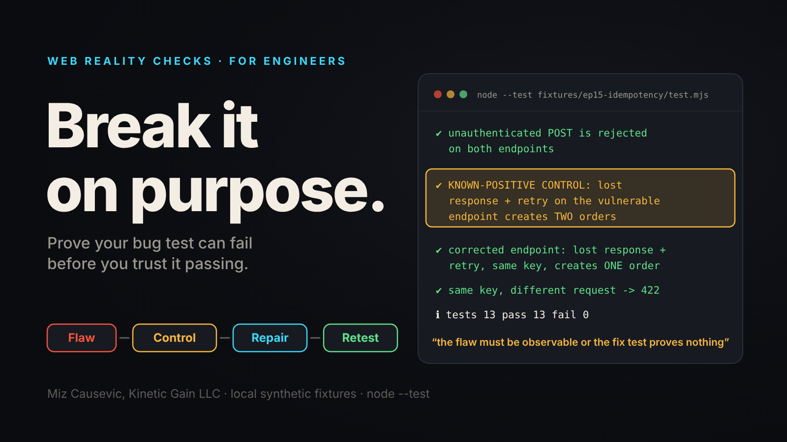
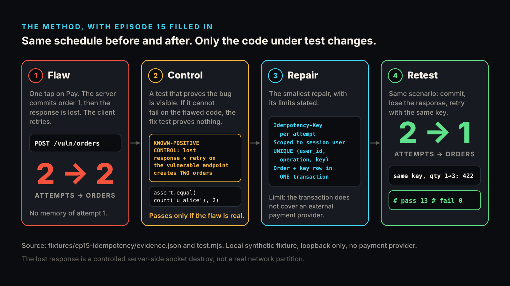
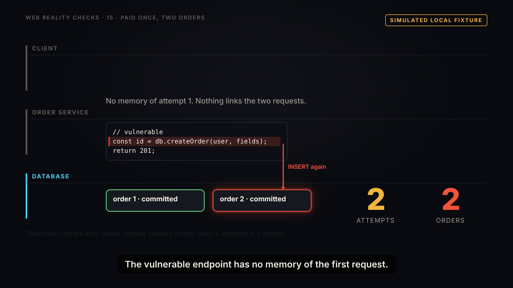
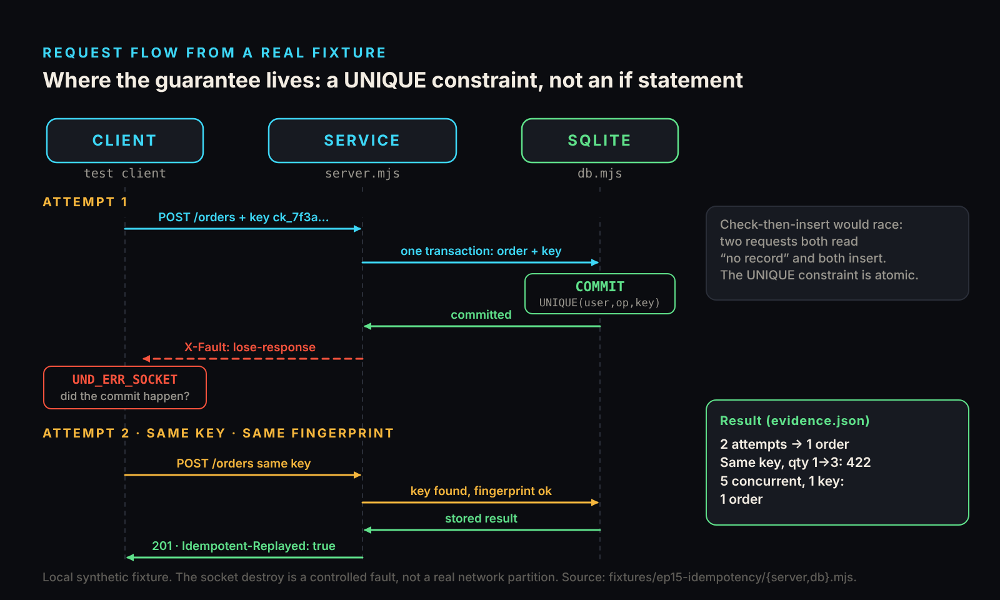
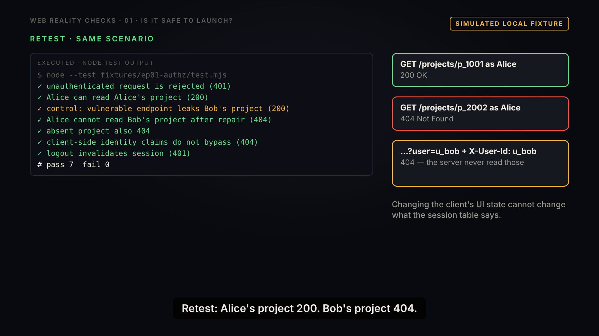
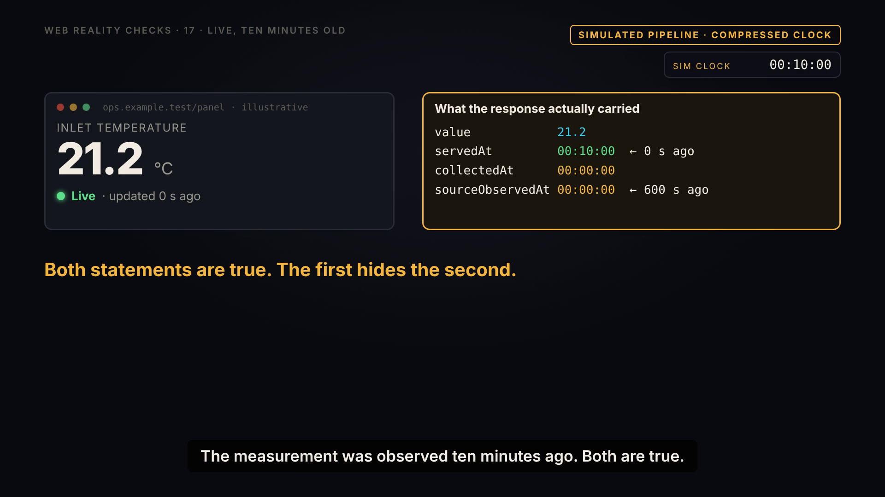

# Break It on Purpose: Known-Positive Controls for Web Bugs

*A test-first way to explain a web bug, prove your fix test can fail, and review AI-generated patches. Three runnable fixtures, plain Node, no framework required.*



A passing test only means something if the same test could have failed. Fixes, including AI-generated patches, too often ship without anyone checking that.

The missing check is a **known-positive control**: a test asserting that the bug is visible in the flawed code, so the test that later passes on the repaired code is evidence, not decoration. Web Reality Checks is a library of {{EPISODES}} short narrated films, each backed by a runnable local fixture with regression tests, and nearly every one is built around that idea. This is the engineer's tour: the method, three episodes from three different arcs, how to run them with `node --test`, and how to fork one for your own stack.

## What is a known-positive control?

In a laboratory, a positive control is a sample you know should trigger the assay. If the assay stays blank on it, the assay is broken, and a blank on your real sample means nothing.

A known-positive control does the same job in a regression suite. You keep the flawed variant of the code next to the repaired one, and you write a test that runs your scenario against the flawed variant and requires the bug to appear. Only then does the matching test on the repaired variant carry weight.

The reason is mechanical. A fix test usually asserts the good outcome: one order, a 404, an honest label. Those assertions pass for many wrong reasons: the scenario never reached the code path, the seed data hid the bug, the harness swallowed an error. If you never watched the same scenario fail against the flaw, you cannot tell "fixed" from "never tested."

The assertion message in the episode 1 and episode 15 controls reads: "the flaw must be observable or the fix test proves nothing." Nearly every fixture test file in the repository contains at least one control, and the flawed endpoints are never meant to be deployed.

## Flaw, Control, Repair, Retest

Every episode follows four moves.

1. **Flaw.** Reproduce the failure on a loopback fixture with synthetic data.
2. **Control.** Prove the test can fail: run the scenario against the flawed code and assert the bug shows up.
3. **Repair.** Apply the smallest change that fixes the demonstrated path, and write down its limits.
4. **Retest.** Run the same schedule of events against the repaired code and read the real numbers from `evidence.json`.

"Same schedule" matters: if the retest sends a different sequence of requests than the flaw run, green may only mean you stopped poking the sore spot.



## Episode 15: one tap, two orders (Duplicates & ordering)

[Episode 15](../../episodes/ep15/content/article-technical.md) asks why a single tap on Pay created two orders. Nobody double-clicked. The first request reached the server and committed. The response was lost on the way back, so the client saw a network error and retried. From the server's side, the retry was a brand-new request.

The fixture makes that ambiguity reproducible with three lines. A request header tells the server to commit the write and then destroy the socket:

```js
const respond = (req, res, code, body, headers) => {
  if (req.headers['x-fault'] === 'lose-response') { res.socket?.destroy(); return; } // commit happened; response lost
  json(res, code, body, headers);
};
```

Here is the control. It sends the lost-response scenario to the vulnerable endpoint and requires the duplicate:

```js
test('KNOWN-POSITIVE CONTROL: lost response + retry on the vulnerable endpoint creates TWO orders', async () => {
  const c = await loginAs('alice');
  const {r, attempts} = await withRetry((i) => post('/vuln/orders', c, ORDER, i === 0 ? {'x-fault': 'lose-response'} : {}));
  assert.ok(attempts[0].networkError, 'first attempt must fail at the network level (response lost after commit)');
  assert.equal(r.status, 201);
  assert.equal(attempts.length, 2);
  assert.equal(db.countOrders('u_alice'), 2, 'the flaw must be observable or the fix test proves nothing');
});
```

Two attempts, two orders, from `evidence.json`. Disabling the Pay button would not help: the second request is a retry after an error, not a double click. [MDN's glossary](https://developer.mozilla.org/en-US/docs/Glossary/Idempotent) defines an idempotent method as one where making several identical requests has the same effect on the server as making one, and notes that POST is not guaranteed to be idempotent. The fixture must add that property itself.



The repair is an `Idempotency-Key` header, one key per checkout attempt, reused on every retry. The server scopes the key to the session user and the operation, never to a client-supplied user id. It stores a fingerprint of the validated fields. And it puts the guarantee in the database, where a race cannot step around it:

```sql
CREATE TABLE idempotency (
  user_id     TEXT NOT NULL,
  operation   TEXT NOT NULL,
  key         TEXT NOT NULL,
  fingerprint TEXT NOT NULL,
  status      INTEGER NOT NULL,
  body        TEXT NOT NULL,
  order_id    INTEGER NOT NULL REFERENCES orders(id),
  created_at  TEXT NOT NULL,
  UNIQUE (user_id, operation, key)
);
```

The order row and this record commit in one transaction. A writer that loses a race hits the constraint, rolls back its own order insert, and receives the stored result. Check-then-insert would lose that race: two requests both read "no record" and both insert.



Retest, same schedule: commit, lose the response, retry with the same key. Two attempts, **one** order, and the retry carries `Idempotent-Replayed: true`. The same key with `qty` changed from 1 to 3 returns 422 and leaves the count at 1. Five concurrent requests with one key produce one order. Two real purchases with two keys produce two. The suite reports `# pass 13 # fail 0`.

One policy is a choice: concurrent requests with the same key wait for the first writer. An immediate 409 would be equally valid; [MDN describes 409 Conflict](https://developer.mozilla.org/en-US/docs/Web/HTTP/Reference/Status/409) as a request that conflicts with the current state of the target resource.

What it does not prove: the transaction covers the local database, not an external payment provider, which needs its own idempotency key and reconciliation. Expired key records would let a late retry count as new. Nothing here gives exactly-once delivery; it makes repetition safe, not impossible.

## Episode 1: the interface that works and leaks (Trust & access)

[Episode 1](../../episodes/ep01/content/article-technical.md) is the smallest case. Two synthetic users, Alice and Bob, own one private project each. The vulnerable endpoint asks whether a user is signed in, then returns the project by id. It never asks whether that user owns it.

The entire difference between flaw and repair is one lookup: by project id alone, or by project id and owner id. The control is the test most teams skip:

```js
test('KNOWN-POSITIVE CONTROL: vulnerable endpoint returns Bob\'s project to Alice', async () => {
  const c = await loginAs('alice');
  const r = await get('/vuln/projects/p_2002', {cookie: c});
  assert.equal(r.status, 200, 'the flaw must be observable or the fix test proves nothing');
  assert.equal((await r.json()).project.ownerId, 'u_bob');
});
```

Retest: Alice reads her own project, 200. Bob's project on the corrected endpoint returns 404, and so does the same request with `?user=u_bob` and an `X-User-Id` header, because the server never reads either. Seven tests, seven pass. The 404 for both "absent" and "not yours" is a deliberate policy documented in the fixture, not a universal rule.

Limit: this repairs one read path. Writes, lists and exports each need the same test, and the fixture's session harness is not production authentication.



## Episode 17: "Live" on ten-minute-old data (Delivery & freshness)

[Episode 17](../../episodes/ep17/content/article-technical.md) shows a control needs no server. The fixture is a simulated pipeline on one shared clock that tests advance by hand: no sockets, no real waiting. A collector samples a source every 600 seconds, an API serves the latest sample, and a dashboard polls every 30.

The flawed label is kept as code, solely as a control:

```js
export const naiveStatus = ({nowMs, lastPoll}) => {
  if (!lastPoll) return {label: 'Connecting…', updatedSecondsAgo: null};
  if (!lastPoll.ok) return {label: 'Offline', updatedSecondsAgo: null};
  return {label: 'Live', updatedSecondsAgo: Math.floor((nowMs - lastPoll.at) / 1000)};
};
```

It measures time since the last poll, so every successful poll resets "updated N s ago" to zero. The test asserts that bug in the loop over all 19 polls before the collector samples again. Every poll returns 200, every naive label says Live, and the real measurement age climbs from 30 to 570 seconds.

The repair separates two questions. Measurement age comes from `sourceObservedAt` only; connection status comes from the last poll only. Connected and stale can both be true. Polling every 5 seconds instead of 30 gives 119 polls instead of 19 and the same age of 570 seconds, because the collector still sampled once. The 300-second stale threshold is this fixture's policy, not a standard.

Limit: one shared clock. Skew between real machines is not modeled.



## Run a fixture in two minutes

You need Node 22 or newer. Fixtures are plain ES modules with no npm install unless an episode requires a library. Node's [built-in test runner](https://nodejs.org/api/test.html) is documented as stable, and `node --test` exits with code 1 if any test fails, so it fits CI.

```
git clone https://github.com/mizcausevic-dev/web-reality-checks.git
cd web-reality-checks
node --test fixtures/ep15-idempotency/test.mjs
node fixtures/ep15-idempotency/demo.mjs
```

The first command runs the tests. The second reruns the scenario and writes `evidence.json`. Node prints an `ExperimentalWarning` for `node:sqlite`; the fixture README says that is expected.

Now break something. Copy the fixture to a scratch folder and delete the `UNIQUE` line from the schema in `db.mjs`. In my run, 12 of the 13 tests still passed, including the lost-response retest and the five-concurrent-request test, because the pre-read and the in-flight map cover them. The one failure was the DB-layer test that skips the pre-read. The only test that noticed the missing constraint was the one written to expose it.

## Fork a fixture for your own stack

The repository ships no framework ports, so this is how I would approach one, not a feature.

- Keep the shape: flawed and repaired variants side by side, a `test.mjs` where the control comes first, a `demo.mjs` that writes `evidence.json`.
- Port the scenario, the oracle and the fault injector before the repair. The scenario is the request sequence. The oracle is what you count: rows, statuses, SQL statements. The injector makes the bad thing happen on demand, as the `x-fault` header does.
- Do not write the repair until the control fails on your flawed variant. If it passes, your scenario is not reaching the bug.
- Take identity from the server session, never from a client-supplied field. Both server fixtures above test that a spoofed id is ignored.
- Write the limits in the README as you go.

Express, Fastify, Django or Rails change only the thin handler layer. The control, the oracle and the evidence file carry over.

## Using controls to review AI-generated code

These fixtures are deliberately constructed; none claims an AI tool produced a particular vulnerability. The method still fits AI-assisted work for a structural reason: a test written by the same process that wrote the patch tends to agree with the patch. It confirms what the code does, not what the bug was.

Before you accept a generated fix, ask for five things.

1. The flawed variant, kept in the repo and labeled.
2. A control test that fails the way the bug fails, with a message saying why it exists.
3. The smallest repair, with the assumptions it relies on written down.
4. A retest that replays the same scenario against the repaired code.
5. A short list of what the fix does not cover.

If the assistant cannot produce a flawed variant that trips the control, it has not understood the bug yet.

## What exists today, and what it does not claim

What exists: {{EPISODES}} episodes in {{ARCS}} arcs (Trust & access, Duplicates & ordering, Data lifecycle, Delivery & freshness, Experience & speed). Each has a fixture, a test suite, a demo that writes `evidence.json`, and a README stating its limits. {{TESTS}} fixture tests pass in total, and the films run {{RUNTIME}} combined. Code is MIT licensed; narration audio and rendered video are all rights reserved.

What is demonstrated and what is not: results shown from fixtures are executed output. Some scenes are labeled conceptual illustrations, such as the TLS leg in episode 3 and all of episode 20. Episode 17 runs on a simulated clock, not real waiting.

What it does not claim: this is not an audit and not a certification. It makes no finding about any real product or company. A repair fixes the demonstrated path only. The repository contains no roadmap, so nothing further is promised.

## Start here

Pick a failure you have shipped. Duplicates: start at [episode 15](../../episodes/ep15/content/article-technical.md), then [episode 18](../../episodes/ep18/content/article-technical.md) on webhooks that arrive twice and out of order. Access: [episode 1](../../episodes/ep01/content/article-technical.md), then [episode 13](../../episodes/ep13/content/article-technical.md) on API keys in JavaScript. Quotas and retries: [episode 16](../../episodes/ep16/content/article-technical.md). Watch the films in the [YouTube playlist link]. Read, clone and run the fixtures at [github.com/mizcausevic-dev/web-reality-checks](https://github.com/mizcausevic-dev/web-reality-checks).

> This episode uses a deliberately constructed local fixture with synthetic data. Nothing here is a finding about a real product or company. Fixture, tests and video source: github.com/mizcausevic-dev/web-reality-checks

Miz Causevic, Kinetic Gain LLC
