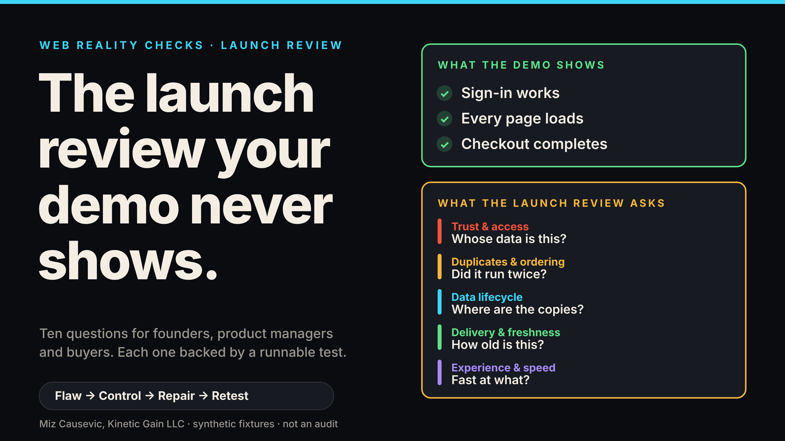
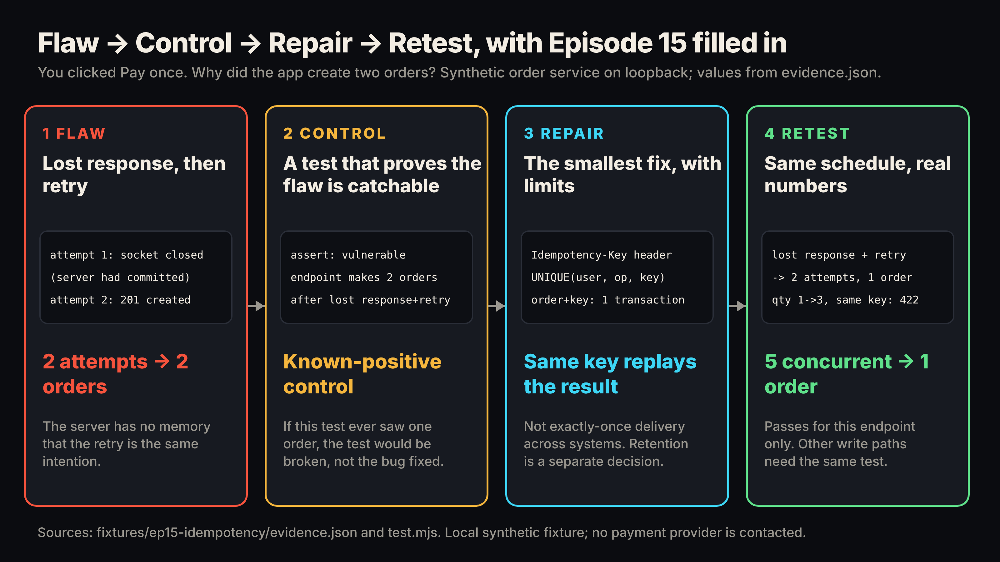
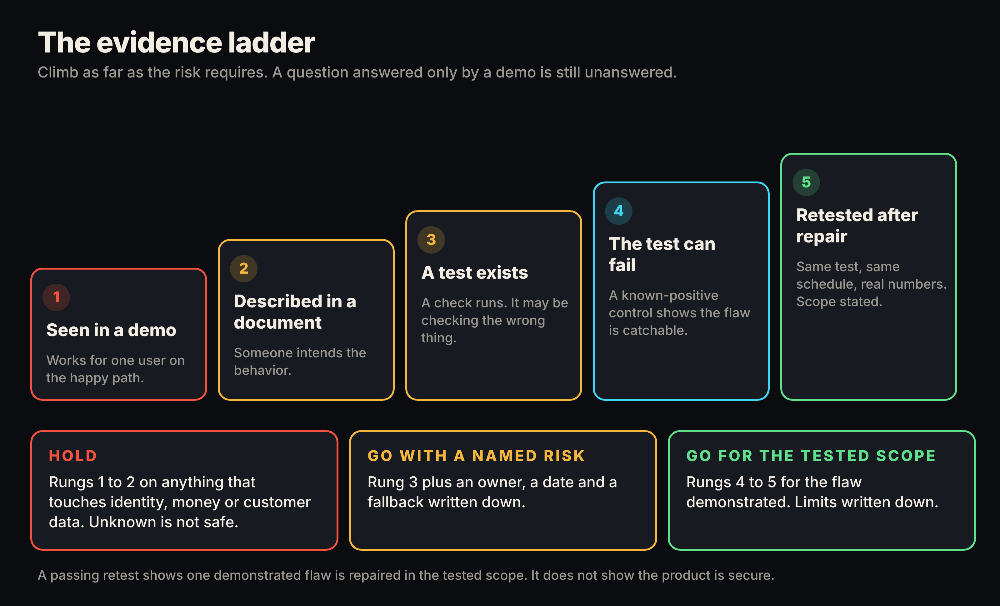
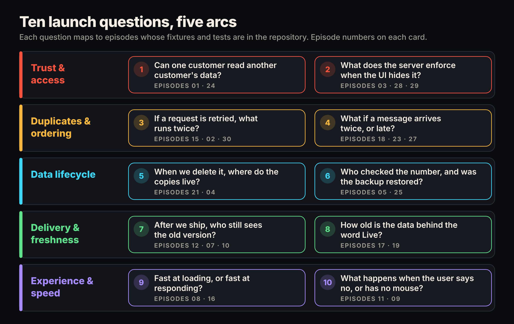

# The Launch Review Checklist Your Demo Never Shows: 10 Questions for Founders, Product Managers and Buyers

*A demo proves the happy path. These ten questions, each backed by a runnable test in an open repository, cover what it cannot.*

Your demo went well. Every screen loaded, every button worked, and the buyer nodded. That tells you the product works for one person doing everything right on a good connection. It tells you nothing about what happens when a customer asks for someone else's order, a payment confirmation gets lost, or a dashboard says "Live" over ten-minute-old data.

This is a launch review checklist for the people who decide whether software ships: founders, product managers and buyers. It draws on Web Reality Checks, a library of {{EPISODES}} short narrated films I made, each one reproducing a web failure on a local, synthetic fixture with regression tests you can run yourself. The repository is open at [github.com/mizcausevic-dev/web-reality-checks](https://github.com/mizcausevic-dev/web-reality-checks), and the films are in the [YouTube playlist link].

> **What this is not.** This is not an audit, a penetration test or a certification. Nothing here is a finding about a real product or company. Answering these questions well does not make a product secure or compliant. It shows which claims have evidence behind them and which are still promises.

## Why a demo cannot answer launch questions

A demo is one path, walked by one user, with nothing going wrong. The failures in this series need conditions a demo never creates: a second user, a dropped connection, a clock that keeps moving, a message delivered twice. No screen has a button for any of them, so nobody clicks them.

The interface says "done" because the layer that draws it did its job. Whether the server refused the wrong person, ran the operation once, or held current data is a separate fact in a separate layer. Take access control. [OWASP](https://owasp.org/Top10/A01_2021-Broken_Access_Control/) lists broken access control first in its 2021 Top 10 and names "permitting viewing or editing someone else's account" among its common weaknesses. A polished interface can sit on top of that weakness with no visible symptom.

## How Web Reality Checks tests a claim

Every episode follows four steps: **Flaw, Control, Repair, Retest.**

1. **Flaw.** Reproduce the failure on a synthetic loopback fixture.
2. **Control.** Prove the test can fail, using a known-positive control: a deliberately broken variant that the test must catch.
3. **Repair.** Apply the smallest fix and state its limits.
4. **Retest.** Run the same test on the same schedule and show real numbers from the fixture's `evidence.json`.

The control is the step non-engineers most often skip, and the one that matters most. Think of pressing the test button on a smoke alarm. An alarm that has never been shown to sound tells you nothing when it stays quiet. A test that has never been shown to fail tells you nothing when it passes, because it may be checking the wrong thing.

In [Episode 01](../../episodes/ep01/content/article-technical.md), Alice is signed in and asks for Bob's private project. The vulnerable endpoint answers 200 with Bob's notes in the body. The repaired one answers 404. The difference between the two versions is one missing ownership condition in one database lookup, and the repaired version returns the same 404 whether the project does not exist or belongs to someone else, so a response cannot confirm that another user's ID is real.

## A decision framework: the evidence ladder

Not every claim needs the top rung, but you should know which one you are standing on. Place each answer on this ladder.

1. **Seen in a demo.** Works for one user on the happy path.
2. **Described in a document.** Someone intends the behavior.
3. **A test exists.** A check runs, though it may be checking the wrong thing.
4. **The test can fail.** A known-positive control shows the flaw is catchable.
5. **Retested after repair.** Same test, same schedule, real numbers, scope stated.

Then decide. **Hold** if a question touching identity, money or customer data sits on rung 1 or 2. **Go with a named risk** at rung 3, with an owner, a date and a fallback written down. **Go for the tested scope** at rungs 4 and 5, with the limits written down too. Rung 5 shows one demonstrated flaw is repaired in the tested scope. It does not show the product is secure.

## A ten-question launch review checklist, mapped to five arcs

The series groups its episodes into {{ARCS}} arcs. Each arc yields two questions to put to a team or a vendor.

### Trust & access

**1. Can one customer read another customer's data?**
Authentication (who are you) and authorization (what may you touch) are separate checks, and a system can pass the first while skipping the second. [Episode 01](../../episodes/ep01/content/article-technical.md) shows 200 for Bob's project on the vulnerable endpoint and 404 on the repaired one. The [Episode 24 fixture](../../fixtures/ep24-shared-cache-leak/README.md) shows a sibling failure: an application cache keyed only by path served Alice's page to Bob ("Welcome back, Alice"), and a `private, no-store` header did not repair it. A good answer names a test per record type in which user A requests user B's record, plus a deliberately broken variant that the test catches.

**2. What does the server enforce when the screen hides or shows something?**
Anything the browser holds can be edited by whoever is using it. In [Episode 03](../../episodes/ep03/content/article-technical.md), the admin route answers 401 with no session, 403 for a member and 200 for an admin: session and permission are two checks. In the [Episode 28 fixture](../../fixtures/ep28-hidden-admin-button/README.md), a member with no publish button still published (201) on the flawed endpoint and got 403 on the repaired one, even with a forged role claim. In the [Episode 29 fixture](../../fixtures/ep29-server-side-price/README.md), a page showing $10.00 per mug let a tampered request store a 200-cent total for two mugs, where 2,000 was correct. The repaired server answered 409 and created no order. Good answer: price, role and ownership are decided on the server, and the browser's values are treated as requests.

### Duplicates & ordering

**3. If a request is retried, what runs twice?**
When a response is lost, the client cannot know whether the server finished, so it retries. Unless the server can recognize the retry as the same intention, it repeats the work. In [Episode 15](../../episodes/ep15/content/article-technical.md), the server committed an order and dropped the connection; the retry produced two attempts and two orders. With a per-purchase idempotency key, the same sequence ended with one order, a changed quantity on the same key was refused with 422, and five concurrent requests on one key still made one order. [Stripe's API documentation](https://docs.stripe.com/api/idempotent_requests) describes the same idea: with an idempotency key you can retry after a connection error "without risk of creating a second object." See also [Episode 02](../../episodes/ep02/content/article-technical.md), one order and three raw purchase events, and the [Episode 30 fixture](../../fixtures/ep30-scheduled-job-twice/README.md), two reports for one scheduled run. Good answer: a written retry policy per operation, with a test.

**4. What happens when the same message arrives twice, or an old one arrives late?**
Messages can arrive more than once and out of order. [Episode 18](../../episodes/ep18/content/article-technical.md) sends a billing provider's updates as version 1, version 3, then a late version 2. The naive receiver ended on version 2, past due, starter plan: it went backward. The corrected receiver recorded the late one as stale, a retry as a duplicate, ended on version 3, active, pro, and applied six concurrent copies of a new event once. The [Episode 23 fixture](../../fixtures/ep23-optimistic-concurrency/README.md) shows the human version: two tabs, one document, and the second save silently overwriting the first until a version check refused it with 409. Good answer: say what identifies a message and what decides which one wins.

### Data lifecycle

**5. When we delete it, where do the copies live?**
A record is rarely stored once. In the [Episode 21 fixture](../../fixtures/ep21-deletion-copies/README.md), the flawed delete made the lookup answer 404 while the search index still held the record and a cached search still returned it. The repaired delete queued cleanup, and the index and cache were clean after the second attempt. That fixture is not a privacy-erasure implementation: backups, logs, exports and third-party copies are out of scope. [Episode 04](../../episodes/ep04/content/article-technical.md) adds the local case: a database inside the page persists for one origin and profile, and is neither sync nor backup. Good answer: an inventory of copies, each with an owner and an expected deletion time.

**6. Who checked the number, and has the backup been restored?**
A count is not a quality measure. In [Episode 05](../../episodes/ep05/content/article-technical.md), a synthetic directory of 10,000 listings produced 3,875 issue instances but 3,303 distinct flagged listings, because some listings carry several flags. A failed website check is a lead to investigate, not proof. The [Episode 25 fixture](../../fixtures/ep25-restore-tests/README.md) applies the same idea to backups: a restored copy is validated against known values, so a backup with one wrong amount fails even when its record counts match. Good answer: a restore test with known values, run on a schedule, with the results kept.

### Delivery & freshness

**7. After we ship, who still sees the old version?**
Deploying and arriving are different events. [Episode 12](../../episodes/ep12/content/article-technical.md) shows an open page still controlled by an older service worker while the new one waits. [Episode 07](../../episodes/ep07/content/article-technical.md) shows that changing a server environment variable cannot rewrite a bundle already built with the old API address; the bundle's file hash stayed identical until a rebuild. In the [Episode 10](../../episodes/ep10/content/article-technical.md) DNS model, fixing a bad record did not erase cached answers: one resolver recovered at t=60 and another at t=75 on the fixture's virtual clock, which is a property of that sequence, not a general propagation time. Good answer: how long the old version can live, and how you would know.

**8. How old is the data behind the word "Live"?**
[Episode 17](../../episodes/ep17/content/article-technical.md) separates two ages. The label reports when the page last fetched; the measurement reports when the sensor last sampled. In the fixture, 19 polls all succeeded and every one said Live, while the reading climbed to 570 seconds old and was flagged stale by policy at the 330-second poll. [Episode 19](../../episodes/ep19/content/article-technical.md) is the same gap in another place: the raw HTML of a client-rendered page held 0 of 198 article words, while the static version held all 198. Good answer: two timestamps on screen and a written staleness threshold.

### Experience & speed

**9. Which kind of fast did you measure?**
Loading and responding are different tests. [Episode 08](../../episodes/ep08/content/article-technical.md) shrank a hero image from 12,173,721 bytes to 17,004, which helps loading and does nothing for a slow click handler (median 4253.02 ms before and 1.40 ms after, CPU time measured in Node, a lab figure, not a field one). [Episode 16](../../episodes/ep16/content/article-technical.md) shows a search box where eight keystrokes became 17 requests, 12 of them rejected as too many; the repaired client sent one. Good answer: name the metric, the conditions and whether it is lab or field.

**10. What happens when the user says no, or has no mouse?**
A banner's look does not prove the application obeys it. In [Episode 11](../../episodes/ep11/content/article-technical.md), the flawed page made four optional requests, three after the visitor had rejected; the corrected page made none while undecided, rejected, or reloaded with a stored rejection. [Episode 09](../../episodes/ep09/content/article-technical.md) found a form passing 3 of 11 keyboard checks, then 11 of 11 after repair. Neither is legal advice or an accessibility conformance claim. Good answer: evidence from the requests, and from using the product without a mouse.

## What exists today, and what it does not claim

**Demonstrated** means the fixture exists in the repository and its tests ran: {{TESTS}} fixture tests pass, and the narrated films total {{RUNTIME}}. Every number above comes from a fixture's `evidence.json`, labeled as synthetic and local.

**Conceptual** means a labeled illustration, not output: the HTTPS leg of Episode 03, the browser steps of Episode 04, the remote client of Episode 07, the browser lab of Episode 08, the screen reader of Episode 09, the service-worker lifecycle of Episode 12, and all of Episode 20. The Episode 21 browser and the Episode 27 search controller are simulated too.

**Planned:** the repository has no roadmap, so nothing is promised.

Each repair covers the demonstrated path only. Episode 01 repairs one read path, not lists, writes or exports. The data is synthetic, and the series measures no real product.

## Take the questions to your next launch meeting

Pick the three questions that touch your money, your identity layer and your customer data. Ask to see the rung, and write the decision beside it. Then clone the repository, run `node --test` inside one fixture folder, and read the known-positive control that proves the test could have failed.

Start with the [YouTube playlist link] or the [repository](https://github.com/mizcausevic-dev/web-reality-checks).

> This episode uses a deliberately constructed local fixture with synthetic data. Nothing here is a finding about a real product or company. Fixture, tests and video source: github.com/mizcausevic-dev/web-reality-checks

Miz Causevic, Kinetic Gain LLC
