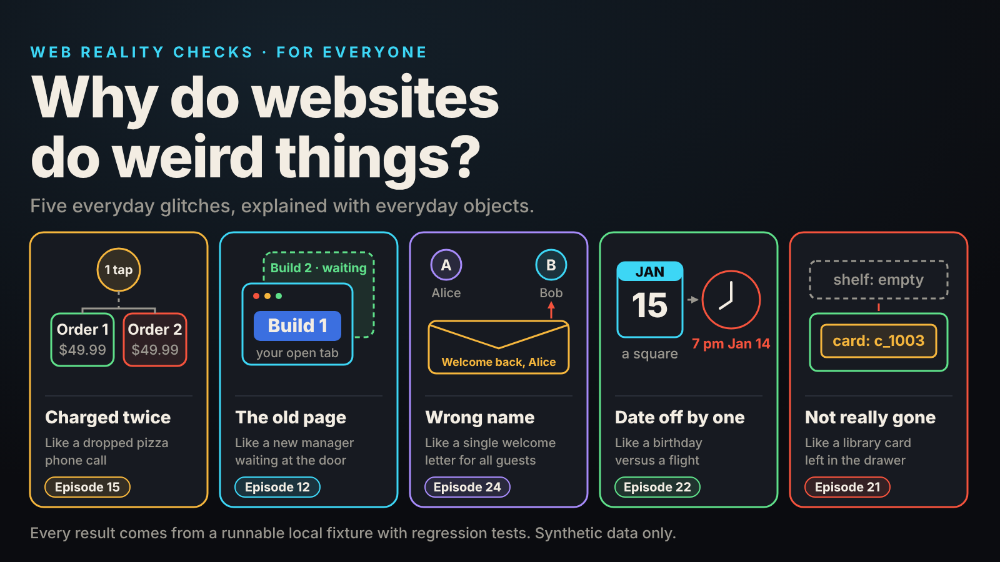
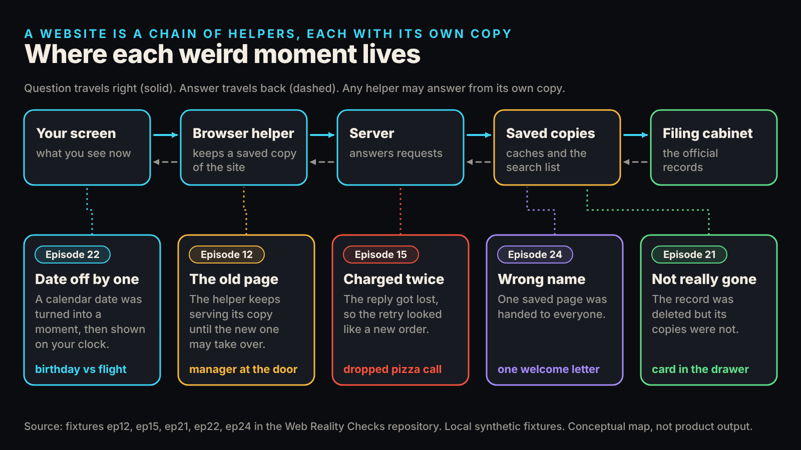
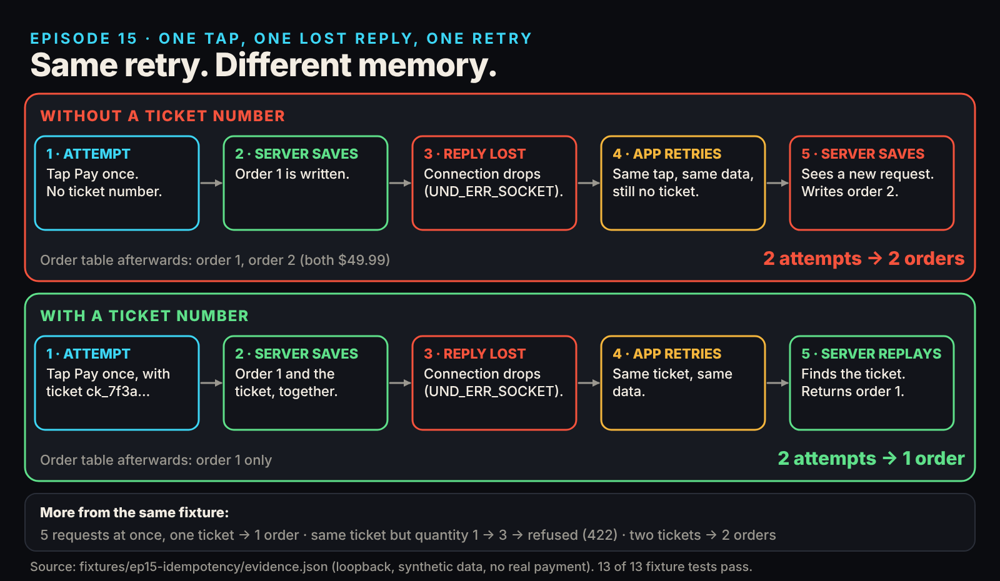
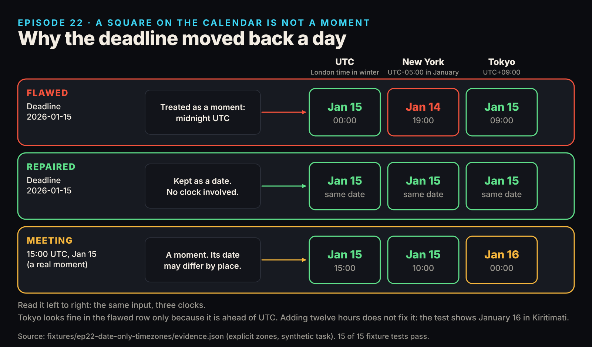

# Why Do Websites Do Weird Things? Five Glitches, Explained With Everyday Objects

*A double charge, a page that will not update, someone else's name on your screen, a date one day early, and a deleted thing that still shows up. Each one reproduced on a laptop. No code required.*

You tapped Pay once, saw an error, tapped again, and now there are two orders. You deleted a contact and it still turns up in search.

If you have ever asked "why do websites do weird things?", the short answer is that a website is not one thing. It is a chain of helpers, and each helper keeps its own copy of the truth. Weirdness appears when two copies disagree, or when a message gets lost between helpers. Below are five weird moments, one everyday object for each, and what happened when we rebuilt each one on a laptop and tested it.

## The short answer: why websites do weird things

Three words will come up.

- A **server** is the computer that answers when your phone or laptop asks for something.
- A **database** is that server's filing cabinet, where the official records live.
- A **cache** is a saved copy kept close by so answers come back faster, like a sticky note.

Speed is why copies exist, and stale copies cause most of the strangeness below.

This article comes from **Web Reality Checks**, a library of {{EPISODES}} short narrated films by Miz Causevic, Kinetic Gain LLC. Each film builds a tiny pretend app with made-up people, makes it misbehave on purpose, proves the check can fail, applies the smallest fix, and runs the same check again. The method has four steps: **Flaw, Control, Repair, Retest.** The films fall into {{ARCS}} groups. These five stories come from four.

## 1. Tapped Pay once, got two orders (Episode 15)

**The object: a phone order to a pizza place.** You give your order, the line goes dead, and you cannot tell whether they heard you. You call back and order again. Two pizzas arrive.

In our pretend shop, the customer taps Pay once. The server saves the order, then we cut the connection before the "success" message can travel back. On screen that looks like an error, so the app tries again, as the message suggests. The flawed shop has no memory of attempt one, so it writes down order number two.

The numbers come from the local test fixture. In the flawed version, two attempts produced **two orders**. In the repaired version, two attempts produced **one order**, and so did five identical requests sent at the same moment.

**Why the fix works:** every attempt carries a ticket number, and the server writes the ticket down together with the order. When the same ticket comes back, the server returns the original confirmation instead of making a new order. This idea is called an *idempotency key*, and payment services such as Stripe use it. [Stripe's documentation](https://docs.stripe.com/api/idempotent_requests) describes it as a way to retry requests "without accidentally performing the same operation twice." Two separate purchases get two tickets and two orders, which is right. If someone reuses a ticket but changes the order from one item to three, the fixed server refuses instead of guessing.

Why not just grey out the Pay button? Because the second request was not an impatient thumb. It was a retry after an error, which an app, a refresh, or a second tab can send for you. So after an error on a payment page, check your email or order history before trying again.

Full episode: [You Clicked Pay Once. Why Did the App Create Two Orders?](../../episodes/ep15/content/article-technical.md)

## 2. The site updated, but you still see the old one (Episode 12)

**The object: a shift handover at a shop.** A new manager arrives but waits at the door until the old manager's shift ends. Customers who walked in earlier are still served by the old manager.

Some websites install a small helper inside your browser, a *service worker*, that keeps a saved copy of the site so it opens quickly. When the site changes, the browser installs the new helper, but the new one does not take over at once. [MDN, the web developers' reference, explains](https://developer.mozilla.org/en-US/docs/Web/API/Service_Worker_API/Using_Service_Workers) that a new version "is only activated when there are no longer any pages loaded that are still using the old service worker." A tab left open all week counts as a page still using the old one.

In our pretend site, Build 1 is a blue page and Build 2 is a green one. After we published Build 2, the server served Build 2 while the open tab still showed Build 1. The page showed an "Update available" notice, and only after approval did Build 2 take over.

The film labels this carefully. The browser lifecycle here is a **model** running the real helper code in Node, not a recording of a real browser, and it covers **one** cause of stale pages. A saved copy in the browser's ordinary cache, or on a delivery network, are different causes with different fixes. If a site looks out of date and you have several tabs of it open, closing all of them and reopening is a reasonable first step, not a cure for everything.

Full episode: [Your Website Updated. Why Am I Still Seeing the Old Version?](../../episodes/ep12/content/article-technical.md)

## 3. Someone else's name on your screen (Episode 24)

**The object: a hotel front desk with one welcome letter.** The first guest of the day gets a letter that says "Welcome back, Alice." The clerk, trying to be efficient, files that single letter under "Welcome letter" and hands the same one to the next guest, Bob.

Alice and Bob each signed in correctly. The sign-in was never the problem. The page was saved for reuse under a label that said only `/dashboard`, a label with no person in it. Alice loaded her page first. When Bob asked for his, the app answered from the saved copy. Bob saw "Welcome back, Alice" and her email address (all synthetic).

You might expect a polite instruction to stop this. We tested that. In the flawed app we added the header `Cache-Control: private, no-store`, which tells caches not to share the page. Bob still got Alice's page, because the app's own saving code never read the header. [MDN](https://developer.mozilla.org/en-US/docs/Web/HTTP/Reference/Headers/Cache-Control) notes that personalized content without `private` "can be stored in a shared cache and end up being reused for multiple users."

The repair stopped sharing that personal page and emptied the old saved copy. In the retest, four requests alternated between Alice and Bob, and each person saw only their own name. One limit: the repair changes later pages only. A page that already reached a screen cannot be called back.

This cache was written for the fixture. It is not a delivery network, and the film does not claim real services do this by default. If you ever see another person's details on a site, take a screenshot, log out, and report it: that is a bug on their side.

Full episode: [Why Did This Dashboard Show Someone Else's Name?](../../episodes/ep24/content/article-technical.md)

## 4. A date that moved back one day (Episode 22)

**The object: a birthday versus a flight.** A birthday on March 3 is a square on the wall calendar, the same square in every country. A flight departure is a precise moment that people in different time zones read on different clocks.

Trouble starts when software turns a calendar square into a moment. In our pretend task, the deadline was "2026-01-15", a date with no time. A common programming habit reads that as midnight at the zero line of the world's clocks (UTC, which matches London time in winter). [MDN notes](https://developer.mozilla.org/en-US/docs/Web/JavaScript/Reference/Global_Objects/Date) that date-only strings like this are "interpreted as a UTC time." The page then shows that moment on the viewer's clock, and midnight in London is 7 p.m. the evening before in New York.

The flawed page showed the deadline as January 15 for UTC, **January 14** for New York, and January 15 for Tokyo. Tokyo looked fine only because it is ahead of UTC, so the same moment is already morning of the 15th there. The repaired page treats the deadline as a calendar date and never turns it into a moment, so it showed January 15 in all three places.

A meeting is different. A 15:00 UTC meeting correctly showed as 10:00 in New York and as midnight starting January 16 in Tokyo. A moment may land on different dates in different places. A deadline may not. The shortcut "add twelve hours" still fails in a zone 14 hours ahead of UTC (Kiritimati), where the test shows January 16.

Full episode: [Your Deadline Moved Back a Day. Nobody Edited It.](../../episodes/ep22/content/article-technical.md)

## 5. Deleted, but still showing (Episode 21)

**The object: a library card catalogue.** A librarian removes a book from the shelf. The little card for it is still in the drawer, and a printed list from last week is still in your hand.

In our pretend contact directory, one record lives in the main table, a second copy sits in a search list, a third in the saved results of recent searches, and a fourth on the screen of someone who already loaded results. The flawed delete removed only the main record. Asking for that contact directly returned "not found" (a 404), but search still returned it, with or without a saved query.

The repair treats deleting as a small job list, not one click. In a single step the server removes the main record and writes down "clean up the copies." A background worker then removes the search entry and clears the saved results. In our test, the first attempt hit an injected failure on the saved results, so the job stayed unfinished and the stale search still appeared. The second attempt finished it. After three failures in a row, the job was marked **failed** and raised an alert instead of pretending it worked.

The open results page stayed as it was until refreshed, shown with a simulated browser. Backups, logs, exports and other companies' copies are not covered, so this is not a privacy-erasure method. If something still shows days after you deleted it, tell the site, because a cleanup job may be stuck.

Full episode: [I Deleted the Record. Why Is It Still Showing Up?](../../episodes/ep21/content/article-technical.md)

## A pocket guide to the five symptoms

| What you see | The usual suspect | Everyday object |
|---|---|---|
| Two orders from one tap | A retry the server could not recognize | Pizza call, line dropped |
| Old version after an update | A helper in your browser still serving the old copy | Manager waiting at the door |
| Another person's name | A saved page shared between people | One welcome letter for every guest |
| Date a day off | A calendar date treated as a moment | Birthday versus flight |
| Deleted but visible | Copies that were not cleaned up | Card catalogue drawer |

A rule of thumb, not a diagnosis: each film shows one cause, and a symptom can have others.

## Who it is for and how it works

It serves shoppers who want to know what to tell support, owners deciding what to ask a developer, and builders who want a test they can run. Every film follows the four steps above. A *known-positive control*, the second step, proves the test can catch the problem, like testing a smoke detector with a candle. A screen that looks right is not proof the system behind it is right.

## What exists today, and what it does not claim

- **Demonstrated:** each fixture is a small program that runs on your own computer, listens only to that computer, and has automated tests that pass. The numbers quoted here come from those runs. The repository's {{TESTS}} passing tests and {{RUNTIME}} of film are counted by the release process.
- **Conceptual or simulated:** the browser lifecycle in Episode 12 is a model, the open browser in Episode 21 is simulated, and the cache in Episode 24 is custom code written for the test.
- **Not claimed:** none of this is an audit of a real product or company, or a certification. Each fix covers the one problem shown, and nothing here says how often these glitches happen in the wild.
- **Planned:** the repository publishes no roadmap, so nothing further is promised.

## Watch, read and run it

Watch the playlist: [YouTube playlist link]. Read the code and run the tests in the open [repository](https://github.com/mizcausevic-dev/web-reality-checks). Each fixture runs with `node --test`.

Related episodes: [One Click. Three Purchase Events. Here's What Went Wrong.](../../episodes/ep02/content/article-technical.md) shows one purchase triggering three separate analytics events, and [Your Dashboard Says 'Live.' Its Data Is Ten Minutes Old.](../../episodes/ep17/content/article-technical.md) covers another label that hides how old the data is.

> This episode uses a deliberately constructed local fixture with synthetic data. Nothing here is a finding about a real product or company. Fixture, tests and video source: github.com/mizcausevic-dev/web-reality-checks

Weird websites are usually ordinary software doing exactly what it was told, one copy at a time.

Miz Causevic, Kinetic Gain LLC
